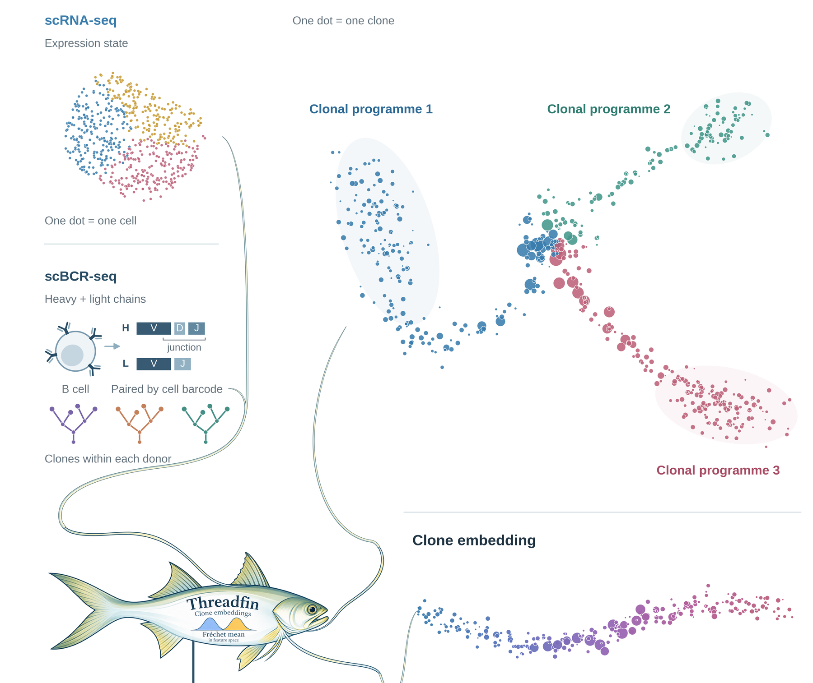
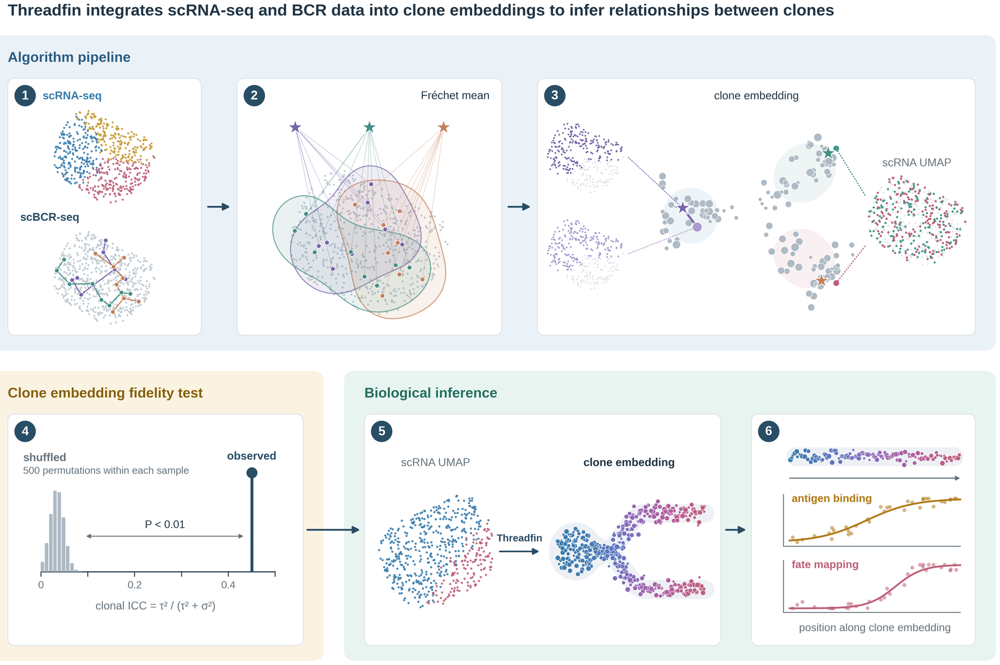

<p align="center">
  
</p>

<h1 align="center">Threadfin</h1>

<p align="center">
  <b>Relationships between B-cell clones from paired single-cell RNA and receptor sequencing</b>
</p>

<p align="center">
  <a href="https://github.com/Reynold4k/Threadfin/actions/workflows/tests.yml"></a>
  <a href="https://www.python.org"></a>
  <a href="CHANGELOG.md"></a>
  <a href="LICENSE"></a>
</p>

**Threadfin** is a Python package for paired single-cell RNA and B-cell receptor (BCR) sequencing. It
uses the **clone** — the B cells that descend from one V(D)J rearrangement — as the unit of analysis.
Each clone is represented by the distribution of transcriptional states among its sampled cells,
estimated relative to the cells sampled alongside it and shrunk according to the number of cells
captured. Clones are then compared with one another: in a **clone embedding** with one point per clone,
in **clonal programmes** of clones that behave alike, and in **clone-level tests** of anything you
measured. Threadfin works with [AnnData](https://anndata.readthedocs.io) and
[Scanpy](https://scanpy.readthedocs.io), and defines clones with
[Dandelion](https://github.com/zktuong/dandelion).

## Why clones?

The cells of one clone are distributed across states: germinal-centre (GC) B cells, plasmablasts, plasma
cells and memory B cells. Two clones can have the same average state and still differ in how their cells
are distributed. Selection, antigen affinity and fate bias act on clones, so questions such as *which
clones connect the germinal centre with plasma-cell output* or *does antigen binding go with a clone's
state* need the clone as the unit of representation and of statistical inference. Three features of
repertoires sampled *in vivo* make this difficult, and Threadfin addresses each:

* **Most clones are captured as one or a few cells.** Profiles are shrunk according to the number of cells
  sampled, and each clone carries a reliability score. No clone is discarded for being small.
* **Clone membership is confounded with donor, sample, tissue and sorting gate.** Each clone is described
  relative to the cells sampled with it, and every test shuffles labels within the sampling design.
* **Treating cells as independent inflates significance.** Tests use clones, not cells, as replicates.

## What Threadfin answers

| Question | Output | Function |
|---|---|---|
| Is cell state inherited within clones? | clonal coherence: variance explained by clone, against labels shuffled within samples | `tl.clonal_coherence` |
| How are clones related to one another? | the clone embedding, laid out automatically so that continua stay connected | `tl.embed_clones` |
| Which clones behave alike? | clonal programmes, with split tests and bootstrap stability | `tl.find_programmes` |
| What explains the differences between clones? | variance in clone profiles explained by a label; per-programme effects | `tl.profile_association`, `tl.association_test` |
| Do clones keep their state over time or across tissues? | the clonal memory index | `tl.clonal_memory` |
| How far behind its germinal centre is a clone's output? | the export lag, in somatic mutations and in days | `tl.export_lag` |

## Examples from public data

The manuscript applies Threadfin to nine paired datasets from immunization, infection, vaccination and
spontaneous germinal centres ([figures](manuscript/figures/README.md)); scripts and results for these and
further public datasets are in [case studies](manuscript/case_studies/README.md), and everything behind the
manuscript — status, datasets, every analysis and a benchmark against related tools — is in
[`manuscript/`](manuscript/README.md).

* **Gut-associated lymphoid tissues** (Siniscalco *et al.*, *Immunity* 2025): the clone embedding resolves
  a continuous path of clones from GC B cells, through clones that contain both GC B cells and plasma
  cells, to plasma-cell clones, with clones that lack GC-fate labelling grouped at its end.
* **Spontaneous germinal centres** (Castrillon *et al.*, *eLife* 2023): position along the clone embedding
  orders clones by the diversity of their cell states, and memory-containing clones concentrate at one
  end.
* ***Plasmodium* infection** (Skinner *et al.*, *Nat. Immunol.* 2026): whether plasmablasts were sampled
  together with GC B cells of the same clone is a property of clones that cannot be read from the
  cell-level embedding.
* **Model-antigen germinal centres** (Merkenschlager *et al.*, *Nature* 2025): the main axis of variation
  between clone profiles follows recent division in two cohorts whose sequencing libraries are crossed, so
  the association cannot be a library artefact; antigen-bait and dark-zone gates are also associated with
  clone profiles but were each sequenced in their own library.

## Installation

```bash
pip install "git+https://github.com/Reynold4k/Threadfin.git"
# with Dandelion, to define clones from BCR contigs:
pip install "threadfin[dandelion] @ git+https://github.com/Reynold4k/Threadfin.git"
```

Threadfin requires Python ≥ 3.10; Scanpy, Leiden, UMAP and Harmony are installed with it, and no GPU or R
is needed. Clones can be defined from BCR contigs with Dandelion (the `[dandelion]` extra also pins
`matplotlib<3.9`, which Dandelion 0.5.7 needs but does not declare), or you can provide your own clone ids
in `adata.obs["clone_id"]`. Dandelion's clone calls depend on Python's string-hash seed; start Python with
`PYTHONHASHSEED=0` if clone ids must be identical run after run.

## Quick start

```python
import scanpy as sc
import threadfin as tf

adata = sc.read_h5ad("b_cells.h5ad")           # raw counts, one row per cell

result = tf.run(
    adata,
    bcr="filtered_contig_annotations.csv",     # Cell Ranger VDJ output or an AIRR .tsv
    donor_key="donor",                         # the individual each cell came from
    sample_key="sample",                       # the sample or library each cell came from
)
print(result.summary())                        # plain-language report
result.plot("threadfin_overview.pdf")          # clone map, coherence, stability, composition
```

`tf.run` defines clones within each donor, builds an expression embedding without immunoglobulin genes,
estimates one profile per clone, tests clonal coherence, lays out the clone embedding, finds clonal
programmes and reports their stability. Add `test=[...]` to test your own labels and `time_key=` to ask
whether clones keep their state. No data at hand? `tf.sim.simulate_repertoire()` makes a repertoire with
a known answer ([Tutorial 1](docs/tutorials/01_getting_started.md)).

<p align="center">
  
</p>

## A complete, tested tutorial on public data

[`docs/tutorials/05_end_to_end_tutorial.ipynb`](docs/tutorials/05_end_to_end_tutorial.ipynb) takes you from an
empty folder to the main result of the manuscript's Figure 4: it creates the environment
([`environment.yml`](docs/tutorials/environment.yml)), downloads a published dataset from GEO (GSE287123,
about 600 MB), assigns cells to mice from hashtags, defines clones, builds the embedding, runs Threadfin and
explains every output, including how to tell biology from a sequencing-library effect. It was executed end
to end in a fresh environment before release and takes about 6 minutes on 8 CPU cores (about 8 GB of memory).

## A clone embedding that holds together

UMAP draws continuous populations of clones as one picture only for suitable settings, and the suitable
settings differ between datasets. Threadfin therefore chooses them for each dataset by default: it lays
the clones out over a ladder of settings, scores each layout for coherence (the fraction of clones in one
connected piece) and for fidelity to the clone profiles, and keeps the most faithful setting that holds
together in every layout it tried. A map is not allowed to be more fragmented than the clone profiles
themselves, and the final map is checked once more before it is returned. The record of the choice is
stored with the results, and the settings can always be fixed by hand
([Tutorial 3](docs/tutorials/03_clone_map.md)).

```python
tf.tl.embed_clones(adata)                               # automatic (default)
tf.tl.embed_clones(adata, n_neighbors=30, min_dist=0.3) # by hand
tf.tl.map_quality(features, xy)                         # score any clone map (profiles, coordinates)
```

## How it works

<p align="center">
  
</p>

1. **Clones** are defined from paired heavy- and light-chain sequences within each donor (Dandelion).
2. **Clone profiles.** Each cell is described relative to the mean of its sampling context. The cells of
   a clone are summarised by a kernel mean embedding of their state distribution, so a clone divided
   between two states differs from a clone in an intermediate state, and the profile is shrunk towards the
   context according to the number of cells (best linear unbiased prediction under a random-effects
   model).
3. **Clonal coherence** is the intraclass correlation of state within clones, tested against clone labels
   permuted within samples.
4. **The clone embedding** is a UMAP of the clone profiles with settings chosen as above.
5. **Clonal programmes** are graph communities of clones; each split is tested against a single Gaussian
   group, and each programme's stability is estimated by bootstrap resampling.
6. **Clone-level tests** quantify how much of the variance between clone profiles a label explains, with
   labels permuted among the clones of each donor.

The full description, with references, is in [Methods](docs/METHODS.md).

## Documentation

| | |
|---|---|
| [Tutorial 1 — Getting started](docs/tutorials/01_getting_started.md) | the whole analysis on simulated data, with its output |
| [Tutorial 2 — Your own data](docs/tutorials/02_your_data.md) | from Cell Ranger output to results, with several samples and donors |
| [Tutorial 3 — The clone map](docs/tutorials/03_clone_map.md) | automatic and hand-set layouts, and how to check a map |
| [Tutorial 4 — Step by step](docs/tutorials/04_step_by_step.md) | the individual functions in `threadfin.tl` |
| [Tutorial 5 — From GEO to results (notebook)](docs/tutorials/05_end_to_end_tutorial.ipynb) | a published dataset end to end: download, demultiplexing, clones, embedding, Threadfin, interpretation |
| [Methods](docs/METHODS.md) | the statistical model behind each step |
| [The manuscript](manuscript/README.md) | publication status, datasets, every analysis, open work |
| [Case studies](manuscript/case_studies/README.md) | scripts and results for the public datasets |
| [Figures](manuscript/figures/README.md) | figures of the manuscript, with their source code |
| [Benchmark](manuscript/benchmarking/README.md) | Threadfin against Clonotrace, clone2vec, Benisse, CoNGA and scirpy |
| [Changelog](CHANGELOG.md) | what changed in each version |

## Citation

A manuscript describing Threadfin is in preparation. Until it is available, please cite this repository
([CITATION.cff](CITATION.cff)) and the tools Threadfin builds on: Dandelion (Suo *et al.*, *Nat.
Biotechnol.* 2024) for clone definition, Scanpy (Wolf *et al.*, *Genome Biol.* 2018) and UMAP (McInnes
*et al.*, *J. Open Source Softw.* 2018).

## How Threadfin compares with related tools

Clonotrace, clone2vec, Benisse and CoNGA also combine lineage and transcriptome, and answer related but
different questions. On the same data and clones ([benchmark](manuscript/benchmarking/README.md)):
Threadfin is the only one that represents every clone with two or more cells by default (clone2vec starts at
three cells, Clonotrace at ten) and its test of clonal coherence keeps its error rate when samples differ,
where per-clone graph scores and cell-level tests do not. For recovering measured clone annotations it is
comparable to clone2vec and to a simple mean of the cells' coordinates, and on simulated discrete
programmes clone2vec and cluster-composition profiles group clones more accurately. The benchmark reports
every result, including those.

## Related tools

* [Dandelion](https://github.com/zktuong/dandelion) — single-cell immune receptor analysis; Threadfin's
  clone definition.
* [Clonotrace](https://github.com/yuntianf/Clonotrace) — distances between expanded clones on the cell-state
  graph after label spreading.
* [clone2vec](https://github.com/kharchenkolab/clone2vec) — clone embeddings learned from which clones'
  cells are neighbours.
* [Benisse](https://github.com/wooyongc/Benisse) — a joint space of BCR sequences and expression.
* [CoNGA](https://github.com/phbradley/conga) — graph-vs-graph analysis of T-cell receptor and expression
  similarity.
* [Scirpy](https://github.com/scverse/scirpy) — single-cell immune receptor analysis in the scverse
  ecosystem.
* [Scanpy](https://github.com/scverse/scanpy) and [AnnData](https://github.com/scverse/anndata) — the data
  structures and single-cell tools Threadfin works with.
* [Immcantation](https://immcantation.readthedocs.io) — B-cell receptor repertoire analysis, including
  clonal lineage reconstruction.

## Support

Please report bugs and ask questions through [GitHub issues](https://github.com/Reynold4k/Threadfin/issues).

## License

MIT; see [LICENSE](LICENSE).
