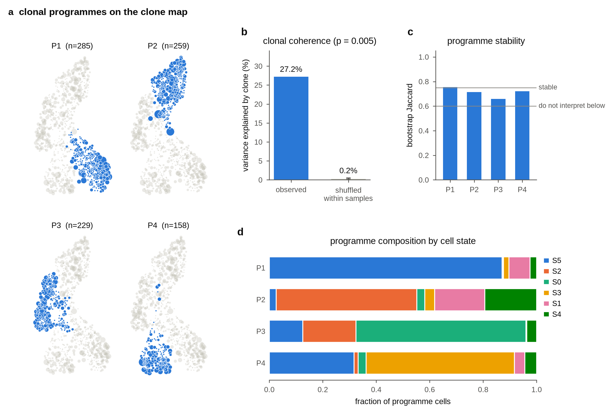

# Tutorial 1 — Getting started

This tutorial runs the whole Threadfin analysis on a **simulated** repertoire. It needs no download and
finishes in about a minute and a half, and because the data are simulated we know the right answer and can
check that Threadfin finds it. Every step is the same on real data: [Tutorial 2](02_your_data.md) shows how
to prepare your own files, and [Tutorial 5](05_end_to_end_tutorial.ipynb) runs everything on a published
dataset downloaded from GEO.

**Who this is for.** Anyone who has paired single-cell RNA and B-cell receptor (BCR) data, or wants to
understand what Threadfin does before using it. You need basic Python; no statistics background is
assumed — each step explains what is computed and why.

---

## 0. Five words you need

| Word | Meaning | Example |
|---|---|---|
| **cell** | one sequenced B cell: its gene expression (RNA) and its receptor sequence (BCR) | one row of `adata` |
| **clone** | all cells that descend from one activated B cell; they share one heavy- and one light-chain rearrangement | 12 cells with the same receptor |
| **clone profile** | Threadfin's description of a clone: *where its cells sit in expression space*, relative to the other cells sampled with them, and shrunk when the clone was seen in few cells | one vector per clone |
| **clone map** (clone embedding) | a 2-D picture with **one point per clone**; clones with similar profiles are close | like a UMAP, but of clones |
| **programme** | a group of clones with similar profiles (if such groups exist) | "GC-dominated clones" |

The core idea: a clone's cells are spread over several states (germinal-centre B cell, plasmablast, memory
B cell …). Two clones can have the same *average* state and still differ in *how* their cells are spread.
Threadfin therefore describes each clone by the distribution of its cells, and compares clones with each other.

> **Why not just analyse cells?** Questions like *"which clones connect the germinal centre with
> plasma-cell output?"* or *"do antigen-binding clones differ from others?"* are questions about clones.
> Treating cells as independent makes large clones dominate and makes P values far too small; Threadfin uses
> the clone as the unit of every test.

Check your installation first (see the [README](../../README.md#installation)):

```python
import threadfin as tf
print(tf.__version__)          # 4.3.0 or later
```

---

## 1. A simulated repertoire

```python
import threadfin as tf

adata = tf.sim.simulate_repertoire(random_state=0)
print(adata)
```

```
AnnData object with n_obs × n_vars = 8467 × 20
    obs: 'clone_id', 'donor', 'context', 'true_programme', 'true_state', 'clone_size'
    uns: 'simulation'
    obsm: 'X_pca'
```

**What this is.** An [AnnData](https://anndata.readthedocs.io) object, the standard container of the
Python single-cell ecosystem. Each row (*observation*) is a cell; `adata.obs` holds one column per cell
annotation and `adata.obsm["X_pca"]` holds each cell's coordinates in a 20-dimensional expression space
(on real data, the principal components of gene expression).

| Column | Meaning | On real data |
|---|---|---|
| `clone_id` | the clone of the cell | from the BCR sequences (Dandelion) |
| `donor` | the individual it came from | mouse or participant id |
| `context` | the sample (library) it was sequenced in | the 10x library, sort or time point |
| `true_programme` | the programme its clone was simulated from | unknown — this is what we want to learn |
| `true_state` | the state the cell was simulated in | an author's cell-type annotation |

**Why simulated data?** Because the truth is known (`true_programme`), you can check every result; on real
data there is no answer key.

**What to look for: most clones are tiny.** As in real repertoires, most of the 3,000 clones were captured
as a single cell:

```python
sizes = adata.obs["clone_id"].value_counts()
print(sizes.value_counts().sort_index().head(6))   # number of clones with 1, 2, 3, ... cells
print(f"{(sizes >= 2).sum()} clones have two or more cells; largest clone: {sizes.max()} cells")
```

```
count
1    2069
2     437
3     168
4      79
5      52
6      31
931 clones have two or more cells; largest clone: 300 cells
```

A clone seen once cannot tell you whether cells of one clone share a state — there is no second cell to
compare. Threadfin therefore profiles every clone with **at least two cells** (931 here). It does *not*
throw away small clones beyond that: a 2-cell clone is kept, and its profile is *shrunk* towards the
average because it is uncertain (section 2).

---

## 2. One call

```python
result = tf.run(
    adata,
    donor_key="donor",            # clones are compared within individuals
    sample_key="context",         # each clone is compared with the cells sampled alongside it
    basis="X_pca",                # an existing embedding; omit it to let Threadfin build one
    state_key="true_state",       # optional: describes the programmes by cell state
    test=["true_programme"],      # optional: labels to test against the clones
)
print(result.summary())
```

**Each argument, and why it matters.**

* `donor_key` — the column naming the individual. Clones never span two individuals, and every test shuffles
  labels only among clones of the *same* individual, so a difference between individuals can never look
  like a difference between clones.
* `sample_key` — the column naming the sampling context (library, sort, time point). Each cell is described
  **relative to the other cells of its sample**: if one library was sequenced more deeply or one sample was
  enriched for plasma cells, that difference is removed before clones are compared. *Choose a nuisance
  variable here — never a tissue, time point or sort gate that you want to compare between clones*
  ([Tutorial 2](02_your_data.md#5-choosing-donor_key-sample_key-and-batch_key) explains the choice).
* `basis` — the expression embedding to use. On real data omit it: Threadfin then builds one that excludes
  immunoglobulin genes (otherwise cells of one clone would look alike simply because they express the same
  receptor transcripts).
* `state_key` — an existing cell annotation. It is used only to *describe* programmes afterwards, never to
  build them.
* `test` — annotations to test against the clones afterwards (antigen binding, isotype, sort gate …).

**What happens inside `tf.run`, in order.**

1. *Clones* (only when you pass `bcr=`): defined from paired heavy and light chains within each donor.
2. *Embedding*: an expression embedding without immunoglobulin genes (skipped here, `basis` is given).
3. *Clone profiles*: one profile per clone with ≥ 2 cells, relative to its sample, shrunk by clone size.
4. *Clonal coherence*: does clone identity explain cell state at all?
5. *Clone map*: a 2-D layout of the profiles, with settings chosen automatically.
6. *Programmes*: groups of clones with similar profiles — only if the groups pass a test — and their
   bootstrap stability.
7. *Tests*: how much each `test` annotation explains about the differences between clones.

The printed report:

```
Threadfin summary
=================
Cells with a BCR: 8,467 of 8,467, in 3,000 clones (494 clones have >= 3 cells).

1. Does clone identity shape cell state? (clonal coherence)
   Clone identity explains 27.2% of transcriptional variance within 'context' strata; shuffled clones explain 0.2% (p = 0.00498, 200 permutations).
   Profiles are shrunk towards the mean, so a clone reaches reliability 0.5 at 3 cells. No clone is filtered out on reliability.

2. Which clones behave alike? (clonal programmes)
   4 programmes from 931 reliable clones (every split significant); 1 is stable (bootstrap Jaccard >= 0.75).
   P1: 285 clones, 1,577 cells, stability 0.75; S5 87%, S1 8%
   P2: 259 clones, 1,979 cells, stability 0.71; S2 53%, S4 19%
   P3: 229 clones, 1,655 cells, stability 0.66; S0 64%, S2 20%
   P4: 158 clones, 1,187 cells, stability 0.72; S3 56%, S5 32%

3. Do your labels explain how clones differ? (clone-level tests)
   true_programme explains clone states: 55.6% of clone-profile variance vs 0.3% for shuffled labels (p = 0.0005, 931 clones).
   ...
```

**How to read it, line by line.**

1. **Clonal coherence.** Clone identity explains 27% of the variation in cell state within samples. When the
   clone labels are shuffled among the cells of each sample, they explain 0.2% — that is what the sampling
   design alone produces. The gap is the evidence that cells of a clone share their state. The P value is a
   permutation P value: with 200 permutations the smallest possible value is 1/201 ≈ 0.005, so
   `p = 0.00498` means "none of the 200 shuffles came close".
   *A large shuffled value (say 10–30 %) is a warning that samples differ a lot in composition; Threadfin
   accounts for it, but a cell-level test that ignored samples would have called that clonal.*
2. **Reliability.** A profile's *reliability* estimates how well it would agree with the clone's true profile
   (the expected squared correlation). It grows with the number of cells: here a clone reaches 0.5 at three
   cells. Small clones are not removed; they simply weigh less (their profiles are shrunk and they have less
   influence on the programmes).
3. **Programmes.** Threadfin found four programmes, and every split between them passed a test against a
   single group. *Stability* is how reproducibly each programme is recovered when cells are resampled
   (bootstrap Jaccard index): **≥ 0.75 stable; 0.6–0.75 present but blurred; < 0.6 do not interpret**.
   The percentages are the cell states of each programme, with each clone weighted equally.
4. **Tests.** `true_programme` explains 56% of the variation between clone profiles, against 0.3% for
   shuffled labels — expected here, because it is the simulated truth. On real data the same line tells you
   whether, for example, antigen binding explains where clones sit.

**Check the answer.** Because the data are simulated, we can compare the programmes Threadfin found with the
simulated ones:

```python
import pandas as pd
from sklearn.metrics import adjusted_rand_score

truth = adata.obs.groupby("clone_id", observed=True)["true_programme"].first()
found = result.clones["clone_programme"].dropna()
print(f"adjusted Rand index: {adjusted_rand_score(truth.loc[found.index], found):.2f}")
print(pd.crosstab(truth.loc[found.index].rename("simulated"), found.rename("found")))
```

```
adjusted Rand index: 0.67
found       P1   P2   P3   P4
simulated
G0           3   36  210    0
G1           8  221    9   14
G2         225    1    0    1
G3          49    1   10  143
```

The adjusted Rand index is 1 for a perfect match and 0 for random labels. Each simulated programme maps
mostly onto one found programme (G0 → P3, G1 → P2, G2 → P1, G3 → P4); the largest disagreement is the
quarter of G3 clones that joined P1. Recovery is good but not perfect, as it would be on real data: profiles
of small clones are uncertain, and the simulated programmes overlap in the states they contain.

---

## 3. The overview figure

```python
result.plot("threadfin_overview.png")
```



**How to read each panel.**

* **a — the clone map, one panel per programme.** Every point is a clone (point size grows with its number of
  cells). The highlighted points are the clones of that programme; grey points are all other clones. Clones
  close together have similar distributions of cell states.
* **b — clonal coherence.** The left bar is the variance explained by clone identity; the right bar is the
  same after shuffling clone labels within samples (with its spread). A tall left bar and a near-zero right
  bar mean clone identity matters.
* **c — programme stability.** One bar per programme; the upper line marks 0.75 (stable), the lower 0.6
  (do not interpret below).
* **d — programme composition.** The cell states that make up each programme, with every clone weighted
  equally, so a single large clone cannot dominate.

> **Three common misreadings.**
> 1. *Proximity on the clone map is not ancestry.* Two clones are close because their cells are distributed
>    alike, not because one descends from the other.
> 2. *The map's axes mean nothing on their own.* Like a UMAP, the map preserves neighbourhoods, not
>    distances along an axis; every statistic is computed from the profiles, not from the map.
> 3. *A programme is not a cell type.* It is a group of clones; a programme can contain cells of several
>    states, and one state can occur in several programmes.

The clone map was laid out with settings chosen automatically for this dataset (see
[Tutorial 3](03_clone_map.md)):

```python
mp = adata.uns["threadfin"]["profiles"]["map_params"]
print(mp["n_neighbors"], mp["min_dist"], mp["quality"]["coherence"])
```

```
56 0.95 0.998
```

`n_neighbors` and `min_dist` are the two UMAP settings; `coherence` 0.998 means 99.8% of clones form one
connected piece of the map, so the continuum of clones was not broken into artificial islands.

---

## 4. What you get back

```python
result.clones.head()[["n_cells", "reliability", "clone_programme", "confidence"]]
```

```
           n_cells  reliability clone_programme  confidence
clone_id
D0|C00011        7     0.765086              P2    1.000000
D0|C00016        6     0.737834              P1    1.000000
D0|C00019        2     0.499726              P3    0.766667
D0|C00051        4     0.657441              P3    0.866667
D0|C00073        3     0.594096              P1    1.000000
```

Each row is a clone. `confidence` is the share of bootstrap replicates in which the clone landed in the same
programme: the 2-cell clone `D0|C00019` is less certain (0.77) than the 7-cell clone above it.

Reliability grows with clone size:

```python
t = result.clones
print(t.groupby(t["n_cells"].clip(upper=10))["reliability"].median().round(2))   # 10 = ten or more cells
```

```
n_cells
2     0.50
3     0.59
4     0.66
5     0.70
6     0.74
7     0.77
8     0.79
9     0.81
10    0.89
```

| Output | Where | Meaning |
|---|---|---|
| per-clone table | `result.clones` | size, reliability, programme, bootstrap confidence, map coordinates (`x`, `y`) |
| programme of every cell | `adata.obs["clone_programme"]` | the programme of the cell's clone |
| clonal coherence | `result.coherence` | variance explained by clone, permutation null and P value |
| programmes | `result.programmes` | size and bootstrap stability of each programme |
| label tests | `result.profile_tests`, `result.tests` | variance explained by each label; per-programme effects |
| everything else | `adata.uns["threadfin"]` | profiles, map settings and the full record of each step |

Save them with

```python
result.clones.to_csv("threadfin_clones.csv")      # opens in any spreadsheet
adata.write_h5ad("threadfin_result.h5ad")         # everything, including adata.uns["threadfin"]
```

---

## 5. Frequently asked questions

**How long does it take on real data?** From under a minute (a few thousand cells) to about 15 minutes
(190,000 cells, 11,000 clones) on one CPU node; the clone-map settings search is usually the longest step.

**Do I need a GPU or R?** No.

**Why are my clones of one cell missing from `result.clones`?** A clone captured once has no second cell, so it
cannot say anything about whether cells of a clone share a state. They still contribute to the sample
averages that every clone is compared with.

**Should I remove small or unreliable clones?** No. Their profiles are already shrunk according to how few
cells were seen; removing them as well discards the same information twice and can empty a dataset (on one
published dataset a reliability cut-off of 0.5 removed every clone).

**Threadfin reported a single programme. Does that mean the clones form a continuum?** It means no split
passed the test. The split test is deliberately conservative, so a single programme is *not* proof of a
continuum; look at the clone map and at the tests of your annotations instead.

**What if coherence is not significant?** Then clone identity does not detectably explain cell state in
your data (or there were too few clones of two or more cells). Annotations can still be associated with
clone profiles — coherence and association are different questions
([Methods](../METHODS.md#4-clonal-coherence-clonal_coherence)).

Next: [Tutorial 2 — your own data](02_your_data.md).
