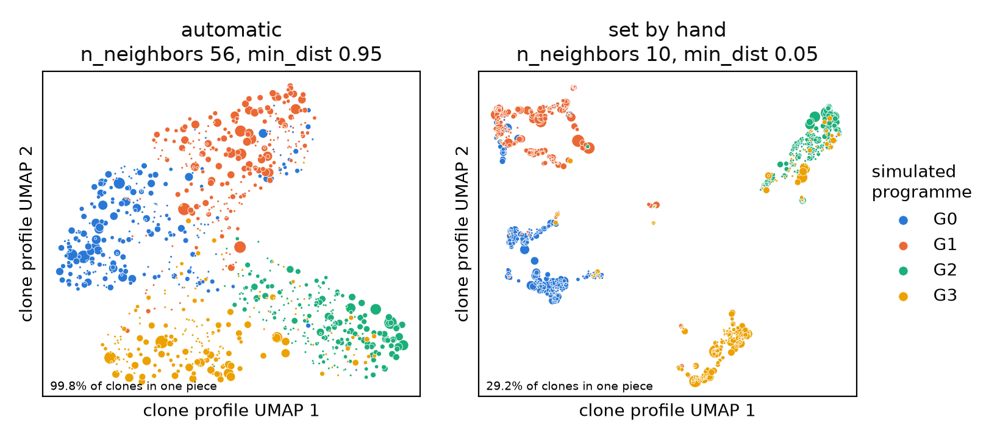

# Tutorial 3 — The clone map

The clone map places every clone on a plane, one point per clone, so that clones whose cells are
distributed alike sit close together. Gradients in the composition of clones — for example from clones of
germinal-centre B cells to clones of ASCs — then appear as paths. This tutorial shows how Threadfin
chooses the map's settings, how to set them by hand and how to check any map.

The map is a display. Clone profiles, clonal coherence, programmes and every test are computed in profile
space; changing the map changes none of them.

## 0. A short primer: what a clone map can and cannot tell you

**What is laid out.** Each clone has a profile: a vector of about 30 numbers that describes how its cells are
distributed over cell states (Tutorial 1, section 0). Two clones whose cells are distributed alike have
similar profiles. The clone map squeezes these 30-dimensional profiles onto a plane with
[UMAP](https://umap-learn.readthedocs.io), the same algorithm that is used for cell embeddings.

**What UMAP preserves.** UMAP tries to keep each clone next to its nearest neighbours in profile space. It
preserves *neighbourhoods* well and *large distances* only roughly.

| You may read from the map | You should not read from the map |
|---|---|
| which clones have similar state distributions (neighbours) | ancestry, or which clone came from which |
| how an annotation (antigen binding, isotype, sort gate) varies across clones, when you colour by it | time or direction of differentiation |
| where a programme lies relative to the others | whether clones form discrete groups or a continuum — the layout is chosen to stay connected; use the programmes, their stability and the tests |
| gradients in the composition of clones | exact distances, or the meaning of an axis |
| | statistical significance — use the tests, which use the profiles |

**Why the settings matter.** With too few neighbours per clone (`n_neighbors`) or too little spacing
(`min_dist`), UMAP breaks a connected population of clones into islands that do not exist in profile space —
the most common way a clone map misleads. With too many neighbours, local structure is smoothed away.
Because the right values depend on the dataset, Threadfin chooses them automatically (section 1).

## 1. Automatic settings

```python
import threadfin as tf

adata = tf.sim.simulate_repertoire(random_state=0)
tf.tl.clone_profiles(adata, basis="X_pca", context_key="context", donor_key="donor",
                     representation="kernel")
table = tf.tl.embed_clones(adata)          # n_neighbors="auto", min_dist="auto"
```

```
[threadfin] clone profiles: 931 clones (>= 2 cells, 6398 cells in all). Profiles are shrunk, so a clone reaches reliability 0.5 at 3 cells; nothing is filtered on that.
[threadfin] choosing clone-map settings (ladder) on 931 clones; target: at least 99.0% of clones in one piece.
[threadfin]   ladder: n_neighbors 56, min_dist 0.95 -> score 0.742 (smoothed 0.740)
[threadfin]   ladder: n_neighbors 32, min_dist 0.95 -> score 0.737 (smoothed 0.739)
[threadfin]   ladder: n_neighbors 56, min_dist 0.80 -> score 0.743 (smoothed 0.738)
[threadfin] clone-map settings: n_neighbors 56, min_dist 0.95; in every layout at least 99.9% of clones form one piece (local fidelity 0.566, global fidelity 0.919; 72 layouts, 49 s).
[threadfin] clone map: 931 of 931 profiled clones laid out (n_neighbors 56, min_dist 0.95, chosen automatically); 99.8% of clones in one connected piece.
```

Two UMAP settings shape the map: `n_neighbors`, the number of profile neighbours each clone is tied to,
and `min_dist`, how closely clones may pack. With too few neighbours or too little spacing, a connected
population of clones breaks into islands. Threadfin therefore tries a ladder of settings and scores every layout on

* **coherence** — the fraction of clones in one connected piece of the map;
* **local fidelity** — how many of each clone's 30 nearest neighbours in profile space stay its
  neighbours on the map;
* **global fidelity** — how well distances on the map follow distances between clone profiles.

It keeps the most faithful setting that holds together in every layout it tried. How much of the map must
hold together is set by the profiles themselves: the fraction of clones that are connected in the mutual
15-nearest-neighbour graph of profiles (here 99%). A small group of clones that is genuinely separate in
profile space may therefore stay apart, but a population that is connected in profile space is never broken
up. The full procedure is described in [Methods](../METHODS.md#5-the-clone-map-embed_clones-tune_clone_map).

## 2. What was chosen, and why

```python
mp = adata.uns["threadfin"]["profiles"]["map_params"]
print(mp["n_neighbors"], mp["min_dist"], {k: round(float(v), 3) for k, v in mp["quality"].items()})
```

```
56 0.95 {'score': 0.739, 'coherence': 0.998, 'local_fidelity': 0.578, 'global_fidelity': 0.9, 'coherence_target': 0.99}
```

`mp["tuning"]["candidates"]` lists the settings that were confirmed on six layouts each
(`mp["tuning"]["history"]` lists every layout scored):

```python
columns = ["n_neighbors", "min_dist", "repulsion_strength", "n_layouts", "score", "coherence",
           "local_fidelity", "global_fidelity"]
print(mp["tuning"]["candidates"][columns].round(3).to_string(index=False))
```

```
 n_neighbors  min_dist  repulsion_strength  n_layouts  score  coherence  local_fidelity  global_fidelity
          56      0.95                 1.0          6  0.742      0.999           0.566            0.919
          32      0.95                 1.0          6  0.741      0.996           0.583            0.899
          56      0.80                 1.0          6  0.744      0.998           0.570            0.919
         100      0.55                 1.0          6  0.740      0.998           0.558            0.922
          18      0.95                 1.0          6  0.742      0.999           0.596            0.887
          56      0.55                 1.0          6  0.750      0.998           0.582            0.918
```

`coherence` is the lowest value across the six layouts of each setting: a setting is only credited with
holding together if it did so every time.

## 3. Settings by hand

Pass numbers to fix the settings, for example to give several panels of one figure the same layout:

```python
tf.tl.embed_clones(adata, n_neighbors=10, min_dist=0.05)
```

```
[threadfin] clone map: 931 of 931 profiled clones laid out (n_neighbors 10, min_dist 0.05); 29.2% of clones in one connected piece.
[threadfin]   the map is more fragmented than the clone profiles (which keep 99.0% of clones connected); n_neighbors='auto', min_dist='auto' chooses settings that keep it together.
```



Both maps show the same 931 clones coloured by the simulated programme. With these hand-set values the
map breaks into separate islands, although the clone profiles form one connected population; the
automatic settings keep the programmes in their own regions and show how they adjoin.

One setting can also be fixed and the other tuned, e.g. `tf.tl.embed_clones(adata, n_neighbors=30)`.
`threadfin.run` takes the same choice as `map_n_neighbors` and `map_min_dist`.

## 4. Checking any map

`tf.tl.map_quality` scores a map from any source against the clone profiles. Here it scores the hand-set
map from section 3:

```python
prof = adata.uns["threadfin"]["profiles"]
xy = prof["clone_table"].loc[:, ["x", "y"]].dropna()
quality = tf.tl.map_quality(prof["features"].loc[xy.index], xy.to_numpy())
print({k: round(float(v), 3) for k, v in quality.items()})
```

```
{'score': -2.793, 'coherence': 0.292, 'local_fidelity': 0.578, 'global_fidelity': 0.815, 'coherence_target': 0.99}
```

Only 29% of clones are in the largest piece, against the 99% that the profiles support, and the global
fidelity is lower than for the automatic map (0.815 against 0.900): the islands also distort the distances
between programmes.

## 5. Colouring the map

```python
table = prof["clone_table"]
table["fraction_S5"] = tf.tl.clone_labels(adata, "true_state", how="fraction:S5")
tf.pl.clone_map(adata, color="fraction_S5")          # a number: one colour scale
tf.tl.find_programmes(adata)
tf.pl.clone_map(adata, color="clone_programme")      # categories: one panel per programme
```

```
[threadfin] programmes: 4 programmes over 931 core clones (resolution 0.2); 1 with bootstrap stability >= 0.75; 931 of 931 profiled clones assigned with posterior >= 0.7.
```

`tf.tl.clone_labels` collapses any cell-level column to one value per clone: the majority category, the
mean of a number, or the fraction of the clone's cells in one category. On your own data the same call
summarises, for example, antigen binding (`how="fraction:positive"`) or mutation load (`how="mean"`).

## 6. Can I trust this map? A checklist

1. **Is the map at least as connected as the profiles?** `mp["quality"]["coherence"]` should be close to
   `mp["quality"]["coherence_target"]`. If it is much lower, islands on the map are artefacts of the layout.
2. **Does colouring by a known annotation give a smooth pattern?** Colour by the fraction of ASCs,
   germinal-centre B cells or by isotype. A biologically meaningful map usually shows gradients; random
   speckle means the profiles carry little about that annotation (check the test in `result.profile_tests`).
3. **Is a group made of one donor?** Colour by donor
   (`tf.pl.clone_map(adata, color="donor")`). A region filled by one donor can reflect a difference in what
   was sampled from that individual rather than a clone type (see Methods, centring on the sampling context).
4. **Does the structure survive a different seed?** `tf.tl.embed_clones(adata, random_state=1)`; the
   automatic settings are chosen to hold together across seeds, but hand-set settings may not.
5. **Is the structure also in the profiles?** Programmes and their stability are computed from the profiles,
   not the map. A group you see on the map but not as a stable programme is not supported as a group by the
   profiles.
6. **Does a connected map mean a continuum?** No. The layout is chosen to be as connected as the profile
   graph, and discrete types of clones joined by clones that mix their states also form one connected piece.
   Judge groups from the programmes, their stability and the tests.

## 7. Notes

* **Reproducibility.** The choice is deterministic for a given `random_state` and number of BLAS threads. With
  another number of BLAS threads (`OMP_NUM_THREADS`) the computations differ at floating-point precision, which
  can change the chosen settings; keep the thread count the same between runs that must give the same map. If
  the final layout falls short of the coherence target, Threadfin tries two more seeds and then the next
  confirmed settings; `mp["layout_seed"]` and `mp["attempts"]` record what was used.
* **Weaker repulsion.** If no standard setting holds together, Threadfin lays the most coherent settings
  out again with weaker repulsion between clones (`repulsion_strength` 0.5, then 0.25), which keeps weakly
  connected groups together. The value used is recorded in `mp["repulsion_strength"]`.
* **Large datasets.** Above 3,000 clones, the search runs on a random subset, `n_neighbors` is scaled to
  the full data, and the best settings are confirmed again on all clones. Expect one to three minutes for a
  few thousand clones and several minutes for ten thousand.
* **Several cores.** `tf.tl.embed_clones(adata, n_jobs=-1)` (or `tf.run(..., n_jobs=-1)`) lays out the
  candidate maps in parallel. The chosen settings and the map are the same as with one core; on 1,887
  clones, 8 cores made the search 2.4 times faster, and more than 8 gave nothing further.
* **Alternative search.** `tf.tl.embed_clones(adata, tune_kwargs={"method": "adam"})` follows a stochastic
  gradient (Adam) instead of the ladder and ends with the same confirmation.

Next: [Tutorial 4 — step by step](04_step_by_step.md).
