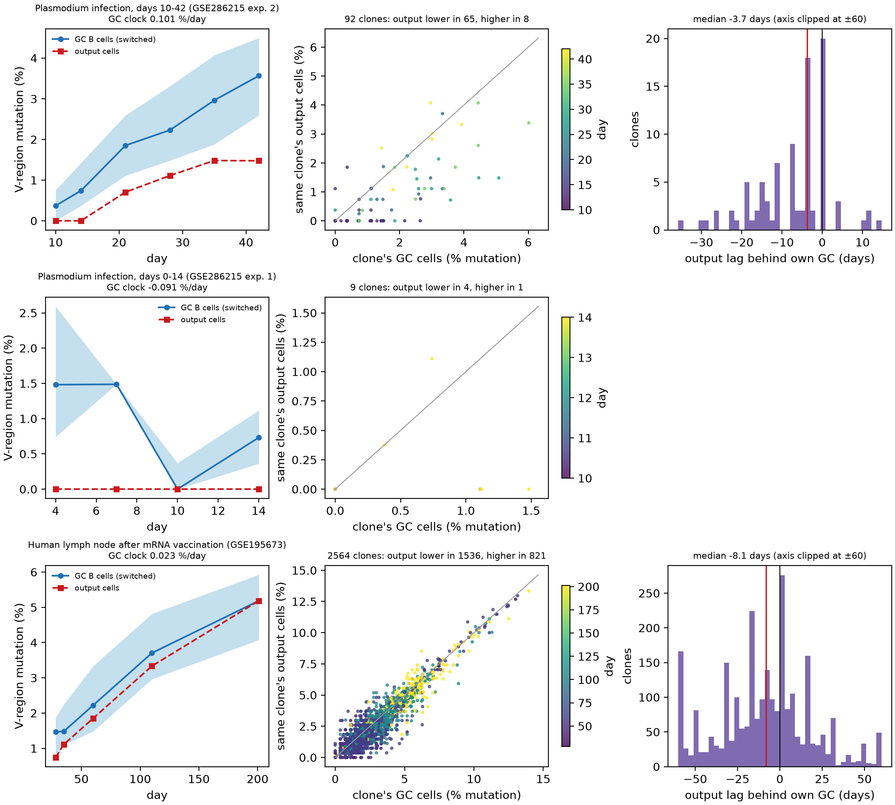

# Export lag: the mutation gap between a clone's output and its own germinal centre

**Question.** Somatic hypermutation only accumulates. Within one clone, an antibody-secreting cell can carry at
most the mutation load the clone's germinal-centre (GC) cells had when it left, so the difference between a
clone's output cells and its own GC cells is a clock that runs in one direction, with the clone as its own
control.

**Run.** `python export_lag_analysis.py` (threadfin ≥ 4.2; reads `manuscript/case_studies/results/<dataset>/cells.csv.gz`;
about 5 s). Uses `threadfin.tl.export_lag` for the per-clone gaps; the GC clock is fitted here on per-visit
medians of class-switched GC cells (Theil–Sen). Up to threadfin 4.3.0 the package fitted the clock on all cell
pairs, which does not fit in memory for tens of thousands of cells; 4.3.1 uses a fixed-seed random sample of
five million pairs above that size, but six to nine per-visit medians remain the more natural fit here.

**Design.** Class-switched cells only; GC B cells versus plasmablasts (and, in the human lymph node, lymph-node
plasma cells) of the same clone at the same visit (and tissue). Cell states are the original studies'
annotations; clones are the paired-chain Dandelion clones of the case studies.

**Results** (`results/summary.json`; per-clone gaps in `results/*_clone_pairs.csv`; GC clocks in
`results/*_gc_clock.csv`; output mutation by day in `results/*_output_by_day.csv`).

| Dataset | Clones | Output less / more / equal | Median gap, pp [95 % CI] | GC clock, %/day [95 % CI] | Median gap, days |
|---|---|---|---|---|---|
| *Plasmodium* days 10–42 (GSE286215 exp. 2) | 92 | 65 / 8 / 19 | −0.38 [−0.73, −0.37] | 0.101 [0.079, 0.135] | −3.7 |
| human lymph node (GSE195673) | 2,564 | 1,536 / 821 / 207 | −0.19 [−0.19, −0.17] | 0.023 [0.002, 0.030] | −8.1 |
| *Plasmodium* days 0–14 (GSE286215 exp. 1) | 9 | 4 / 1 / 4 | 0.00 | not estimable | — |

*Left:* median mutation of switched GC cells per day (band: interquartile range) and of output cells.
*Middle:* each clone's output cells against its own GC cells; points below the diagonal are clones whose
output is less mutated than their GC. *Right:* the gap in days at the GC's own rate.

**What it does not show.** That the output cells sampled at a visit descend from the GC cells sampled at that
visit; that every clone matures at the population's average rate (assumed by the conversion into days);
anything about affinity. For these reasons the analysis is exploratory and not part of the manuscript.
