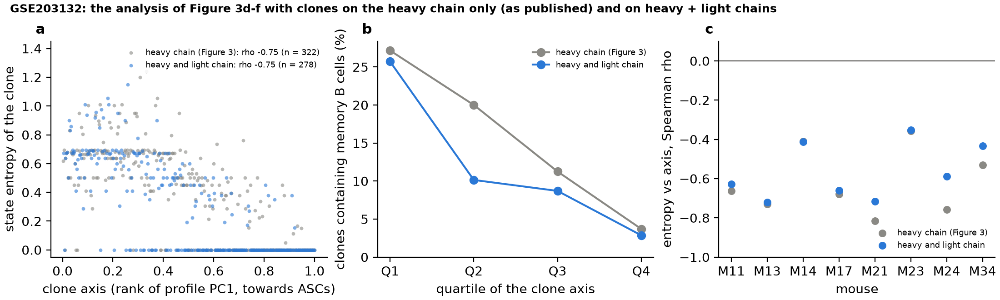

# Spontaneous germinal centres (GSE203132): heavy-chain clones vs paired-chain clones

**Question.** Figure 3a–f defines the clones of GSE203132 on the heavy chain alone, because the deposited AIRR
table (`GSE203132_10X_clone-pass_germ-pass.tsv.gz`) holds only heavy chains. Every other dataset in the
manuscript uses heavy + light chain clones. Do the results of Figure 3d–f change when the light chain is
added?

**Answer.** No. Adding the light chain splits 481 of the 1,051 heavy-chain clones with ≥ 2 cells (adjusted
Rand index 0.81 between the two partitions), but every statistic of Figure 3d–f stays where it was:

| | heavy chain (Figure 3) | heavy + light chain |
|---|---|---|
| cells with a clone | 8,105 | 8,105 |
| clones (with ≥ 2 cells) | 2,878 (1,051) | 3,640 (1,038) |
| largest clone (cells) | 114 | 111 |
| share of state variance explained by clone (ICC; shuffled) | 0.279 (0.026) | 0.293 (0.026) |
| clones with ≥ 5 cells of an annotated state | 322 | 278 |
| state entropy vs clone axis, Spearman ρ | −0.747 | −0.754 |
| the same, entropy rarefied to 5 cells | −0.746 | −0.749 |
| the same, on the clone-map coordinate | −0.742 | −0.740 |
| mice with a negative ρ | 8 of 8 (−0.36 to −0.82) | 8 of 8 (−0.35 to −0.72) |
| clones containing memory B cells, quartiles 1→4 of the axis | 27 %, 20 %, 11 %, 4 % | 26 %, 10 %, 9 %, 3 % |
| rarefied probability of a memory cell vs axis, ρ | −0.229 | −0.241 |

All correlations have P < 10⁻⁴; the entropy correlations have P < 10⁻⁴⁸.



**Data and steps.**

1. [`annotate_contigs.sh`](annotate_contigs.sh) — the deposit also contains each mouse's
   `filtered_contig.fasta` (every assembled contig, heavy and light). These were annotated with IgBLAST 1.22.0
   (NCBI release) against the IMGT mouse IG reference (V, D and J of IGH, IGK and IGL), output in AIRR format.
2. [`paired_clones.py`](paired_clones.py) — keeps the deposited heavy-chain rows that Figure 3 used, adds the
   productive light chains of the same cells from IgBLAST, and calls clones with Dandelion through
   `threadfin.tl.define_clones_dandelion` (heavy + light chain, junction identity 0.85, within each mouse, run
   with `PYTHONHASHSEED=0`). So the only change from Figure 3 is the light chain. The deposit has no UMI counts
   for light chains; Dandelion's clone calls do not use them.
3. [`compare_clone_definitions.py`](compare_clone_definitions.py) — runs the analysis of Figure 3d–f (the code
   of `figures/reserve/source/revision_spont_gc_2026-10-17.py`) for both clone definitions: kernel profiles
   centred on the mouse, the clone map with the Figure 3 settings (30 neighbours, minimum distance 0.3), the
   first principal component of the profiles oriented towards antibody-secreting cells, Shannon entropy of the
   five RNA-annotated states (raw and rarefied to five cells, 1,000 draws), memory-containing clones by
   quartile of the axis, and the same within each mouse. With the heavy-chain clones it reproduces the saved
   Figure 3 values exactly (ρ = −0.747, n = 322; ICC 0.2786).

**Check of the annotation.** IgBLAST's annotation of the 8,106 deposited heavy chains agrees with the deposit
for 100 % of junction amino-acid sequences, 99.8 % of V genes and 100 % of J genes. Every cell with a heavy
chain also has a productive light chain (7,566 one, 540 two or more; 8,140 κ and 506 λ chains).

**Caveats.** The light chain splits many heavy-chain clones. Some of these splits are real (different
B-cell clones that share a heavy-chain rearrangement), others come from cells with two light chains and from
light-chain V-gene calls that IgBLAST cannot resolve between closely related genes; this analysis does not
separate the two. Either way, the conclusions of Figure 3d–f do not depend on the clone definition.

**Reproduce.**

```bash
IGBLAST_DIR=<ncbi-igblast-1.22.0> IGBLAST_DB=<imgt mouse database> DATA=<GSE203132 download> \
    bash annotate_contigs.sh <igblast_dir>
PYTHONHASHSEED=0 python paired_clones.py <igblast_dir> <GSE203132_10X_clone-pass_germ-pass.tsv.gz> results
python compare_clone_definitions.py results/spont_gc_paired_clones.csv
```

`paired_clones.py` needs `pip install "threadfin[dandelion]"`; the comparison needs the cached embedding of
the case study (`internal_validation/algorithm_revision/embedding_cache/spont_gc_embedding.h5ad`, made by
`case_studies/` from the deposited count matrices).

**Files.** `results/spont_gc_paired_clones.csv` (cell → paired clone id), `results/spont_gc_paired_clones.json`
(annotation check, chain counts, Dandelion settings and hash seed), `results/gse203132_paired_contigs.tsv.gz`
(the contig table given to Dandelion), `results/comparison.json` (all statistics above),
`results/clones_heavy.csv` and `results/clones_paired.csv` (per-clone axis, entropy and memory values).
