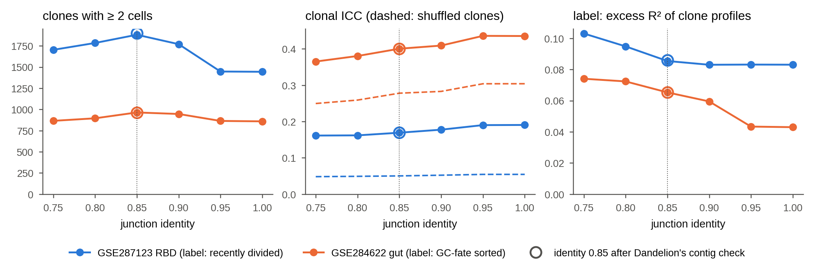

# Do the results depend on how clones are called?

**Question.** Threadfin calls clones with Dandelion at a junction amino-acid identity of 0.85 (Dandelion's
default for B cells) and without Dandelion's contig check. Would a stricter or looser threshold, or the
check, change the conclusions?

**Design.** Two case studies with a sorting label that the profiles do not use:
GSE287123 RBD (Figure 4; label: fraction of recently divided cells per clone) and GSE284622 gut (Figure 3g–j;
label: fraction of GC-fate-sorted cells per clone). Clones were called at identities 0.75, 0.80, 0.85, 0.90,
0.95 and 1.0, and at 0.85 after Dandelion's contig check (`check_contigs=True`). For each clone definition,
the analysis of the case study was repeated on its cached embedding with the case-study settings: the clonal
ICC on mean profiles centred on the mouse, tested by 200 permutations within samples, and the variance of the
kernel clone profiles explained by the label (profile association, 1,000 permutations within mice).
`PYTHONHASHSEED=0`; Threadfin 4.4.2, sc-dandelion 0.5.7.

```
PYTHONHASHSEED=0 python clone_definition_sensitivity.py results        # needs sc-dandelion
python clone_definition_sensitivity.py --plot results
```



| dataset | identity | contig check | clones ≥ 2 cells | cells in them | clonal ICC (shuffled) | label excess R² |
|---|---|---|---|---|---|---|
| RBD | 0.75 | no | 1,703 | 10,727 | 0.161 (0.048) | 0.103 |
| RBD | 0.80 | no | 1,784 | 10,467 | 0.162 (0.049) | 0.095 |
| RBD | **0.85** | no | **1,881** | **9,812** | **0.169 (0.050)** | **0.085** |
| RBD | 0.90 | no | 1,770 | 9,116 | 0.178 (0.052) | 0.083 |
| RBD | 0.95 | no | 1,447 | 7,827 | 0.190 (0.054) | 0.083 |
| RBD | 1.00 | no | 1,444 | 7,813 | 0.191 (0.054) | 0.083 |
| RBD | 0.85 | yes | 1,899 | 9,891 | 0.169 (0.050) | 0.086 |
| gut | 0.75 | no | 865 | 6,066 | 0.365 (0.250) | 0.074 |
| gut | 0.80 | no | 895 | 5,958 | 0.380 (0.259) | 0.072 |
| gut | **0.85** | no | **964** | **5,724** | **0.401 (0.278)** | **0.065** |
| gut | 0.90 | no | 946 | 5,500 | 0.409 (0.283) | 0.059 |
| gut | 0.95 | no | 864 | 4,864 | 0.436 (0.304) | 0.043 |
| gut | 1.00 | no | 859 | 4,852 | 0.435 (0.304) | 0.043 |
| gut | 0.85 | yes | 964 | 5,724 | 0.401 (0.278) | 0.065 |

Every clonal ICC exceeded all 200 shuffles (p = 0.005) and every label effect all 1,000 shuffles (p = 0.001).
With Threadfin 4.6.0 (the same script re-run on 2026-10-30, `results_460/clone_definition_sensitivity.csv`),
which shuffles the label among clones of the same mouse and similar size, the label excess R² is RBD 0.102,
0.094, 0.085, 0.083, 0.083, 0.083 (identities 0.75–1.0) and 0.085 (contig check), gut 0.074, 0.072, 0.065,
0.060, 0.043, 0.043 and 0.065; every label effect still exceeds all 1,000 shuffles, and the clone counts and
ICCs are unchanged.
Bold rows are the setting of the manuscript. Their clonal ICCs equal the published ones to three decimals (RBD
0.169, gut 0.401); the numbers of clones differ by six from the case studies (1,887 and 958), because Dandelion's
calls depend on Python's hash seed and Threadfin ≥ 4.4 renames contig ids that two libraries share
([tutorial path](../tutorial_path/README.md)). Full table:
[`results/clone_definition_sensitivity.csv`](results/clone_definition_sensitivity.csv).

**Reading.**

* *Identity.* Looser thresholds merge more cells into fewer, larger clones; stricter ones split clones whose
  members have diverged by somatic hypermutation (at 1.0, almost a quarter of the RBD clones with two or more
  cells are lost). The clonal ICC rises slowly with the threshold, from 0.161 to 0.191 (RBD) and from 0.365 to 0.435
  (gut), because the clones that remain are more homogeneous; the shuffled ICC rises with it, so the excess
  over shuffled clones changes less (RBD 0.113–0.136, gut 0.116–0.132). The label effect is largest at loose
  thresholds and is significant at every threshold. No conclusion depends on the choice of 0.85.
* *Contig check.* 8.4 % of RBD cells and 4.1 % of gut cells carry two productive chains of one kind and so
  receive a clone id that joins both (column `cells_with_compound_id`). Most have two light chains (RBD 86 %,
  gut 100 %), which Dandelion's check allows, as in allelic inclusion; it resolves cells with two heavy chains.
  The check set aside 150 RBD contigs and 24 gut contigs and changed the clonal ICC by less than 0.001 and the
  label effect by less than 0.001. Across the 14 public datasets, combined ids affect 0–20.5 % of cells (EBV
  organoids the most), mostly two light chains except in bone-marrow plasma cells, where two heavy chains are
  the most common.

**Conclusion.** The conclusions of both case studies hold at junction identities from 0.75 to 1.0 and with or
without Dandelion's contig check. Threadfin keeps Dandelion's defaults, reports how many cells received a
combined id, and offers the check as `clone_options={"check_contigs": True}` in `tf.run`.
