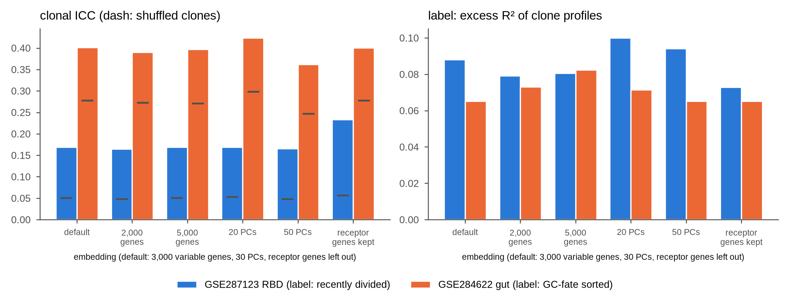

# Do the results depend on how the expression embedding is built?

**Question.** Threadfin's embedding uses 3,000 variable genes and 30 principal components, after leaving out
the receptor genes. Would other common choices change the conclusions? And does leaving out the receptor genes
matter?

**Design.** Two case studies, prepared exactly as in `case_studies/run_case_study.py` (same data, same clone
ids): GSE287123 RBD (Figure 4; label: fraction of recently divided cells per clone) and GSE284622 gut
(Figure 3g–j; label: fraction of GC-fate-sorted cells). The embedding was rebuilt with 2,000, 3,000 or 5,000
variable genes and 20, 30 or 50 principal components, and once with the receptor genes left in. For each
embedding the analysis of the case study was repeated: the clonal ICC on mean profiles centred on the mouse
(200 permutations within samples) and the variance of the kernel clone profiles explained by the label (1,000
permutations within mice). Threadfin 4.5.0.

```
PYTHONHASHSEED=0 python embedding_sensitivity.py mouse_rbd results
PYTHONHASHSEED=0 python embedding_sensitivity.py gut_gc_reporter results
python embedding_sensitivity.py --plot results
```



| embedding | RBD: clonal ICC (shuffled) | RBD: label excess R² | gut: clonal ICC (shuffled) | gut: label excess R² |
|---|---|---|---|---|
| **3,000 genes, 30 PCs (default)** | **0.169 (0.051)** | **0.088** | **0.401 (0.278)** | **0.065** |
| 2,000 genes | 0.165 (0.048) | 0.079 | 0.390 (0.272) | 0.073 |
| 5,000 genes | 0.169 (0.051) | 0.081 | 0.397 (0.271) | 0.082 |
| 20 PCs | 0.169 (0.053) | 0.100 | 0.424 (0.298) | 0.071 |
| 50 PCs | 0.166 (0.048) | 0.094 | 0.362 (0.247) | 0.065 |
| receptor genes left in | 0.233 (0.057) | 0.073 | 0.401 (0.278) | 0.065 |

Every clonal ICC exceeded all 200 shuffles (P = 0.005) and every label effect all 1,000 (P = 0.001). The default
rows reproduce the case studies (RBD: ICC 0.169, division excess R² 0.088; gut: ICC 0.401). Tables:
`results/embedding_sensitivity_*.csv`.

**Reading.**

* *Variable genes and components.* The excess of the clonal ICC over shuffled clones stays within 0.116–0.118
  (RBD) and 0.115–0.126 (gut) across 2,000–5,000 genes and 20–50 components. The raw ICC of the gut data moves
  more (0.36–0.42), together with its shuffled value, probably because the leading components carry relatively
  more of the variation that differs between samples; the excess, which is what the test compares, does not. The label
  effects range from 0.079 to 0.100 (RBD) and 0.065 to 0.082 (gut), all significant.
* *Receptor genes.* The RBD deposit includes 652 receptor genes (immunoglobulin and TCR segments). Left in, they raise the clonal ICC from
  0.169 to 0.233 (excess over shuffled clones 0.118 → 0.176): cells of one clone share their V-gene and isotype
  transcripts, so they look alike for a reason that has nothing to do with cell state. The label effect falls
  (0.088 → 0.073), because this receptor similarity is unrelated to division. The gut deposit includes only 4
  receptor genes and is unaffected. This is why `prepare_embedding` leaves the receptor genes out by
  default.

**Conclusion.** The conclusions do not depend on the number of variable genes or components within common
ranges; leaving the receptor genes in would inflate clonal coherence.
