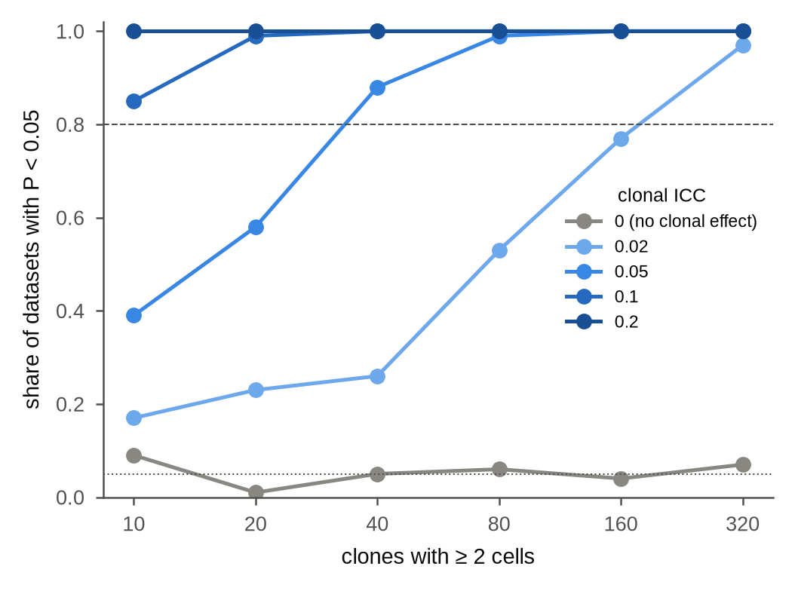

# How many clones does the coherence test need?

**Question.** Before an experiment, or when a dataset has few expanded clones: how many clones with two or more
cells does the clonal-coherence test need to detect a given clonal effect?

**Design.** Simulated datasets with two donors and two samples per donor. Clones with two or more cells
(2 + Poisson(1.5) cells, 3.5 on average) are each sampled within one sample, and as many cells again are
singletons. A cell's 30-dimensional state is its sample's shift (SD 0.5) plus its clone's shift (SD *s*) plus
noise (SD 1), so clone identity explains a share ICC = *s*² / (*s*² + 1) of the variance within samples. Each
dataset was analysed as `tf.run` does it (mean clone profiles centred on the sample; clonal ICC against 200
permutations of clone labels within samples), and called significant at P < 0.05. 100 datasets per design cell;
5 clonal ICCs × 6 numbers of clones; Threadfin 4.5.0, 1.5 minutes on 8 cores.

```
python coherence_power.py results 8
python coherence_power.py --plot results
```



**Share of datasets with P < 0.05** (`results/coherence_power.csv`; each value ± about 0.05 from 100 datasets):

| clones with ≥ 2 cells | ICC 0 (false positives) | 0.02 | 0.05 | 0.1 | 0.2 |
|---|---|---|---|---|---|
| 10 | 0.09 | 0.17 | 0.39 | 0.85 | 1.00 |
| 20 | 0.01 | 0.23 | 0.58 | 0.99 | 1.00 |
| 40 | 0.05 | 0.26 | 0.88 | 1.00 | 1.00 |
| 80 | 0.06 | 0.53 | 0.99 | 1.00 | 1.00 |
| 160 | 0.04 | 0.77 | 1.00 | 1.00 | 1.00 |
| 320 | 0.07 | 0.97 | 1.00 | 1.00 | 1.00 |

**Reading.**

* *False positives.* Without a clonal effect, 1–9 % of datasets reached P < 0.05 (5.3 % over all sizes), as
  expected from 100 datasets per cell: the test is calibrated, also with ten clones.
* *Power.* A clonal ICC of 0.1 is detected with 80 % power from about 10 clones, 0.05 from about 40 clones,
  and 0.02 needs about 160–320 clones. In the 15 case studies (`../../dataset_overview.csv`) the clonal ICC
  exceeds shuffled clones by 0.08–0.67 in all but one, with 204–11,141 clones of two or more cells: well within
  the range of high power. The exception is GSE246382 (Smart-seq2 GC and plasma cells): 96 clones and an excess
  of only 0.015, the size of effect that a true ICC of about 0.02 leaves with this few clones (simulated median
  excess 0.010 with 80 clones), which the simulation detects in about half of datasets; its coherence was not
  significant (P = 0.23).
* *Estimates.* With few clones the clonal ICC is estimated a little low (median 0.15 for a true 0.2 with ten
  clones; 0.19 from 80 clones), because each clone is then a sizeable part of its sample and centring on the
  sample removes part of its shift. The shuffled ICC has the same small-sample offset, so the excess over
  shuffled clones, not the raw ICC, is the quantity to compare between datasets of very different size.

**Limits.** Clones here differ by a shift of their whole state distribution, and every sample has the same
expected size. Real clones also differ in how their cells divide between states, which adds signal, and real
samples differ in size and composition, which the permutation within samples absorbs. Programmes and label
tests ask more of the data than coherence and are not covered here.
