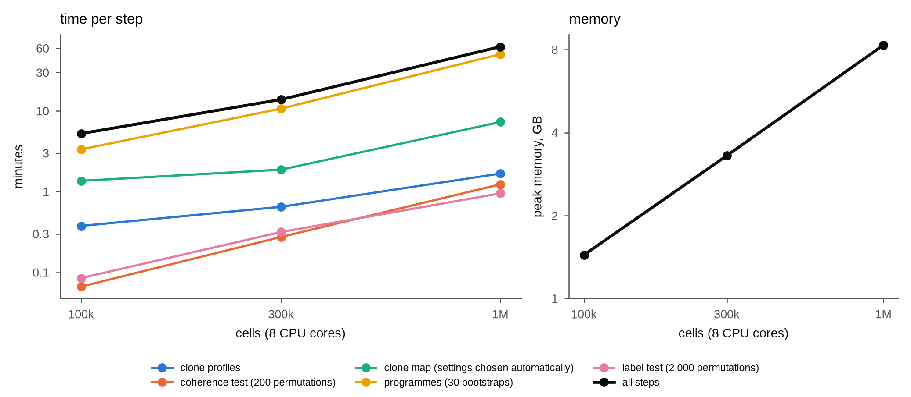

# Does the analysis scale to atlas-size data?

**Question.** Single-cell atlases of B and T cells now reach a million cells. How long do Threadfin's steps take
at that size, and how much memory do they need?

**Design.** Synthetic repertoires of 100,000, 300,000 and 1,000,000 cells with a 30-dimensional embedding (as
from PCA), ten donors and 40 samples, and clone sizes drawn from a truncated Zipf distribution as in real
repertoires (most clones seen once). Every step of `tf.run` after the embedding was timed with its peak memory,
on 8 CPU cores (`n_jobs=8`): clone profiles (kernel), the coherence test with 200 permutations, the clone map
with automatically chosen settings, programmes with 30 bootstrap replicates, and one label test with 2,000
permutations. The runs used the 4.5.0 code before its version number was set (recorded as 4.4.2); none of the
timed steps changed afterwards.

```
python atlas_scale.py 1000000 8 results/atlas_1000000.json      # likewise 100000 and 300000
python atlas_scale.py --plot results
```



| cells | clones (≥ 2 cells) | clone profiles | coherence | clone map | programmes | label test | all steps | peak memory |
|---|---|---|---|---|---|---|---|---|
| 100,000 | 17,017 (6,655) | 23 s | 4 s | 82 s | 3.4 min | 5 s | 5.3 min | 1.4 GB |
| 300,000 | 53,506 (20,848) | 39 s | 17 s | 1.9 min | 10.7 min | 19 s | 13.9 min | 3.3 GB |
| 1,000,000 | 182,665 (71,376) | 1.7 min | 1.2 min | 7.3 min | 50.6 min | 57 s | 62.6 min | 8.3 GB |

**Reading.**

* A million cells, with 71,376 clones of two or more cells, take about an hour on 8 cores and 8.3 GB of memory.
  Time grows about in proportion to the number of cells (twelve-fold for ten times the cells), memory less than
  in proportion (six-fold).
* The programme search takes most of the time (two thirds at 100,000 cells, four fifths at a million), because its stability is estimated by repeating the
  community detection and the split tests in 30 bootstrap replicates. Clone profiles, the coherence test and the
  label test take a few minutes together. `n_boot` sets the number of replicates when time matters more than the
  precision of the stability estimates.
* Not included: building the expression embedding (normalisation, variable genes, PCA, optionally Harmony), which
  is standard Scanpy and can be replaced by any embedding of your own (`tf.run(..., basis=...)`).

For the comparison with other tools on real data, see the benchmark
([`../../../benchmarking/`](../../../benchmarking/README.md), Figures 12 and 13).
