# Figures of the tutorial-path runs

Every figure that Threadfin draws for each public dataset of the [tutorial path](../README.md): the overview that `result.plot()` saves and every other `threadfin.pl` figure that applies, drawn by [`make_gallery.py`](../make_gallery.py) from the result that [`run_dataset.py`](../run_dataset.py) kept (threadfin 4.6.0). Each dataset's page says what every image shows.

| dataset | overview | figures | cells | clones ≥ 2 cells | clonal ICC (shuffled) | programmes |
|---|---|---|---|---|---|---|
| [GSE253857 bone-marrow plasma cells](bone_marrow_pc/README.md) | <a href="bone_marrow_pc/README.md">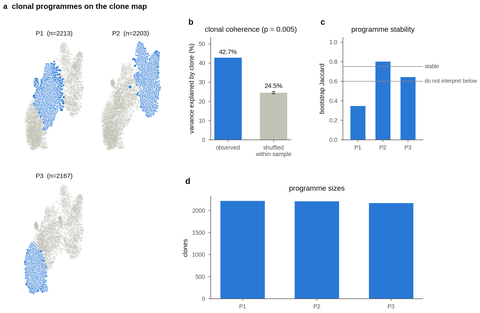</a> | 32 | 115,144 | 6,583 | 0.427 (0.245) | 3 |
| [GSE171703 SARS-CoV-2 bait-sorted B cells](covid_bcell/README.md) | <a href="covid_bcell/README.md">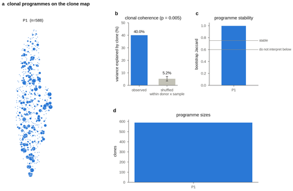</a> | 12 | 61,423 | 588 | 0.400 (0.052) | 1 |
| [GSE317492 EBV tonsil organoids](ebv/README.md) | <a href="ebv/README.md">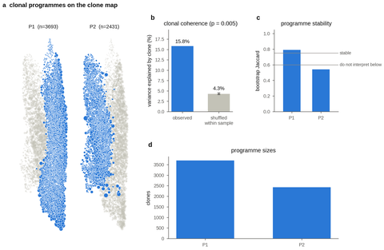</a> | 21 | 205,630 | 6,124 | 0.158 (0.043) | 2 |
| [GSE175522 blood, influenza vaccine](flu/README.md) | <a href="flu/README.md">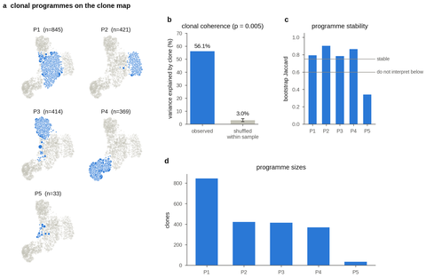</a> | 22 | 123,693 | 2,082 | 0.561 (0.030) | 5 |
| [GSE317692 influenza lung](flu_lung/README.md) | <a href="flu_lung/README.md">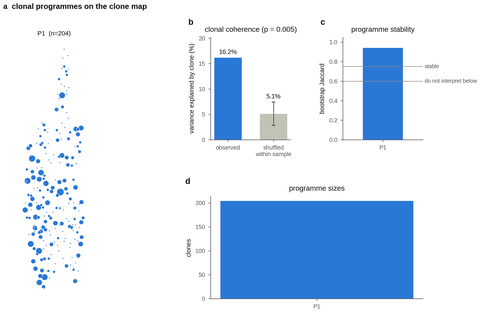</a> | 14 | 4,121 | 204 | 0.162 (0.051) | 1 |
| [GSE246382 GC + plasma cells (Smart-seq2, TRUST4)](gc_np_pc/README.md) | <a href="gc_np_pc/README.md">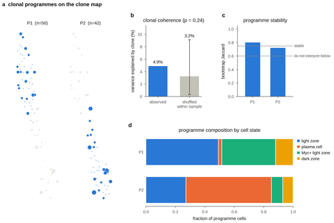</a> | 19 | 884 | 92 | 0.049 (0.032) | 2 |
| [GSE284622 gut GC-fate reporter](gut_gc_reporter/README.md) | <a href="gut_gc_reporter/README.md">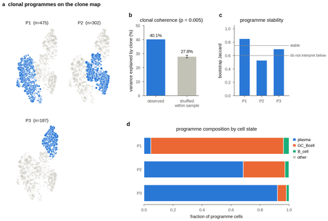</a> | 31 | 16,619 | 964 | 0.401 (0.278) | 3 |
| [GSE140802 LARRY day 2 (clone ids given)](larry_d2/README.md) | <a href="larry_d2/README.md">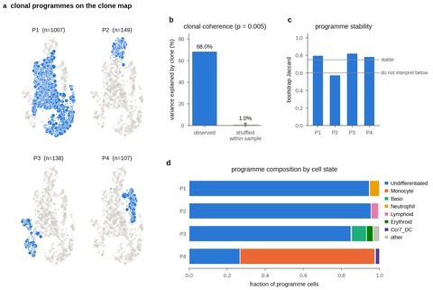</a> | 11 | 28,249 | 1,401 | 0.680 (0.010) | 4 |
| [GSE140802 LARRY days 4/6 (clone ids given)](larry_d46/README.md) | <a href="larry_d46/README.md">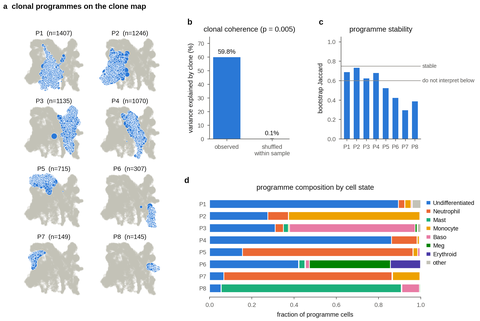</a> | 11 | 44,664 | 6,174 | 0.598 (0.001) | 8 |
| [GSE195673 lymph node, mRNA vaccine](ln_vaccine/README.md) | <a href="ln_vaccine/README.md">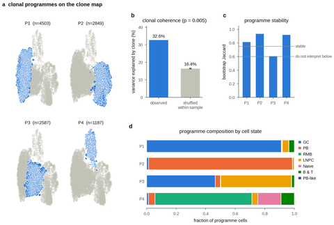</a> | 26 | 193,442 | 11,126 | 0.326 (0.164) | 4 |
| [GSE286215 Plasmodium d0-14](malaria/README.md) | <a href="malaria/README.md">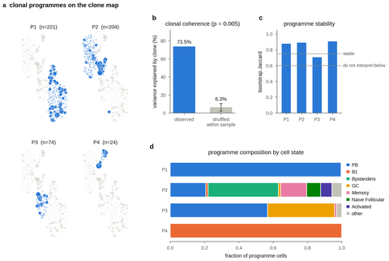</a> | 21 | 40,623 | 523 | 0.735 (0.063) | 4 |
| [GSE286215 Plasmodium d10-42](malaria_late/README.md) | <a href="malaria_late/README.md">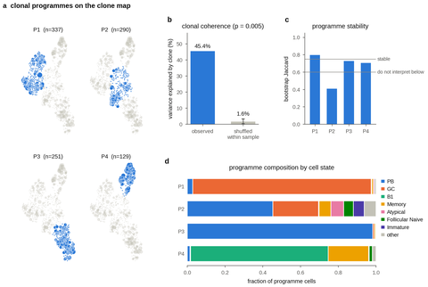</a> | 21 | 72,359 | 1,007 | 0.454 (0.016) | 4 |
| [GSE287123 NP reporter](mouse_np/README.md) | <a href="mouse_np/README.md">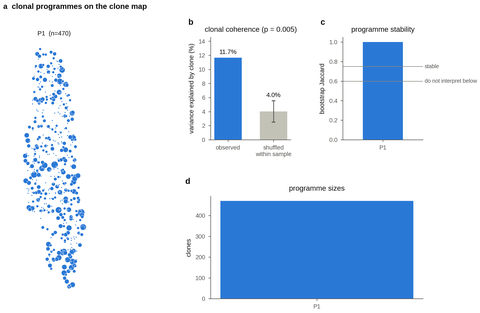</a> | 12 | 10,109 | 470 | 0.117 (0.040) | 1 |
| [GSE287123 RBD reporter (Tutorial 5)](mouse_rbd/README.md) | <a href="mouse_rbd/README.md">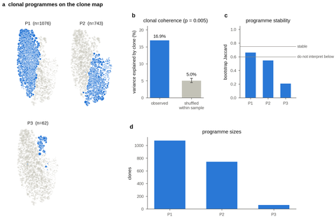</a> | 32 | 36,188 | 1,881 | 0.169 (0.050) | 3 |
| [GSE203132 spontaneous GCs](spont_gc/README.md) | <a href="spont_gc/README.md">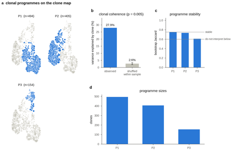</a> | 16 | 22,898 | 1,053 | 0.279 (0.026) | 3 |
| [E-MTAB-9005 paediatric tonsil](tonsil/README.md) | <a href="tonsil/README.md">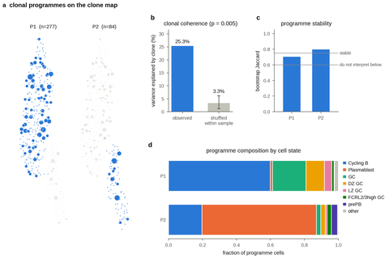</a> | 20 | 22,478 | 361 | 0.253 (0.033) | 2 |

321 images, 47.5 MB.
