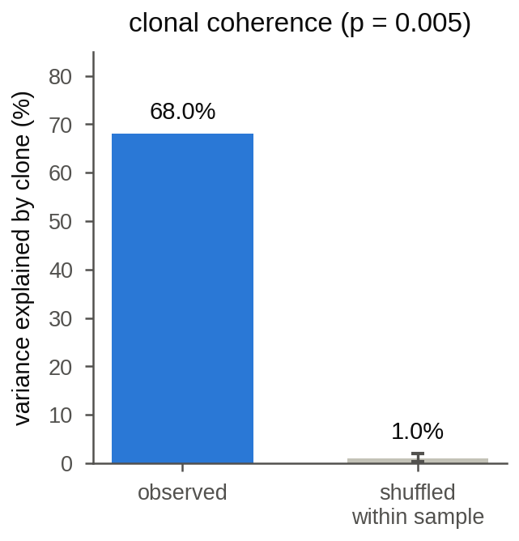
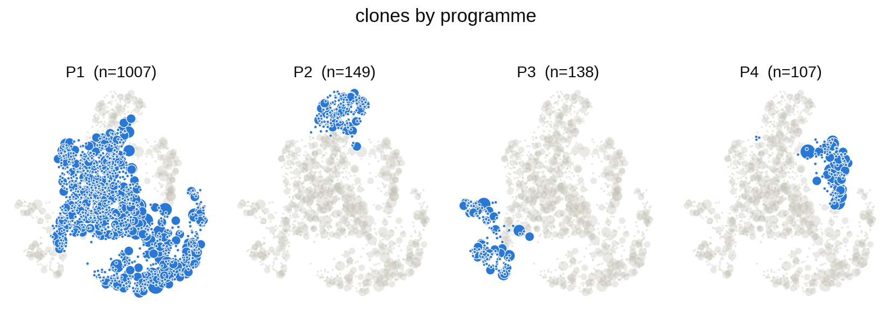
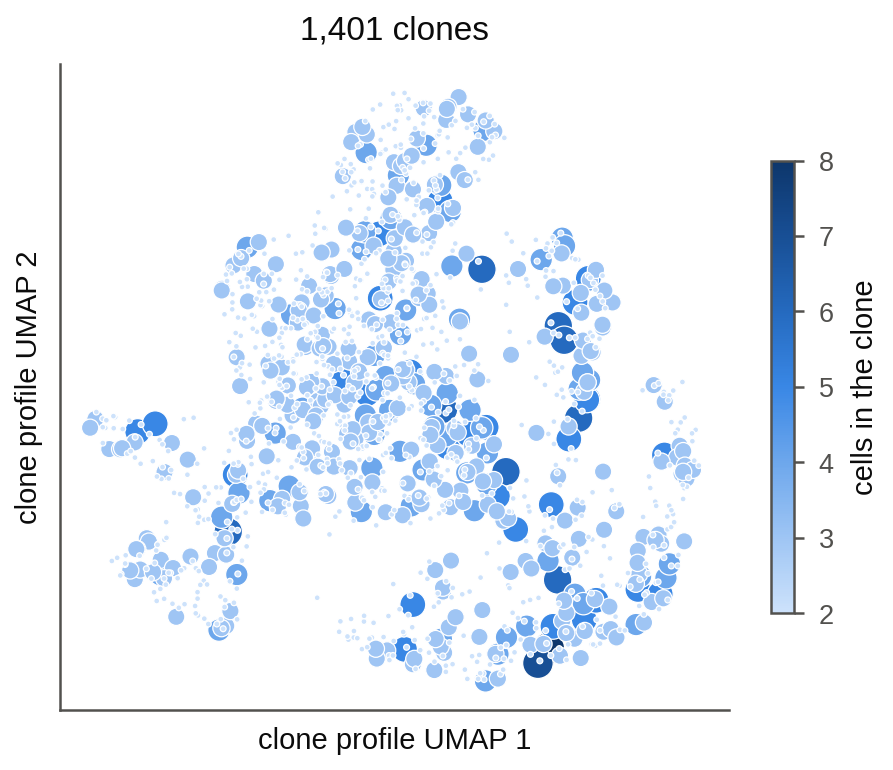
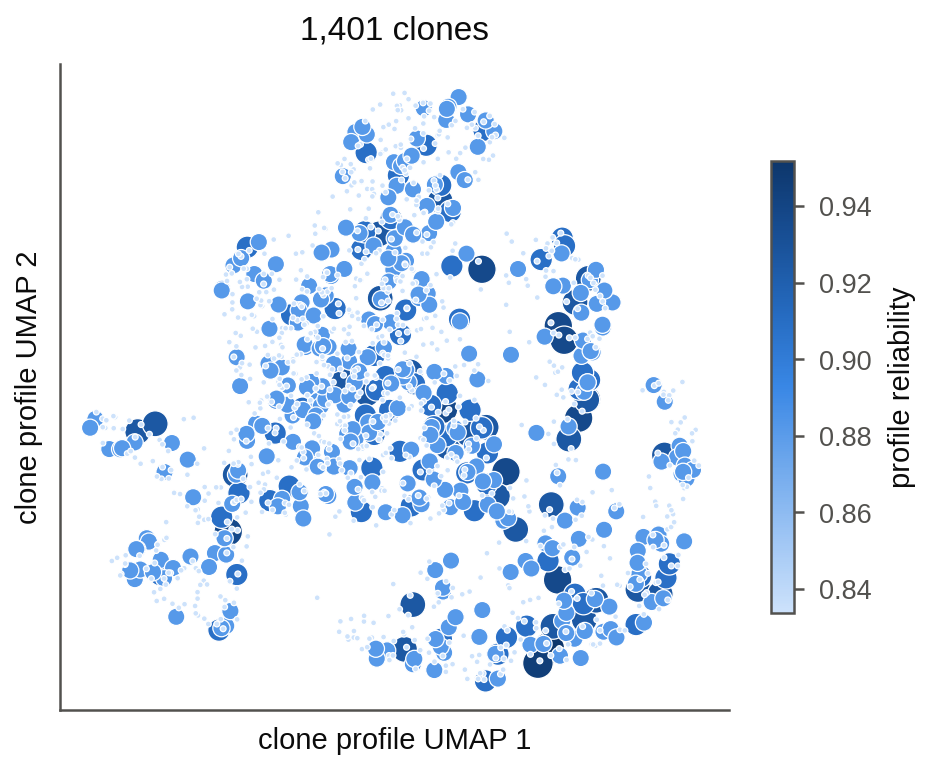
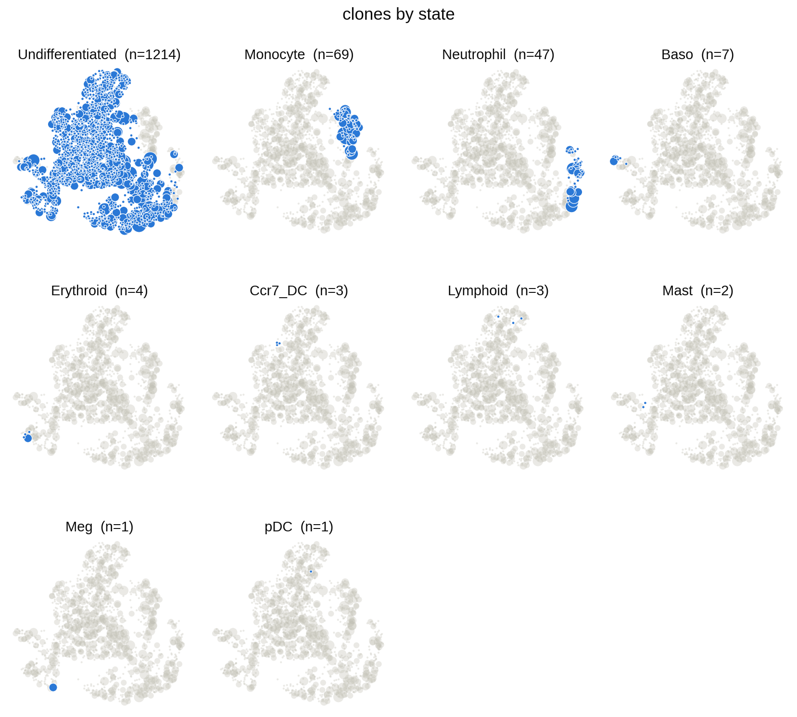
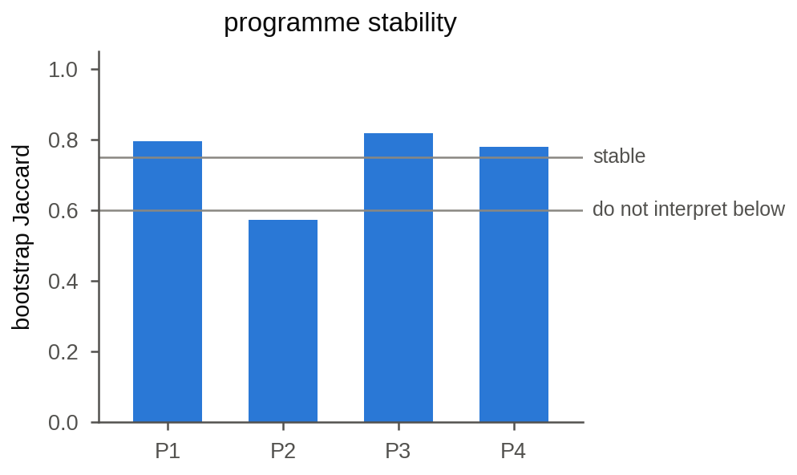
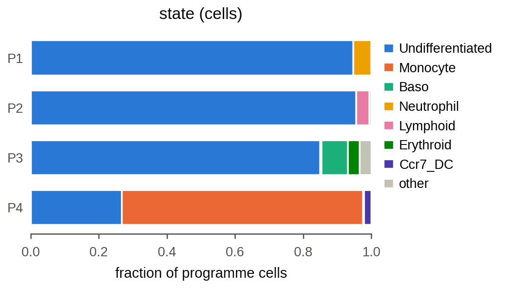
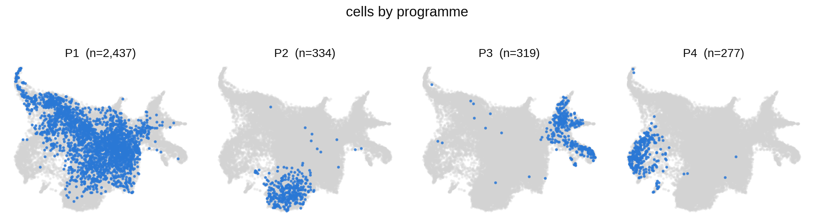
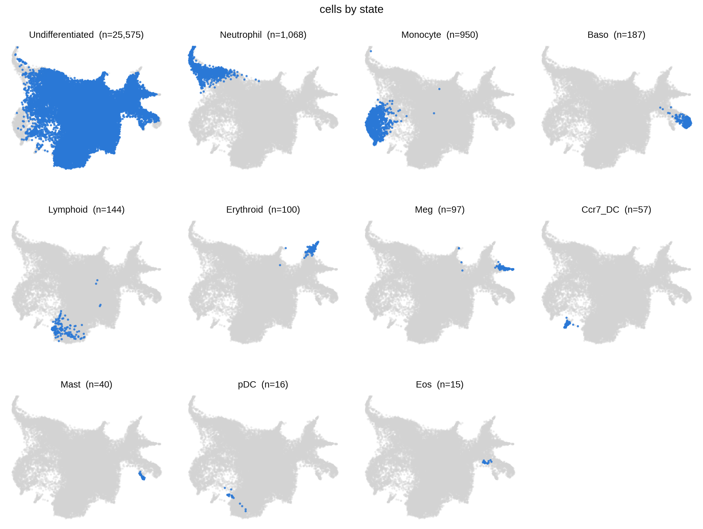

# GSE140802 LARRY day 2 (clone ids given) (`larry_d2`)

threadfin 4.6.0 · 28,249 cells · 1,401 clones with two or more cells · clonal ICC 0.680 (shuffled 0.010, P = 0.005) · 4 programmes

The run: `tf.run(adata, donor_key="donor", sample_key="sample", state_key="state", basis="X_published", n_jobs=8)` ([`run_dataset.py`](../../run_dataset.py)); the figures are drawn from the kept result by [`make_gallery.py`](../../make_gallery.py).

| figure | what it shows |
|---|---|
| [Overview (`result.plot()`)](#overview-resultplot) | The figure that `result.plot()` saves: (a) clonal programmes on the clone map, (b) clonal coherence, (c) programme stability, (d) programme composition by `state`. |
| [Clonal coherence](#clonal-coherence) | Share of transcriptional variance explained by clone identity (clonal ICC), observed and with clone labels shuffled within each `sample` (bar: mean of 200 permutations; whisker: their central 95 %). |
| [Clone map: programmes](#clone-map-programmes) | The clone map (UMAP of clone profiles; one point per clone, area by its number of cells) coloured by clonal programme, one panel per programme, every other clone in grey. |
| [Clone map: clone size](#clone-map-clone-size) | The clone map coloured by the number of cells of each clone. |
| [Clone map: profile reliability](#clone-map-profile-reliability) | The clone map coloured by the reliability of each clone's profile (0 to 1; it grows with the number of cells sampled from the clone). |
| [Clone map: state](#clone-map-state) | The clone map coloured by `state`, the level held by at least half of each clone's cells, one panel per level, every other clone in grey (clones without such a majority appear only in grey). |
| [Programme stability](#programme-stability) | Bootstrap stability of each programme (mean Jaccard overlap with the best-matching group over 30 bootstrap replicates), with the 0.75 (stable) and 0.6 guides. |
| [Programme composition: state (cells)](#programme-composition-state-cells) | For each programme (one bar), the fraction of the programme's cells in each level of `state` (levels beyond the seventh pooled as 'other'). |
| [Programme composition: state (clones)](#programme-composition-state-clones) | For each programme (one bar), the mean over the programme's clones of each clone's fraction of cells in each level of `state`, so that every clone counts once (levels beyond the seventh pooled as 'other'). |
| [Cells: programmes](#cells-programmes) | Cells on a UMAP of the embedding the run used (`X_published`): the cells of each programme's clones, one panel per programme, on the grey of all cells. |
| [Cells: state](#cells-state) | Cells on a UMAP of the embedding the run used (`X_published`): the cells of each level of `state`, one panel per level, on the grey of all cells. |

## Overview (`result.plot()`)

## Clonal coherence

## Clone map: programmes

## Clone map: clone size

## Clone map: profile reliability

## Clone map: state

## Programme stability

## Programme composition: state (cells)

## Programme composition: state (clones)

## Cells: programmes

## Cells: state

