# GSE287123 NP reporter (`mouse_np`)

threadfin 4.6.0 · 10,109 cells · 470 clones with two or more cells · clonal ICC 0.117 (shuffled 0.040, P = 0.005) · 1 programme

The run: `tf.run(adata, bcr=contigs, donor_key="donor", sample_key="donor", strata_key="sample", time_key="division_gate", test=["division_gate", "isotype"], n_jobs=8)` ([`run_dataset.py`](../../run_dataset.py)); the figures are drawn from the kept result by [`make_gallery.py`](../../make_gallery.py).

| figure | what it shows |
|---|---|
| [Overview (`result.plot()`)](#overview-resultplot) | The figure that `result.plot()` saves: (a) clonal programmes on the clone map, (b) clonal coherence, (c) programme stability, (d) programme sizes. |
| [Clonal coherence](#clonal-coherence) | Share of transcriptional variance explained by clone identity (clonal ICC), observed and with clone labels shuffled within each `sample` (bar: mean of 200 permutations; whisker: their central 95 %). |
| [Clone map: clone size](#clone-map-clone-size) | The clone map coloured by the number of cells of each clone. |
| [Clone map: profile reliability](#clone-map-profile-reliability) | The clone map coloured by the reliability of each clone's profile (0 to 1; it grows with the number of cells sampled from the clone). |
| [Clone map: donor](#clone-map-donor) | The clone map coloured by donor, one panel per donor, every other clone in grey. |
| [Clone map: division_gate](#clone-map-division_gate) | The clone map coloured by `division_gate`, the level held by at least half of each clone's cells, one panel per level, every other clone in grey (clones without such a majority appear only in grey). |
| [Clone map: isotype](#clone-map-isotype) | The clone map coloured by `isotype`, the level held by at least half of each clone's cells, one panel per level, every other clone in grey (clones without such a majority appear only in grey). |
| [Label effects](#label-effects) | For each tested label, the share of the variance between clone profiles that it explains (blue) and the same with the label shuffled among clones of the same donor and of similar size (grey), with the permutation P value. |
| [Clonal memory over division_gate](#clonal-memory-over-division_gate) | How much a clone's profile changes between levels of `division_gate`, against other clones of the same donor seen at the same two levels; the title gives the memory index with its 95 % CI. |
| [Gene heritability](#gene-heritability) | Clonal ICC of every gene expressed in at least 5 % of the cells of clones with two or more cells (receptor genes excluded), by rank; the 12 highest are named (`tl.gene_heritability` with its defaults). |
| [Cells: division_gate](#cells-division_gate) | Cells on a UMAP of the embedding the run used (`X_threadfin`): the cells of each level of `division_gate`, one panel per level, on the grey of all cells. |
| [Cells: isotype](#cells-isotype) | Cells on a UMAP of the embedding the run used (`X_threadfin`): the cells of each level of `isotype`, one panel per level, on the grey of all cells. |

## Overview (`result.plot()`)

## Clonal coherence

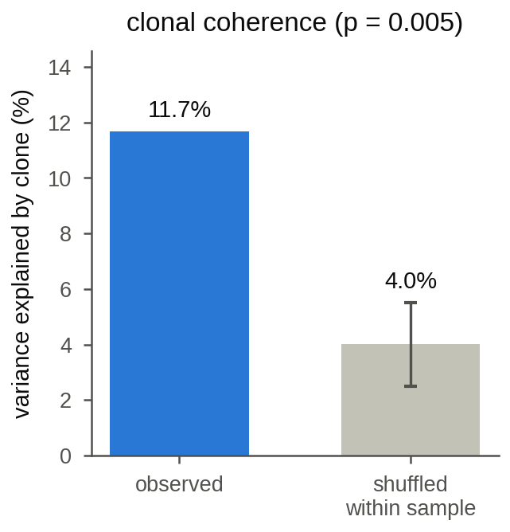

## Clone map: clone size

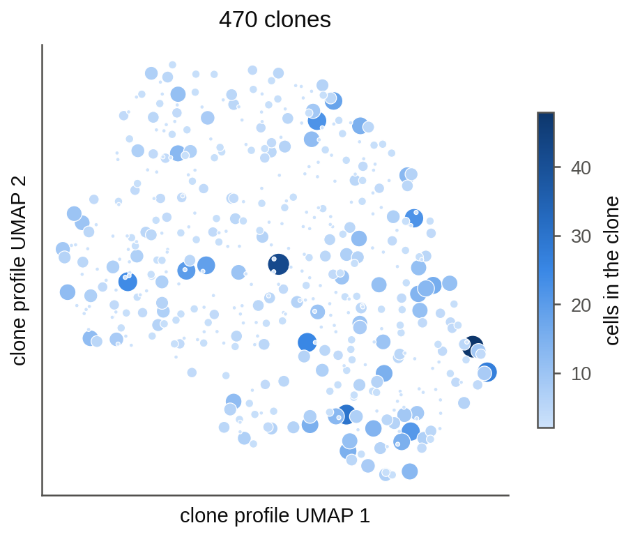

## Clone map: profile reliability

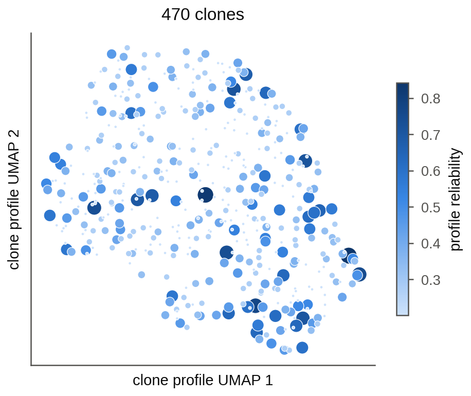

## Clone map: donor

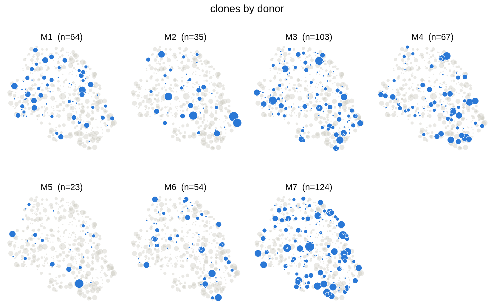

## Clone map: division_gate

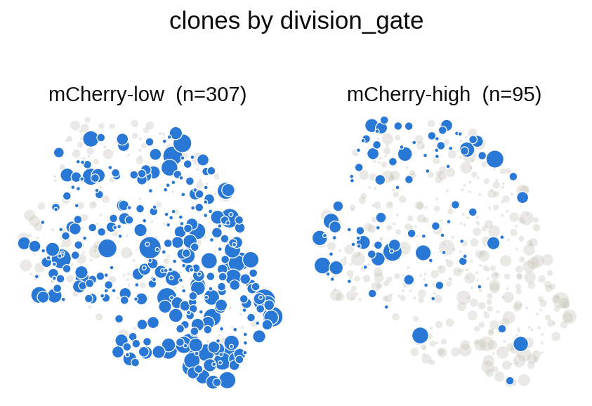

## Clone map: isotype

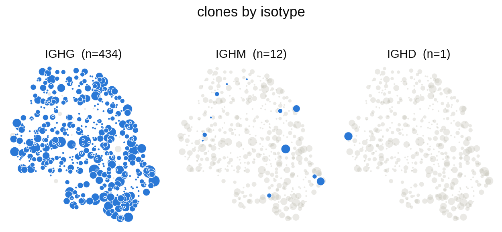

## Label effects

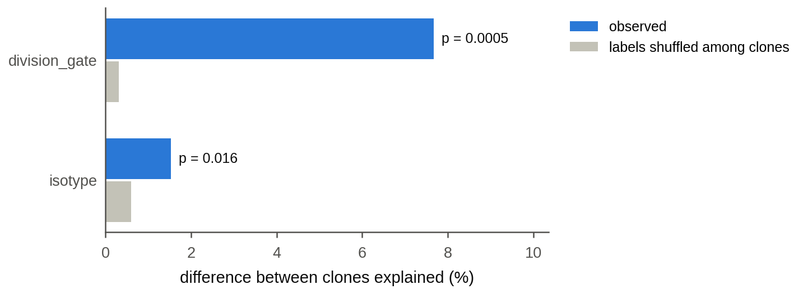

## Clonal memory over division_gate

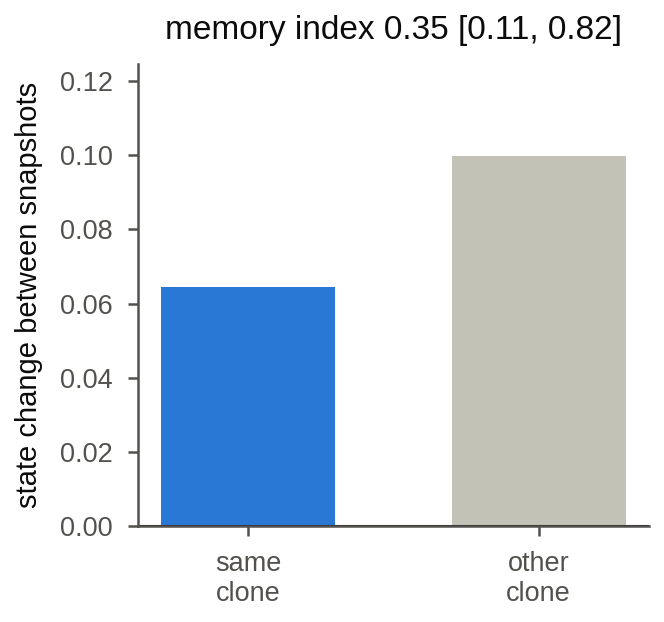

## Gene heritability

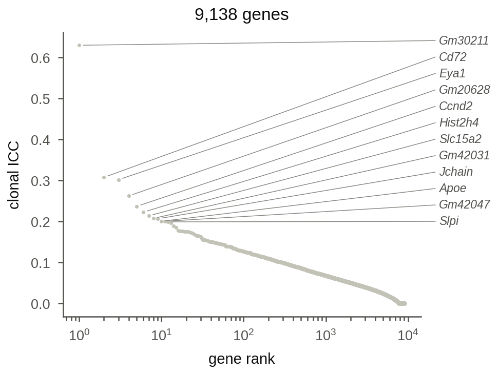

## Cells: division_gate

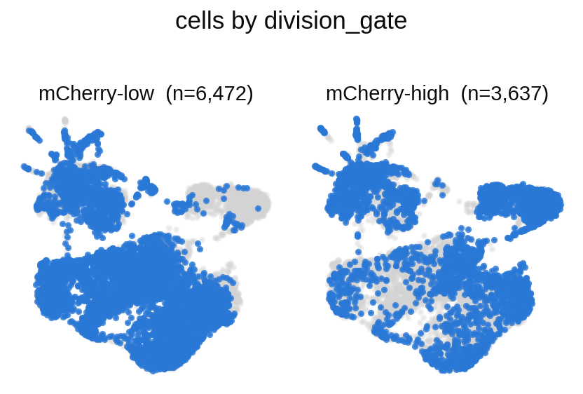

## Cells: isotype

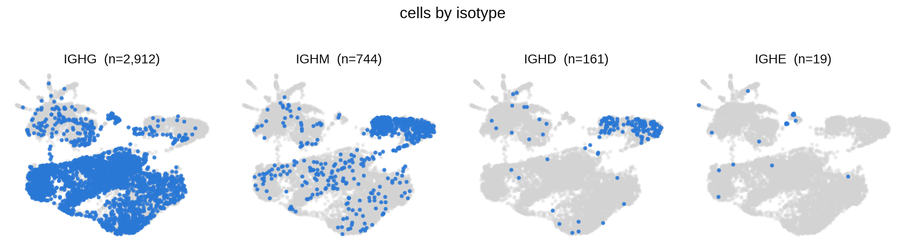
