# GSE203132 spontaneous GCs (`spont_gc`)

threadfin 4.6.0 · 22,898 cells · 1,053 clones with two or more cells · clonal ICC 0.279 (shuffled 0.026, P = 0.005) · 3 programmes

The run: `tf.run(adata, bcr=contigs, donor_key="donor", sample_key="donor", strata_key="sample", test=["isotype"], n_jobs=8)` ([`run_dataset.py`](../../run_dataset.py)); the figures are drawn from the kept result by [`make_gallery.py`](../../make_gallery.py).

| figure | what it shows |
|---|---|
| [Overview (`result.plot()`)](#overview-resultplot) | The figure that `result.plot()` saves: (a) clonal programmes on the clone map, (b) clonal coherence, (c) programme stability, (d) programme sizes. |
| [Clonal coherence](#clonal-coherence) | Share of transcriptional variance explained by clone identity (clonal ICC), observed and with clone labels shuffled within each `sample` (bar: mean of 200 permutations; whisker: their central 95 %). |
| [Clone map: programmes](#clone-map-programmes) | The clone map (UMAP of clone profiles; one point per clone, area by its number of cells) coloured by clonal programme, one panel per programme, every other clone in grey. |
| [Clone map: clone size](#clone-map-clone-size) | The clone map coloured by the number of cells of each clone. |
| [Clone map: profile reliability](#clone-map-profile-reliability) | The clone map coloured by the reliability of each clone's profile (0 to 1; it grows with the number of cells sampled from the clone). |
| [Clone map: donor](#clone-map-donor) | The clone map coloured by donor, one panel per donor, every other clone in grey. |
| [Clone map: isotype](#clone-map-isotype) | The clone map coloured by `isotype`, the level held by at least half of each clone's cells, one panel per level, every other clone in grey (clones without such a majority appear only in grey). |
| [Programme stability](#programme-stability) | Bootstrap stability of each programme (mean Jaccard overlap with the best-matching group over 30 bootstrap replicates), with the 0.75 (stable) and 0.6 guides. |
| [Programme composition: isotype (cells)](#programme-composition-isotype-cells) | For each programme (one bar), the fraction of the programme's cells in each level of `isotype` (levels beyond the seventh pooled as 'other'). |
| [Programme composition: isotype (clones)](#programme-composition-isotype-clones) | For each programme (one bar), the mean over the programme's clones of each clone's fraction of cells in each level of `isotype`, so that every clone counts once (levels beyond the seventh pooled as 'other'). |
| [Label effects](#label-effects) | For each tested label, the share of the variance between clone profiles that it explains (blue) and the same with the label shuffled among clones of the same donor and of similar size (grey), with the permutation P value. |
| [Programme association: isotype](#programme-association-isotype) | Clone-level association of each programme with `isotype`: Mantel-Haenszel odds ratio within donor x clone-size bins with its 95 % CI, one panel per level. Filled markers: FDR < 0.05. |
| [Gene heritability](#gene-heritability) | Clonal ICC of every gene expressed in at least 5 % of the cells of clones with two or more cells (receptor genes excluded), by rank; the 12 highest are named (`tl.gene_heritability` with its defaults). |
| [Cells: programmes](#cells-programmes) | Cells on a UMAP of the embedding the run used (`X_threadfin`): the cells of each programme's clones, one panel per programme, on the grey of all cells. |
| [Cells: isotype](#cells-isotype) | Cells on a UMAP of the embedding the run used (`X_threadfin`): the cells of each level of `isotype`, one panel per level, on the grey of all cells. |
| [Marker signatures by programme](#marker-signatures-by-programme) | Mean log-normalised expression of the case-study marker sets (plasma cell, germinal centre, dark zone / cycling, light zone, memory, naive, interferon) in the cells of each programme, z-scored across programmes. |

## Overview (`result.plot()`)

## Clonal coherence

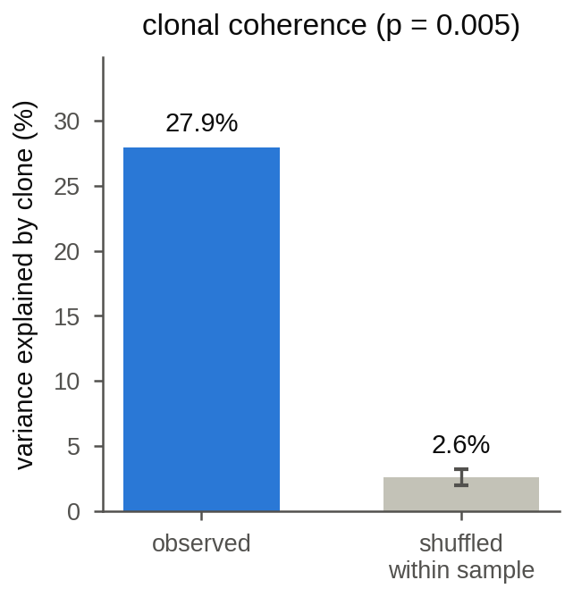

## Clone map: programmes

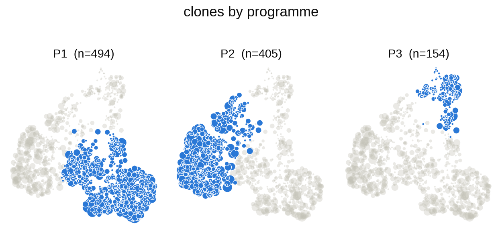

## Clone map: clone size

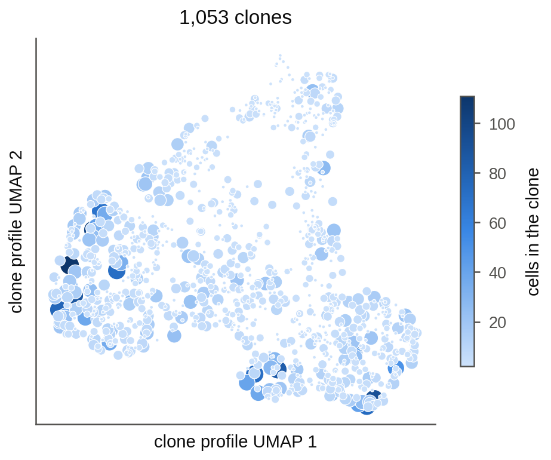

## Clone map: profile reliability

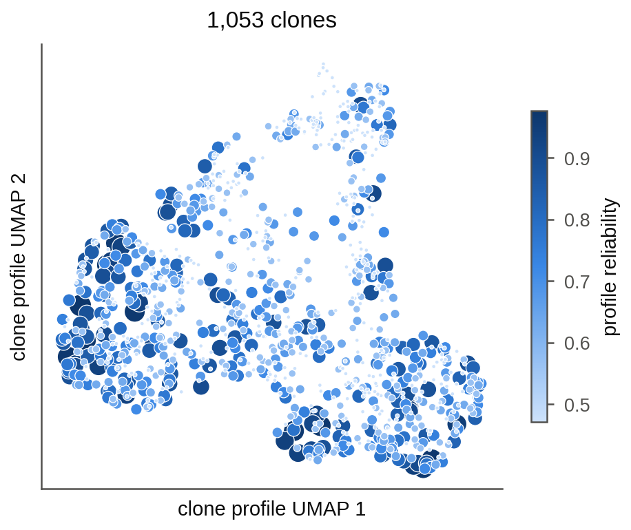

## Clone map: donor

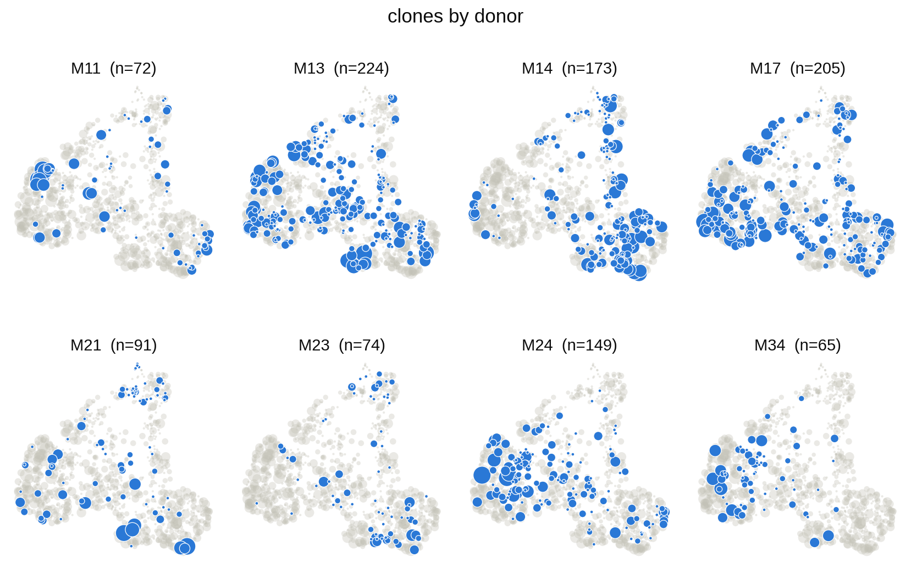

## Clone map: isotype

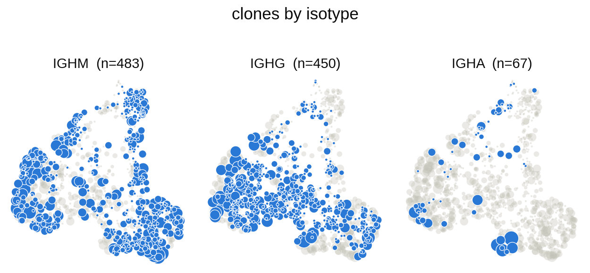

## Programme stability

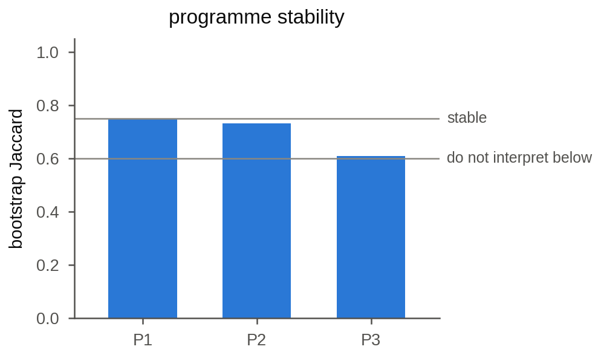

## Programme composition: isotype (cells)

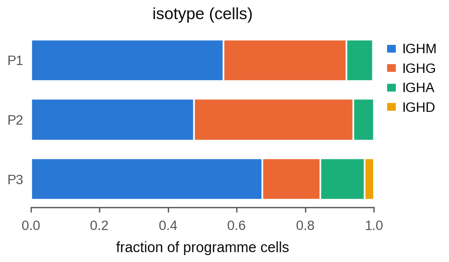

## Programme composition: isotype (clones)

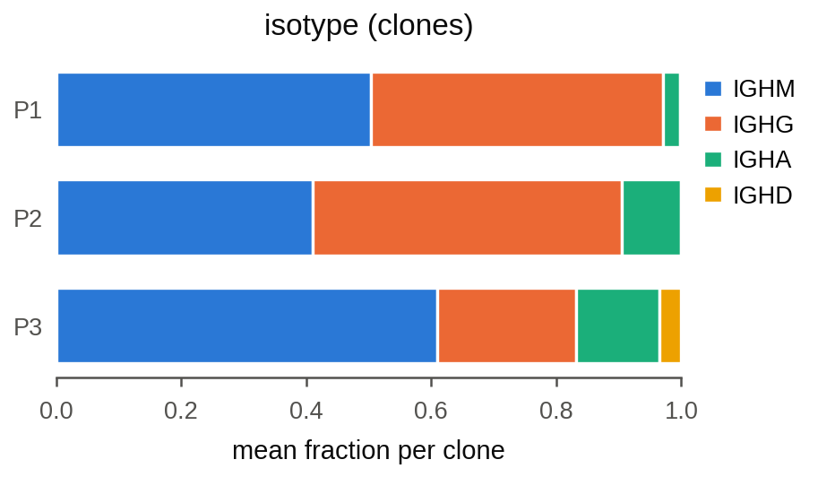

## Label effects

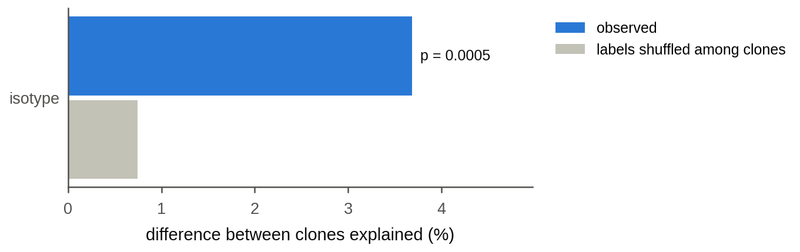

## Programme association: isotype

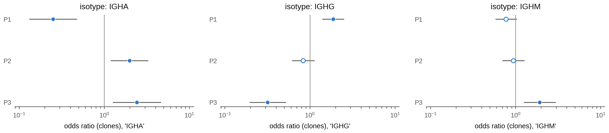

## Gene heritability

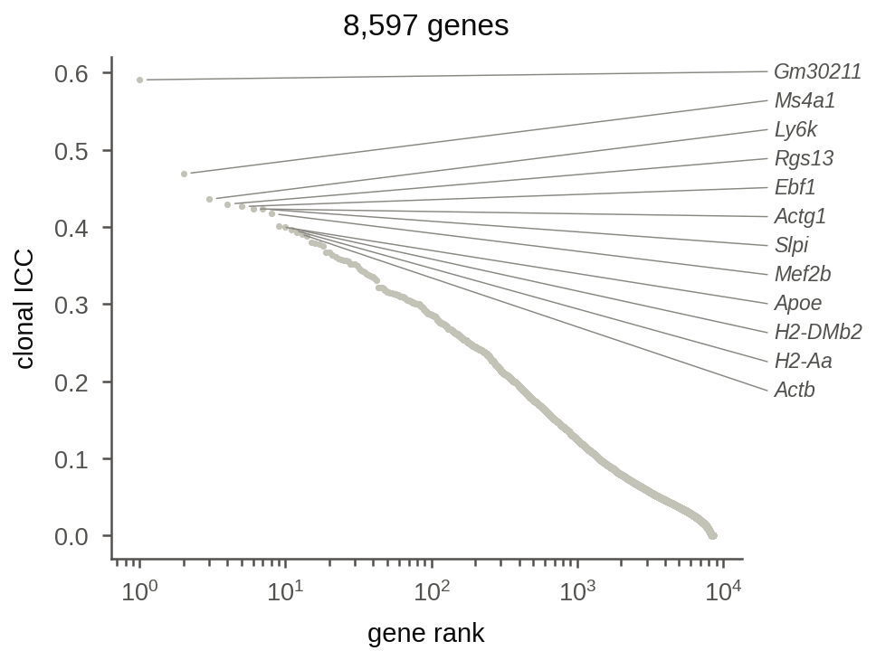

## Cells: programmes

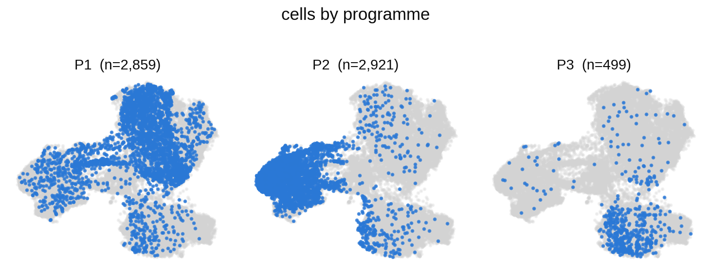

## Cells: isotype

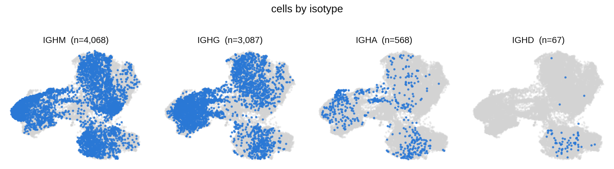

## Marker signatures by programme

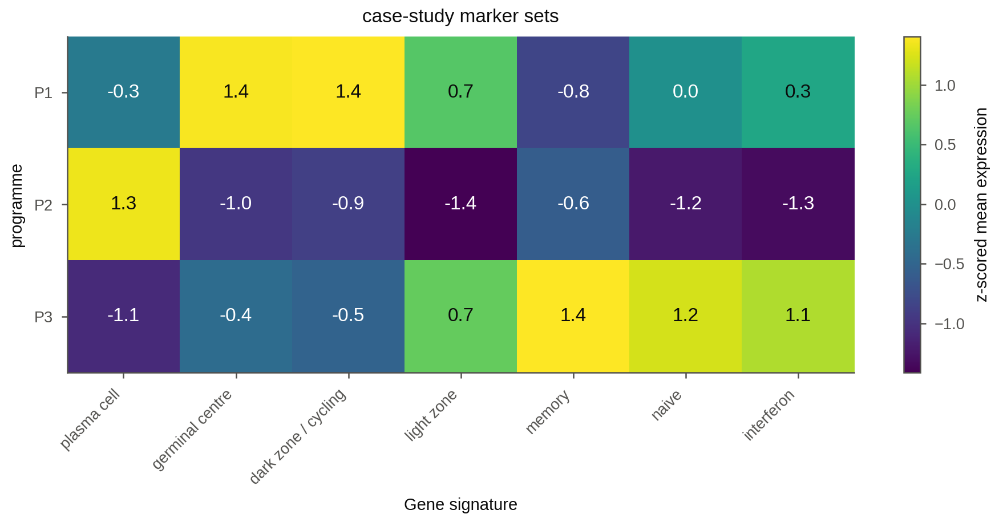
