# Benchmark: Threadfin, Clonotrace, clone2vec, Benisse, CoNGA's reduction and scirpy

This folder is an end-to-end comparison of Threadfin with the published tools that turn paired single-cell
RNA + lineage (BCR or barcode) data into a description of **clones**, run on the same data with the same
inputs. It was built on 2026-10-20 for the manuscript; every number below comes from the tables in
[`results/`](results/) and every figure from [`figures/`](figures/), and both can be regenerated from the
scripts in [`scripts/`](scripts/) (section 9).

The benchmark asks practical questions a user would ask before choosing a tool, and reports every answer —
including the ones where Threadfin is not the best.

**Contents**

0. [The benchmark at a glance](#0-the-benchmark-at-a-glance)
1. [Summary in plain words](#1-summary-in-plain-words)
2. [The tools and the question each one answers](#2-the-tools-and-the-question-each-one-answers)
3. [How the comparison was kept fair](#3-how-the-comparison-was-kept-fair)
4. [Datasets](#4-datasets)
5. [Tasks and how each is scored](#5-tasks-and-how-each-is-scored)
6. [Results](#6-results)
7. [What this benchmark does not show](#7-what-this-benchmark-does-not-show)
8. [Capability matrix](#8-capability-matrix)
9. [Reproducing the benchmark](#9-reproducing-the-benchmark)
10. [Files](#10-files)

---

## 0. The benchmark at a glance

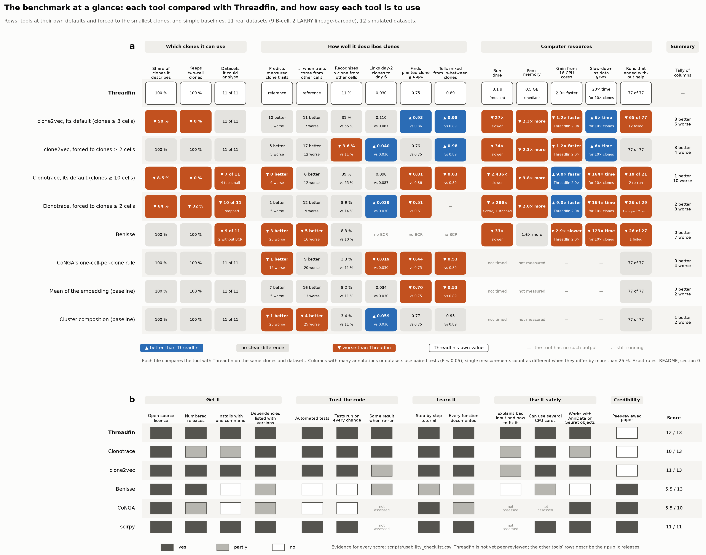

**How to read it.** In panel **a**, each row is a tool — at its own default and, where it matters, forced down
to clones of two cells — or one of three simple baselines. Each column is one question of the benchmark, in
plain words, grouped as in section 6 (the calibration of clonal tests, which only Threadfin, scirpy and a
cell-level ANOVA address, is in section 6.6). Every tile compares the tool with
Threadfin on the same clones and datasets: **blue ▲** better than Threadfin, **grey** no clear difference,
**orange ▼** worse, with the number behind the verdict ("vs" gives Threadfin's value on the same clones);
Threadfin's own row gives its value. Runs that failed, were stopped or needed help are counted, never dropped.
Panel **b** is a usability checklist in the spirit of the software-quality checklists of earlier benchmarks
(Saelens *et al.* 2019, *Nat. Biotechnol.*; the spatial-alignment benchmark of *Nat. Comput. Sci.* 2026,
s43588-026-00977-z, Fig. 4): 1 = yes, 0.5 = partly, 0 = no, with the evidence for every score in
[`scripts/usability_checklist.csv`](scripts/usability_checklist.csv). The figure is drawn by
[`scripts/make_overview.py`](scripts/make_overview.py) from the tables in [`results/`](results/)
(`results/overview.csv` lists every tile with its test).

**What it shows, in plain words.**

* **Which clones a tool can use is the largest difference.** At their defaults, Threadfin and Benisse describe
  every clone with two or more cells; clone2vec (≥ 3 cells) describes a median 50 % and none of the two-cell
  clones, and Clonotrace (≥ 10 cells) a median 8.5 %, and could not be run on 4 of the 11 datasets.
* **On measured clone traits, Threadfin, clone2vec forced to two-cell clones and a plain mean of the embedding
  cannot be told apart.** Clonotrace at its default and Benisse recover fewer annotations; CoNGA's one-cell
  rule and cluster composition recover fewer as well.
* **Threadfin is not best everywhere.** In simulation, clone2vec separates mixed from in-between clones
  better and, at its default, also groups clones by their planted programme better; clone2vec, Clonotrace
  forced to two-cell clones and the cluster-composition baseline link day-2 LARRY clones to their day-6
  descendants slightly better; clone2vec's run time grows more slowly with the number of clones; and
  Clonotrace gains more from extra cores (2.7 times faster from 4 to 16 cores, against Threadfin's 2.0 from 1
  to 16).
* **Cost and reliability.** clone2vec takes about 30 times and Benisse 33 times Threadfin's time for the
  clone representation; Clonotrace 290–2,400 times. One Clonotrace run (11,141 clones) was stopped after
  72 h and four needed a larger cell graph to finish; clone2vec at its default failed on 12 of 77 runs (small
  inputs) and Benisse on 1 of 27. Benisse becomes slower with more cores (2.9 times slower on 16 cores than on
  one) and needed 35 GB for 5,570 clones. The complete Threadfin analysis — profiles, test, clone map,
  programmes — takes 18 s to 9.5 min in one process and under 2.3 GB (section 6.9).
* **Ease of use.** Threadfin scores 12 of 13 on the checklist: it is not yet peer-reviewed. scirpy (11 of 11 assessed) and clone2vec (11 of 13) are the most mature of the other tools.

How each column's verdict is reached:

<!-- BEGIN:overview_rules -->

| column | how the verdict is reached |
|---|---|
| Share of clones it describes | median over the 11 datasets of the share of clones with ≥ 2 cells that the tool represents; a run that failed, stopped or could not start counts as 0. Better or worse: more than 5 percentage points from Threadfin. |
| Keeps two-cell clones | the same for clones of exactly two cells. |
| Datasets it could analyse | datasets (of 11) on which the tool produced a result. |
| Predicts measured clone traits | measured annotations that no tool used (sorting gates, isotype, mutation, tissue, time, later fate; RNA-derived calls excluded), each scored on the clones the tool represents: the tool is better (worse) on an annotation when the 95 % paired bootstrap interval of R² − R²(Threadfin) excludes 0. Column verdict: two-sided sign test of better vs worse annotations, P < 0.05. |
| … when traits come from other cells | as above, but the representation and the annotation come from disjoint halves of each clone's cells (3 random splits, both directions); sign test over annotations. |
| Recognises a clone from other cells | share of clones whose representation from one half of their cells is nearest to their own other half (median over datasets); Wilcoxon signed-rank test over datasets. |
| Links day-2 clones to day 6 | LARRY: mean reciprocal rank of each day-4 clone's own day-6 clone among all day-6 clones; 95 % paired bootstrap interval over clones. |
| Finds planted clone groups | simulated data with a known answer: share of clones whose nearest clone has the same planted programme; Wilcoxon over simulated datasets. |
| Tells mixed from in-between clones | AUROC for telling clones made of two kinds of cells from clones of cells halfway between them (clones ≥ 10 cells); Wilcoxon over simulated datasets. |
| Run time | time to compute the clone representation, divided by Threadfin's on the same dataset (median); Clonotrace: only runs whose clone distances used several R sessions, a run stopped at 72 h counted as 72 h. Better or worse: every ratio beyond 25 % in the same direction, otherwise a Wilcoxon test on the log ratios (≥ 6 datasets). |
| Peak memory | peak memory, the same way. |
| Gain from 16 CPU cores | time with 1 core divided by time with 16 cores (GSE287123 RBD; Threadfin: its complete analysis). Better or worse: more than 25 % from Threadfin's gain. |
| Slow-down as data grow | how much longer the clone representation takes for 10 times more clones, from 5-50 % subsets of GSE195673 (8 cores). Better or worse: an exponent more than 0.25 from Threadfin's. |
| Runs that ended without help | runs on the full data and on the disjoint halves that finished with the tool's default settings; failed or stopped runs, and runs that needed a larger cell graph, are counted against the tool. |

<!-- END:overview_rules -->

The usability checklist as a table (evidence for every entry in `scripts/usability_checklist.csv`):

<!-- BEGIN:usability -->

| criterion | Threadfin | Clonotrace | clone2vec | Benisse | CoNGA | scirpy |
|---|---|---|---|---|---|---|
| Open-source licence | yes | yes | yes | yes | yes | yes |
| Numbered releases | yes | partly | yes | yes | partly | yes |
| Installs with one command | yes | partly | yes | no | no | yes |
| Dependencies listed with versions | yes | yes | yes | partly | partly | yes |
| Automated tests | yes | yes | yes | no | no | yes |
| Tests run on every change | yes | yes | yes | no | no | yes |
| Same result when re-run | yes | yes | partly | partly | n.a. | n.a. |
| Step-by-step tutorial | yes | yes | yes | partly | yes | yes |
| Every function documented | yes | yes | yes | partly | partly | yes |
| Explains bad input and how to fix it | yes | partly | partly | no | n.a. | n.a. |
| Can use several CPU cores | yes | yes | yes | partly | n.a. | yes |
| Works with AnnData or Seurat objects | yes | partly | yes | no | yes | yes |
| Peer-reviewed paper | no | no | no | yes | yes | yes |

<!-- END:usability -->

---

## 1. Summary in plain words

* **The tools answer different questions.** Threadfin describes each clone by the distribution of its
  cells' transcriptional states and tests whether clone identity explains cell state. Clonotrace
  measures how far apart expanded clones are on the cell-state graph after spreading each clone's label
  over neighbouring cells. clone2vec learns a clone embedding from which clones' cells are neighbours. Benisse
  embeds receptor *sequences* and refines that embedding with expression. CoNGA (whose reduction rule is
  used here) represents each clone by one cell. scirpy's clonotype modularity scores each clone for being
  more connected in the cell graph than random cells.
* **Coverage is the largest difference.** At their own defaults Threadfin and Benisse represent every clone
  with ≥ 2 cells; clone2vec (≥ 3 cells) leaves out every two-cell clone — 28–86 % of the analysable clones
  depending on the dataset — and Clonotrace (≥ 10 cells) can describe only the 5–18 % of clones that reach
  ten cells and cannot run at all on 4 of the 11 datasets. Forced down to two-cell clones, clone2vec covers
  everything, but Clonotrace still discards 24–47 % of the clones (39–84 % of the two-cell clones) after
  label spreading.
* **Two-cell clones do carry information — and not only for Threadfin.** On two-cell clones alone, the
  measured annotations are predicted with a median R² of 0.25 by Threadfin, 0.26 by clone2vec when it is
  forced to include them, and 0.26 by a plain mean of the cells' embedding coordinates. The information is
  in the data; what Threadfin adds is that it uses these clones by default, weights them by how many cells
  were sampled, and tests them at the right error rate. The statement "only Threadfin can use two-cell
  clones" is true of the tools' **defaults**, not of what the data allow.
* **No representation is uniformly best at recovering measured annotations.** Scored on the same clones,
  clone2vec forced to ≥ 2 cells beat Threadfin on 6 of 41 annotations and lost on 10; at its own
  default (≥ 3 cells) it won 10 and lost 7. A plain mean of the embedding won 7 and lost 10. Clonotrace
  won 1 and lost 8 of 30 when forced to ≥ 2 cells, and won none and lost 8 of 26 at its default (≥ 10
  cells), with its default distance. Benisse lost 22 of 31, but won
  the three annotations that are properties of the receptor sequence (RBD-bait binding, V-region mutation,
  the W33L affinity mutation) — the question it was built for.
* **Threadfin's clonal test holds its error rate where the alternatives do not.** With clone labels shuffled
  within each sample (no clonal signal, but the real differences between samples kept), Threadfin's
  coherence test rejected in 0–8 % of replicates at α = 5 %; scirpy flagged at least one clone in 100 % of
  replicates in 4 of 9 datasets, and a cell-level ANOVA rejected in 86–100 %.
* **Reproducible across disjoint cells of the same clone.** Represented from two disjoint halves of its
  cells, a clone is its own best match among all clones for a median of 8 % of clones with Threadfin and
  with a plain mean (chance under 1 %), 3 % with clone2vec, and about as often as Threadfin with Clonotrace
  on the datasets where both ran; Benisse keeps the clone–clone distances best, by construction, because
  both halves share the receptor sequence it is built from. Recognising a LARRY barcode two days later is hard
  for every method (top-1 at most 6 % among thousands of candidates, all far above chance).
* **On simulated data with a known answer, Threadfin is not the best at grouping clones.** clone2vec and a
  cell-cluster-composition baseline group clones by their true programme more accurately, and separate a
  "mixed" clone (half GC, half plasma cells) from an "intermediate" clone (all cells halfway) better —
  the distinction Threadfin's kernel profile was designed for (AUROC with ≥ 10 cells per clone: 0.99 and
  0.96 vs 0.88; Clonotrace 0.62 with its default distance, 0.81 with the published one). With small clones
  no method separates the two (AUROC 0.39–0.66). Threadfin's donor
  centring removes an additive donor shift exactly (results identical with and without it), but the
  simulated donor effect is purely additive, the easiest possible case, and centring itself creates some
  same-donor structure when donors differ in clone composition.
* **Cost.** Building Threadfin's clone profiles took 0.2–43 s and < 2.5 GB per dataset; clone2vec
  0.5–11 min; Benisse 6 s–19 min (up to 32 GB); Clonotrace from a minute to more than a day: 18 h for the
  1,139 expanded LARRY clones and 31 h for the 6,174 LARRY clones forced to ≥ 2 cells (4–6 workers), and the
  run on the 11,141 lymph-node clones was stopped after 72 h. Its clone-distance step grows with the number
  of clones and with how widely label spreading spreads each clone — 7 h for only 31 expanded clones in
  GSE171703, where each of them spreads over much of the graph. With 16 instead of 1 core, Threadfin's
  complete analysis ran 2.0 times faster, clone2vec 1.2 times and Benisse 2.9 times slower; for ten times
  more clones, Threadfin's clone profiles took 20 times longer, clone2vec 6 times, Clonotrace 110 and
  Benisse 123 times (section 6.9). Threadfin and Clonotrace gave identical results with any number of cores;
  clone2vec and Benisse differed slightly (clone-distance correlation ≥ 0.9999).

What this means for the manuscript is in section 7 and in [`../README.md`](../README.md).

<!-- BEGIN:status -->

*Status of the full-data runs when these tables were generated (2026-10-24 10:09, Melbourne time).*

Still running: none.

Failed (each with the reason the tool gave): none.

Stopped before completion: Clonotrace (forced to ≥ 2 cells) on Human LN vaccine — stopped after 72 h: bootstrap label spreading took 15 h on 4 workers; the clone-distance step (one process in this run) had been running for 57 h when it was stopped on 2026-10-23. For comparison, LARRY days 4/6 (6,174 eligible clones, 4,693 kept) needed 29 h of clone distances on 6 workers; this dataset has 11,141 eligible clones. A rerun with more workers was still running when this table was made.

Split-half runs still running (sections 6.4–6.5 use the halves that are complete): none.

<!-- END:status -->

---

## 2. The tools and the question each one answers

| tool | version run | what one clone becomes | default minimum clone size | question it answers |
|---|---|---|---|---|
| **Threadfin** | 4.3.1 (this repository) | a profile: the mean of random Fourier features of its cells' states (a kernel mean embedding), cells centred on their donor, smoothed over 15 neighbouring cells, shrunk towards the donor average by the number of cells | 2 | Do cells of one clone share a state, beyond how they were sampled? Which annotations explain differences between clones? |
| **Clonotrace** (Fu *et al.* 2025, bioRxiv 10.1101/2025.09.01.673503) | 1.2.1, commit 158a7b2 | a column of cell-to-clone probabilities after bootstrap label spreading on the cell graph; two clones are compared by the mean graph distance from each cell of one clone to its two nearest cells of the other (both directions) — the vignette's fast approximation of an optimal-transport distance — blended in 1.2.1 with the distance between clone centroids (`revised = TRUE`) | 10 (the vignette's "expanded clones", `count >= 10`) | How different are two expanded clones' distributions over the cell-state graph? |
| **clone2vec** (Isaev *et al.* 2026, kharchenkolab/clone2vec) | 0.1.1 (PyPI) | a 10-dimensional vector learned by a skip-gram model from which clones' cells are nearest neighbours | 3 | Which clones occupy similar regions of the cell embedding? |
| **Benisse** (Zhang *et al.* 2022, *Nat. Mach. Intell.*; wooyongc/Benisse) | 1.1.0, commit f0ff4c1 | a point in a latent space of receptor sequences (heavy-chain CDR3 encoder) refined by a sparse graph supervised by expression | every clonotype | Which receptor sequences go with which expression profiles? |
| **CoNGA** reduction (Schattgen *et al.* 2022, *Nat. Biotechnol.*) | rule of `conga.preprocess.reduce_to_single_cell_per_clone` (0.1.2), re-implemented on the shared embedding | its most central cell (the cell with the smallest summed distance to the clone's other cells) | 1 | (CoNGA then tests graph-vs-graph overlap; only its clone reduction is benchmarked) |
| **scirpy** clonotype modularity (Sturm *et al.* 2020) | 0.22.5 | a per-clone score: how many more edges join the clone's cells in the cell neighbour graph than join random cells | 2 | Which individual clones are more transcriptionally connected than random cells? |
| baseline: **mean of the embedding** | — | the plain mean of its cells' embedding coordinates | 2 here | — |
| baseline: **cluster composition** | — | the fractions of its cells in each Leiden cluster of all cells (square-root transformed) | 2 here | — |

Two further published tools were considered and not run: **CellRank/CoSpar**-style clonal fate inference
(answers fate probabilities of *cells*, not a clone representation) and **Dandelion**'s own analysis
modules (Threadfin already uses Dandelion for clone definition; Dandelion has no clone-state
representation).

---

## 3. How the comparison was kept fair

1. **Identical inputs.** Every tool received the same cell embedding (30 principal components of
   log-normalised expression with immunoglobulin and T-cell-receptor genes removed — the embedding of the
   manuscript), the same clone ids (Dandelion, heavy + light chain, called within donors), the same donors
   and samples ([`scripts/prepare_inputs.py`](scripts/prepare_inputs.py)). Benisse needs receptor sequences
   and expression values, so it also received each cell's heavy-chain V gene, J gene and CDR3 amino-acid
   sequence and the log-normalised expression of the same 3,000 highly variable genes from which the
   embedding was computed.
2. **Each tool's documented defaults**, taken from its tutorial or README at the version above, and
   recorded per run in `run.json`. Where a default could not be run on these data, the change is listed in
   the table below — none of the changes was chosen by looking at a benchmark result.
3. **Two settings per tool where the minimum clone size matters.** Every tool was run at its own default
   ("native") and forced down to clones of ≥ 2 cells ("forced"), so that a difference between tools cannot
   come only from which clones each is allowed to see.
4. **The same clones in every comparison.** A comparison between Threadfin and another tool uses exactly the
   clones that the other tool represents (pairwise common sets), so a tool that drops clones is scored on
   the clones it kept, and Threadfin on the same ones. How many clones each tool keeps is reported
   separately (coverage), never folded into the accuracy scores.
5. **Annotations that no tool used.** The scored annotations (sorting gates, isotype, V-region mutation,
   tissue, time point, later fate) were never given to any tool. Annotations that are themselves derived
   from the expression data (cell-type calls, marked "(RNA)") are easy by construction and are shown
   separately.
6. **Donor-centred scoring.** Annotation values are centred within donor before scoring, so no tool gains
   by separating donors, and permutation nulls shuffle values among clones of the same donor.
7. **Every failure is reported.** Runs that failed or could not be started are listed with the reason. A
   failed run was repeated only to apply the remedy the tool itself prints (a larger cell graph when
   Clonotrace reports a disconnected graph), never to obtain a better score.
8. **Same resources.** Each tool ran with 4 CPU threads (Clonotrace: 4 parallel R sessions) on the same
   type of node (University of Melbourne Spartan cluster, 128-core Intel Xeon Sapphire Rapids nodes with
   1–4 TB of memory, shared with other jobs, so times are indicative to within a factor of about two).

| tool | change from its tutorial, and why |
|---|---|
| Clonotrace | Label spreading, sparsification and the approximate clone distance exactly as in the vignette. (a) When the default cell graph for distances (k = 10) was disconnected, Clonotrace stops and advises a larger k; the run then retried k = 30 and k = 50 and recorded the k used. (b) Clones that keep no cell with probability ≥ 0.1 after label spreading make `clone_disance()` stop; they are removed and counted as lost coverage. (c) The first full-data runs computed the clone distances in one R session instead of the vignette's parallel plan; the distances are identical (verified pair by pair on the NP dataset, 49,455 pairs, and on LARRY days 4/6, 648,091 pairs) but those runs' times are single-process and are marked † in the runtime table. Later runs use 4 parallel sessions (6 for the LARRY run forced to ≥ 2 cells); where both versions exist, the tables use the parallel one. (d) The run forced to ≥ 2 cells on GSE195673 (11,141 clones) was stopped after 72 h (15 h of label spreading, then 57 h of clone distances in one process). |
| clone2vec | Documented defaults (`clonal_nn` k = 15, 10 dimensions). Its `split_by` option was not used: it builds a separate graph per category, which for donor-private clones disconnects the clone graph. |
| Benisse | Its README allows a dimension reduction instead of expression, but its initialisation takes 10 principal components of the 10 % most variable rows, which fails on a 30-dimensional embedding; it therefore received log-normalised expression of the 3,000 highly variable genes (as its README recommends). Benisse's unit is the exact clonotype (V + CDR3 + J), finer than a clone; clone-to-clone distances are the mean latent distance over all pairs of the two clones' cells. Run on clones ≥ 2 cells, except ≥ 10 cells on the largest dataset (11,141 clones; its optimisation scales with the square of the number of clonotypes). Not run on LARRY (no receptor). |
| CoNGA rule | Applied to the shared embedding; CoNGA's own pipeline recomputes 50 principal components on its own normalisation. |
| scirpy | `clonotype_modularity(permutation_test="approx")` on a 15-nearest-neighbour graph of the shared embedding; a dataset is counted as "clonal structure found" when at least one clone has FDR < 0.05. This dataset-level reading is ours — scirpy reports per-clone results — and the per-clone false-discovery share is reported too. |

---

## 4. Datasets

Nine B-cell datasets of the manuscript's case studies (paired RNA + BCR, clones = Dandelion clones within
donors) and two from LARRY lentiviral barcoding of mouse haematopoietic progenitors (Weinreb *et al.* 2020),
the dataset of Clonotrace's own tutorial, where a clone is a heritable barcode — ground truth that does not
depend on any receptor-based clone definition.

*A correction made during the benchmark.* Benisse received heavy-chain CDR3 sequences for only 29 % of the
cells in GSE171703's clones. The cause: that dataset's stored clone ids included Dandelion's
light-chain-only groups (cells without a heavy chain grouped by their light chain alone), 1,689 of its 2,281
"clones" with two or more cells. These groups are not clones; they were removed (592 clones with ≥ 2 cells
remain), and **every tool was re-run on the corrected input**. The same defect was fixed in threadfin 4.3.1
and in the case studies (see the [record of defects](../analyses/negative_and_withdrawn_results.md)); the
other eight B-cell datasets contain at most one such group (a two-cell group among the 1,887 RBD clones,
left in place).

<!-- BEGIN:datasets -->

| dataset | study | accession | cells | clones ≥ 2 cells | ≥ 10 cells | donors / samples | annotations scored |
|---|---|---|---|---|---|---|---|
| Gut GC reporter | Siniscalco et al. 2025 Immunity | GSE284622 | 16,619 | 958 | 119 | 3 / 17 | GC-fate sort (tdTomato+); lamina propria; IgA; IgG; V-region mutation; plasma cell (RNA) |
| RBD reporter | Merkenschlager et al. 2025 Nature | GSE287123 | 36,188 | 1,887 | 160 | 10 / 40 | recently divided (mCherry-low); RBD-bait+; dark-zone gate; IgG; V-region mutation |
| NP reporter | Merkenschlager et al. 2025 Nature | GSE287123 | 10,109 | 471 | 41 | 7 / 14 | recently divided (mCherry-low); W33L; IgG; V-region mutation |
| GC + plasma cells | ElTanbouly et al. 2024 J. Exp. Med. | GSE246382 | 884 | 96 | 1 | 11 / 11 | plasma-cell sort; W33L; V-region mutation |
| Plasmodium d10-42 | Skinner et al. 2026 Nat. Immunol. | GSE286215 (exp. 2) | 72,359 | 1,015 | 0 | 42 / 42 | IgG; V-region mutation; GC B cell (RNA); plasmablast (RNA) |
| Plasmodium d0-14 | Skinner et al. 2026 Nat. Immunol. | GSE286215 (exp. 1) | 40,623 | 523 | 0 | 20 / 20 | IgG; V-region mutation; GC B cell (RNA); plasmablast (RNA) |
| Human LN vaccine | Kim et al. 2022 Nature | GSE195673 | 193,442 | 11,141 | 1,243 | 8 / 56 | blood (vs lymph node); spike binding; IgG; IgA; V-region mutation; days after vaccination; GC B cell (RNA) |
| Spontaneous GC | Castrillon et al. 2023 eLife | GSE203132 | 22,898 | 1,051 | 127 | 8 / 8 | IgG; IgA; V-region mutation |
| Human COVID-19 | Dugan et al. 2021 Immunity | GSE171703 | 61,423 | 592 | 31 | 37 / 36 | IgG; IgA |
| LARRY d2 | Weinreb et al. 2020 Science | GSE140802 | 28,249 | 1,401 | 0 | — / — | day-6 neutrophil fraction; day-6 monocyte fraction; day-6 neutrophil share (of neu + mono) |
| LARRY d4/d6 | Weinreb et al. 2020 Science | GSE140802 | 44,664 | 6,174 | 1,139 | — / — | re-identify a barcode's day-6 clone from day 4 |

<!-- END:datasets -->

---

## 5. Tasks and how each is scored

| task | what is measured | why it matters |
|---|---|---|
| **T1 Coverage** | how many of a dataset's clones with ≥ 2 cells (and with exactly 2) a tool represents | a clone that is not represented cannot be studied; most clones in B-cell data are small |
| **T2 Annotation recovery** | each clone's measured annotation (e.g. fraction of its cells in a sort gate) predicted as the mean over its 10 nearest clones in the tool's representation; R² against the truth, permutation null (values shuffled among clones of the same donor, 199 permutations), and a paired bootstrap interval (1,000 resamples of clones) of the difference to Threadfin; also R² on two-cell clones only | a representation is useful if clones that are close in it are biologically alike in ways that were measured independently |
| **T3 Annotation recovery with disjoint cells** | as T2, but the representation is built from one half of every clone's cells and the annotation measured on the other half (3 random splits × 2 directions) | rules out that a tool scores well only because the same cells define both the representation and the annotation |
| **T4 Split-half reproducibility** | the same clones represented from two disjoint halves of their cells: Spearman correlation of all clone–clone distances, overlap of the 10 nearest clones, and how often a clone's own half is its best match among all clones (re-identification) | a representation that changes when other cells of the same clone are sampled describes sampling noise, not the clone |
| **T5 LARRY clone linking** | each day-4 barcode clone's distance to all day-6 clones; is its own barcode's day-6 clone the nearest (top-1), among the 10 nearest (top-10), and mean reciprocal rank | the barcode is ground truth: a good representation of a clone's state should recognise the same clone two days later |
| **T6 Later fate from early state (LARRY)** | day-2 clone representation predicts the fractions of that barcode's day-6 cells that became neutrophils or monocytes (scored as T2) | Clonotrace's motivating question, with an outcome measured on other cells days later |
| **T7 Simulation** | repertoires with known programmes, clone sizes and donor shifts (12 datasets, section 6.7): purity of the 10 nearest clones by true programme, separation of "mixture" from "intermediate" clones (AUROC), excess of same-donor neighbours | the only task with a known right answer |
| **T8 Test calibration and power** | real data with clone labels shuffled (within sample, or across the dataset), 50 replicates each, and with 10–50 % of cells keeping their real label: how often each test reports clonal structure | a test that reports structure in shuffled data cannot be trusted on real data |
| **T9 Cost** | wall time and peak memory of each tool's representation step | what it takes to run |

**How to read R² here.** R² = 1 − (squared error of the prediction) / (variance of the annotation). With
k = 10 neighbours, a representation that carries no information gives R² ≈ −0.1 (the noise of averaging 10
random clones), so 0 is already a little better than chance; the permutation null of every score is in the
tables. R² is computed after centring within donor, so it measures differences *between clones of the same
donor*.

---

## 6. Results

### 6.1 Coverage — which clones can each tool describe?

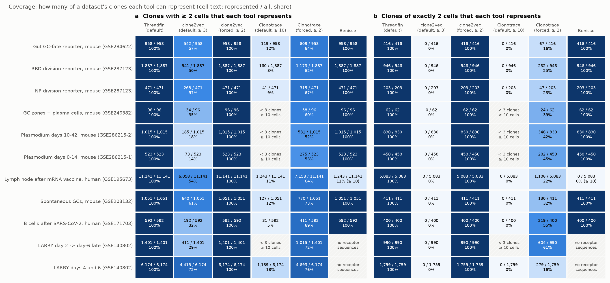

<!-- BEGIN:coverage -->

| dataset | clones ≥ 2 cells | of which 2 cells | Threadfin | clone2vec (default ≥ 3) | clone2vec (forced ≥ 2) | Clonotrace (default ≥ 10) | Clonotrace (forced ≥ 2) | Benisse |
|---|---|---|---|---|---|---|---|---|
| Gut GC reporter | 958 | 416 | 958 (416 two-cell) | 542 (0 two-cell) | 958 (416 two-cell) | 119 (0 two-cell) | 609 (67 two-cell) | 958 (416 two-cell) |
| RBD reporter | 1,887 | 946 | 1,887 (946 two-cell) | 941 (0 two-cell) | 1,887 (946 two-cell) | 160 (0 two-cell) | 1,173 (232 two-cell) | 1,887 (946 two-cell) |
| NP reporter | 471 | 203 | 471 (203 two-cell) | 268 (0 two-cell) | 471 (203 two-cell) | 41 (0 two-cell) | 315 (47 two-cell) | 471 (203 two-cell) |
| GC + plasma cells | 96 | 62 | 96 (62 two-cell) | 34 (0 two-cell) | 96 (62 two-cell) | n/a (< 3 clones ≥ 10 cells) | 58 (24 two-cell) | 96 (62 two-cell) |
| Plasmodium d10-42 | 1,015 | 830 | 1,015 (830 two-cell) | 185 (0 two-cell) | 1,015 (830 two-cell) | n/a (< 3 clones ≥ 10 cells) | 531 (346 two-cell) | 1,015 (830 two-cell) |
| Plasmodium d0-14 | 523 | 450 | 523 (450 two-cell) | 73 (0 two-cell) | 523 (450 two-cell) | n/a (< 3 clones ≥ 10 cells) | 275 (202 two-cell) | 523 (450 two-cell) |
| Human LN vaccine | 11,141 | 5,083 | 11,141 (5,083 two-cell) | 6,058 (0 two-cell) | 11,141 (5,083 two-cell) | 1,243 (0 two-cell) | stopped after 72 h | 1,243 (0 two-cell) [≥ 10 cells] |
| Spontaneous GC | 1,051 | 411 | 1,051 (411 two-cell) | 640 (0 two-cell) | 1,051 (411 two-cell) | 127 (0 two-cell) | 770 (130 two-cell) | 1,051 (411 two-cell) |
| Human COVID-19 | 592 | 400 | 592 (400 two-cell) | 192 (0 two-cell) | 592 (400 two-cell) | 31 (0 two-cell) | 411 (219 two-cell) | 592 (400 two-cell) |
| LARRY d2 | 1,401 | 990 | 1,401 (990 two-cell) | 411 (0 two-cell) | 1,401 (990 two-cell) | n/a (< 3 clones ≥ 10 cells) | 1,015 (604 two-cell) | n/a (no BCR sequences) |
| LARRY d4/d6 | 6,174 | 1,759 | 6,174 (1,759 two-cell) | 4,415 (0 two-cell) | 6,174 (1,759 two-cell) | 1,139 (0 two-cell) | 4,693 (279 two-cell) | n/a (no BCR sequences) |

<!-- END:coverage -->

*Reading.* Most clones in these datasets are small: 28–86 % of the clones with ≥ 2 cells have exactly two.
clone2vec's default excludes all of them; Clonotrace's default keeps only clones of ≥ 10 cells (≤ 18 %
of clones where it can run) and cannot run on the Plasmodium, GC-zone and LARRY day-2 datasets, which have
fewer than three such clones. Forced to two-cell clones, Clonotrace still loses clones: after bootstrap
label spreading and sparsification, a clone whose cells all fall below probability 0.1 is removed — mostly
two-cell clones in crowded regions of the graph (for example 714 of 946 two-cell clones in the RBD dataset).

### 6.2 Do two-cell clones carry information?

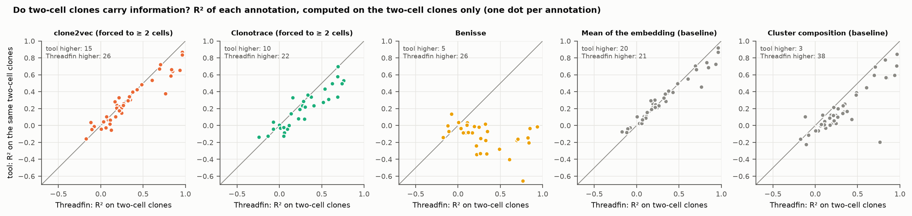

<!-- BEGIN:two_cell -->

| tool | annotations | median R² on two-cell clones, tool | median R² on the same clones, Threadfin | tool higher | Threadfin higher | annotations with R² > 0.1 for the tool |
|---|---|---|---|---|---|---|
| clone2vec (forced to ≥ 2 cells) | 41 | 0.259 | 0.246 | 15 | 26 | 30 |
| Clonotrace (forced to ≥ 2 cells) | 32 | 0.221 | 0.278 | 10 | 22 | 19 |
| Benisse | 31 | -0.084 | 0.246 | 5 | 26 | 1 |
| Mean of the embedding (baseline) | 41 | 0.259 | 0.246 | 20 | 21 | 33 |
| Cluster composition (baseline) | 41 | 0.120 | 0.246 | 3 | 38 | 23 |
| Medoid cell, CoNGA's rule (baseline) | 41 | 0.207 | 0.246 | 7 | 34 | 29 |
| Threadfin, mean profile | 41 | 0.252 | 0.246 | 20 | 21 | 29 |
| Threadfin, no shrinkage | 41 | 0.242 | 0.246 | 24 | 17 | 32 |

<!-- END:two_cell -->

*Reading.* Yes: on two-cell clones alone, measured annotations are recovered with a median R² of about 0.25,
and for most annotations above 0.1. The answer to "does only Threadfin capture two-cell clones?" is:
**by default, yes** — clone2vec and Clonotrace exclude them unless told otherwise, and Clonotrace still
loses 39–84 % of them when forced — **but the information itself is not unique to Threadfin**: clone2vec forced to ≥ 2
cells and a plain mean of the cells' coordinates recover about as much from the same two-cell clones.
Threadfin's specific contributions for small clones are (i) including them by default, (ii) shrinking a
small clone's profile towards its donor average in proportion to how few cells were sampled, so that
downstream statistics weight it correctly (section 6.8 shows the ablation), and (iii) clonal tests that stay
calibrated with many small clones (section 6.6).

### 6.3 Recovering measured annotations

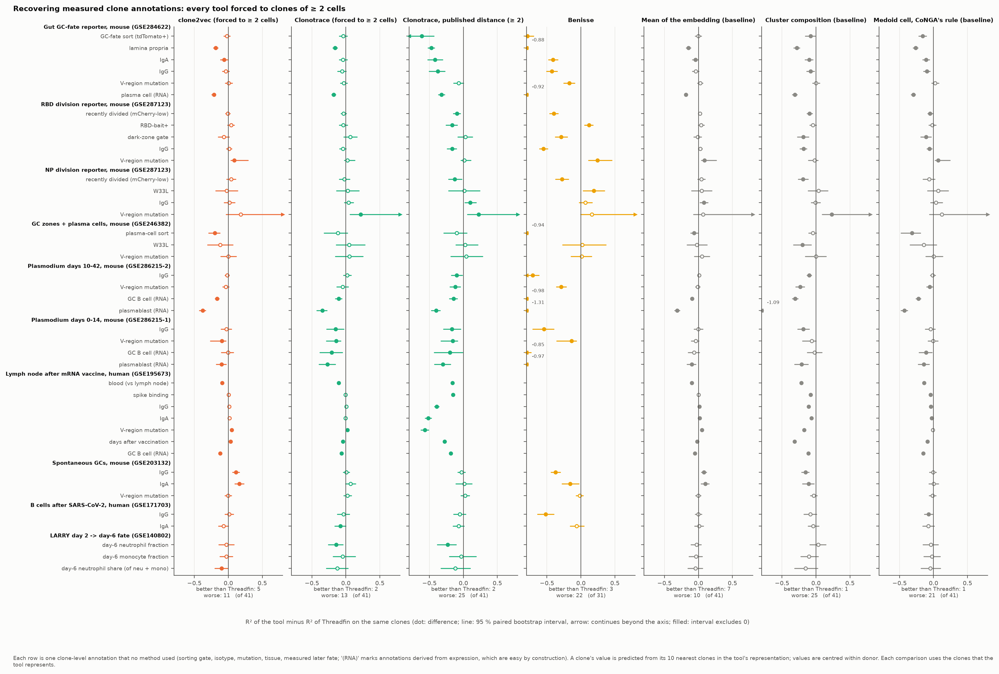

**Every tool forced to clones of ≥ 2 cells** (each comparison on the clones that tool represents):

<!-- BEGIN:pairwise_forced -->

| tool | datasets | annotations | tool better (95 % CI > 0) | Threadfin better (CI < 0) | no clear difference | median ΔR² (tool − Threadfin) | median clones per comparison |
|---|---|---|---|---|---|---|---|
| clone2vec (forced to ≥ 2 cells) | 10 | 41 | 5 | 10 | 26 | -0.018 | 958 |
| Clonotrace (forced to ≥ 2 cells) | 9 | 34 | 1 | 10 | 23 | -0.041 | 471 |
| Clonotrace, published distance (≥ 2) | 9 | 34 | 2 | 18 | 14 | -0.108 | 471 |
| Benisse | 8 | 31 | 3 | 22 | 6 | -0.372 | 958 |
| Mean of the embedding (baseline) | 10 | 41 | 7 | 10 | 24 | -0.003 | 958 |
| Cluster composition (baseline) | 10 | 41 | 1 | 25 | 15 | -0.101 | 958 |
| Medoid cell, CoNGA's rule (baseline) | 10 | 41 | 1 | 21 | 19 | -0.050 | 958 |

<!-- END:pairwise_forced -->

The same, leaving out the annotations derived from expression ("(RNA)"), which are easy by construction:

<!-- BEGIN:pairwise_forced_no_rna -->

| tool | datasets | annotations | tool better (95 % CI > 0) | Threadfin better (CI < 0) | no clear difference | median ΔR² (tool − Threadfin) | median clones per comparison |
|---|---|---|---|---|---|---|---|
| clone2vec (forced to ≥ 2 cells) | 10 | 35 | 5 | 5 | 25 | -0.006 | 958 |
| Clonotrace (forced to ≥ 2 cells) | 9 | 29 | 1 | 5 | 23 | -0.035 | 411 |
| Clonotrace, published distance (≥ 2) | 9 | 29 | 2 | 13 | 14 | -0.095 | 411 |
| Benisse | 8 | 26 | 3 | 17 | 6 | -0.284 | 958 |
| Mean of the embedding (baseline) | 10 | 35 | 7 | 5 | 23 | +0.001 | 958 |
| Cluster composition (baseline) | 10 | 35 | 1 | 20 | 14 | -0.095 | 958 |
| Medoid cell, CoNGA's rule (baseline) | 10 | 35 | 1 | 15 | 19 | -0.043 | 958 |

<!-- END:pairwise_forced_no_rna -->

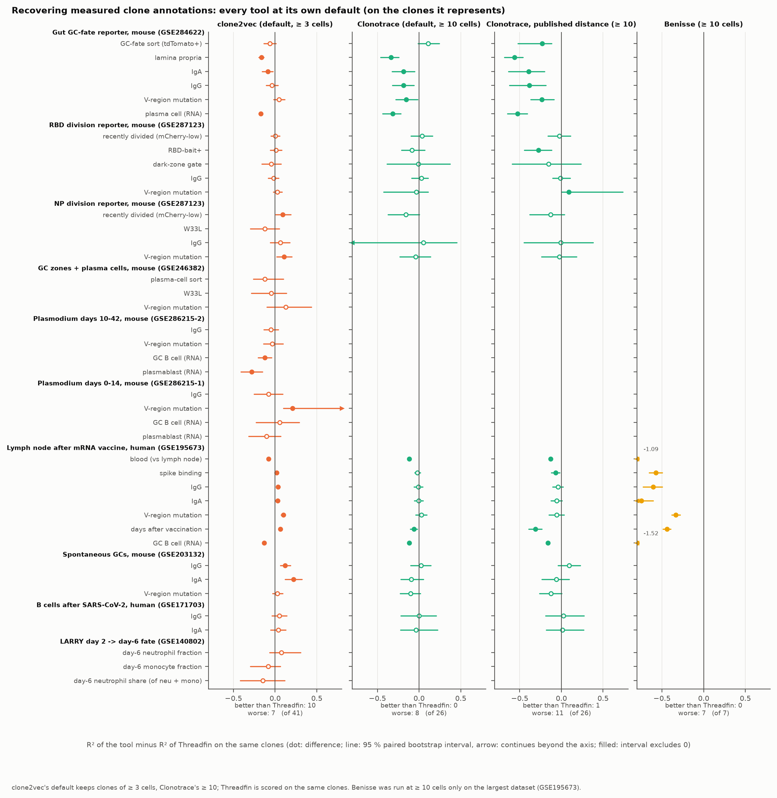

**Every tool at its own default**, scored on the clones it represents:

<!-- BEGIN:pairwise_native -->

| tool | datasets | annotations | tool better (95 % CI > 0) | Threadfin better (CI < 0) | no clear difference | median ΔR² (tool − Threadfin) | median clones per comparison |
|---|---|---|---|---|---|---|---|
| clone2vec (default, ≥ 3 cells) | 10 | 41 | 10 | 7 | 24 | +0.002 | 268 |
| Clonotrace (default, ≥ 10 cells) | 6 | 26 | 0 | 8 | 18 | -0.039 | 127 |
| Clonotrace, published distance (≥ 10) | 6 | 26 | 0 | 11 | 15 | -0.096 | 127 |
| Benisse (≥ 10 cells) | 1 | 7 | 0 | 7 | 0 | -0.606 | 1243 |

<!-- END:pairwise_native -->

<details><summary>Every annotation, every tool (R² of the tool vs R² of Threadfin on the same clones; ▲ tool better, ▼ Threadfin better, 95 % paired bootstrap interval excluding 0)</summary>

<!-- BEGIN:pairwise_detail -->

| dataset | target | clone2vec (forced to ≥ 2 cells) | Clonotrace (forced to ≥ 2 cells) | Benisse | Mean of the embedding (baseline) |
|---|---|---|---|---|---|
| Gut GC reporter | IgA | 0.27 vs 0.34 ▼ | 0.28 vs 0.32 | -0.07 vs 0.34 ▼ | 0.29 vs 0.34 ▼ |
| Gut GC reporter | IgG | 0.25 vs 0.28 | 0.22 vs 0.27 | -0.14 vs 0.28 ▼ | 0.24 vs 0.28 |
| Gut GC reporter | GC-fate sort (tdTomato+) | 0.66 vs 0.68 | 0.62 vs 0.65 | -0.10 vs 0.68 ▼ | 0.68 vs 0.68 |
| Gut GC reporter | V-region mutation | 0.07 vs 0.06 | 0.06 vs 0.09 | -0.11 vs 0.06 ▼ | 0.09 vs 0.06 |
| Gut GC reporter | lamina propria | 0.71 vs 0.89 ▼ | 0.75 vs 0.91 ▼ | 0.01 vs 0.89 ▼ | 0.74 vs 0.89 ▼ |
| Gut GC reporter | plasma cell (RNA) | 0.74 vs 0.95 ▼ | 0.76 vs 0.94 ▼ | 0.03 vs 0.95 ▼ | 0.77 vs 0.95 ▼ |
| RBD reporter | RBD-bait+ | 0.10 vs 0.05 | 0.01 vs 0.05 | 0.17 vs 0.05 ▲ | 0.09 vs 0.05 |
| RBD reporter | IgG | 0.34 vs 0.32 | 0.30 vs 0.35 | -0.23 vs 0.32 ▼ | 0.35 vs 0.32 |
| RBD reporter | dark-zone gate | 0.21 vs 0.27 | 0.31 vs 0.25 | -0.02 vs 0.27 ▼ | 0.26 vs 0.27 |
| RBD reporter | V-region mutation | -0.04 vs -0.13 ▲ | -0.02 vs -0.04 | 0.12 vs -0.13 ▲ | -0.04 vs -0.13 ▲ |
| RBD reporter | recently divided (mCherry-low) | 0.30 vs 0.31 | 0.28 vs 0.31 | -0.09 vs 0.31 ▼ | 0.33 vs 0.31 |
| NP reporter | recently divided (mCherry-low) | 0.30 vs 0.26 | 0.21 vs 0.24 | -0.02 vs 0.26 ▼ | 0.30 vs 0.26 |
| NP reporter | V-region mutation | 0.01 vs -0.18 | -0.01 vs -0.23 ▲ | -0.02 vs -0.18 | -0.11 vs -0.18 |
| NP reporter | W33L | -0.18 vs -0.16 | -0.16 vs -0.19 | 0.03 vs -0.16 ▲ | -0.11 vs -0.16 |
| NP reporter | IgG | -0.04 vs -0.05 | -0.06 vs -0.10 | 0.01 vs -0.05 | 0.03 vs -0.05 ▲ |
| GC + plasma cells | plasma-cell sort | 0.59 vs 0.79 ▼ | 0.50 vs 0.62 | -0.15 vs 0.79 ▼ | 0.73 vs 0.79 ▼ |
| GC + plasma cells | V-region mutation | -0.15 vs -0.15 | -0.14 vs -0.19 | -0.13 vs -0.15 | -0.10 vs -0.15 |
| GC + plasma cells | W33L | -0.05 vs 0.07 | -0.08 vs -0.13 | 0.09 vs 0.07 | 0.04 vs 0.07 |
| Plasmodium d10-42 | GC B cell (RNA) | 0.67 vs 0.84 ▼ | 0.57 vs 0.68 ▼ | -0.14 vs 0.84 ▼ | 0.74 vs 0.84 ▼ |
| Plasmodium d10-42 | IgG | 0.50 vs 0.52 | 0.42 vs 0.40 | -0.19 vs 0.52 ▼ | 0.53 vs 0.52 |
| Plasmodium d10-42 | plasmablast (RNA) | 0.39 vs 0.77 ▼ | 0.35 vs 0.69 ▼ | -0.54 vs 0.77 ▼ | 0.46 vs 0.77 ▼ |
| Plasmodium d10-42 | V-region mutation | 0.31 vs 0.35 | 0.26 vs 0.31 | 0.06 vs 0.35 ▼ | 0.34 vs 0.35 |
| Plasmodium d0-14 | V-region mutation | -0.03 vs 0.06 ▼ | -0.07 vs 0.07 ▼ | -0.08 vs 0.06 ▼ | 0.02 vs 0.06 |
| Plasmodium d0-14 | GC B cell (RNA) | 0.69 vs 0.70 | 0.32 vs 0.53 ▼ | -0.15 vs 0.70 ▼ | 0.64 vs 0.70 |
| Plasmodium d0-14 | plasmablast (RNA) | 0.53 vs 0.63 ▼ | 0.33 vs 0.60 ▼ | -0.35 vs 0.63 ▼ | 0.53 vs 0.63 ▼ |
| Plasmodium d0-14 | IgG | 0.20 vs 0.23 | 0.10 vs 0.25 ▼ | -0.31 vs 0.23 ▼ | 0.23 vs 0.23 |
| Human LN vaccine | blood (vs lymph node) | 0.88 vs 0.97 ▼ | — | — | 0.87 vs 0.97 ▼ |
| Human LN vaccine | V-region mutation | 0.39 vs 0.35 ▲ | — | — | 0.39 vs 0.35 ▲ |
| Human LN vaccine | IgG | 0.40 vs 0.39 | — | — | 0.40 vs 0.39 ▲ |
| Human LN vaccine | GC B cell (RNA) | 0.84 vs 0.96 ▼ | — | — | 0.91 vs 0.96 ▼ |
| Human LN vaccine | IgA | 0.17 vs 0.15 | — | — | 0.17 vs 0.15 ▲ |
| Human LN vaccine | spike binding | 0.32 vs 0.32 | — | — | 0.32 vs 0.32 |
| Human LN vaccine | days after vaccination | 0.50 vs 0.47 ▲ | — | — | 0.45 vs 0.47 ▼ |
| Spontaneous GC | V-region mutation | 0.06 vs 0.06 | 0.06 vs 0.03 | 0.04 vs 0.06 | 0.05 vs 0.06 |
| Spontaneous GC | IgA | 0.36 vs 0.19 ▲ | 0.23 vs 0.16 | 0.04 vs 0.19 ▼ | 0.30 vs 0.19 ▲ |
| Spontaneous GC | IgG | 0.38 vs 0.27 ▲ | 0.31 vs 0.30 | -0.11 vs 0.27 ▼ | 0.35 vs 0.27 ▲ |
| Human COVID-19 | IgA | 0.03 vs 0.09 | -0.02 vs 0.06 ▼ | 0.03 vs 0.09 | 0.10 vs 0.09 |
| Human COVID-19 | IgG | 0.23 vs 0.22 | 0.14 vs 0.18 | -0.30 vs 0.22 ▼ | 0.22 vs 0.22 |
| LARRY d2 | day-6 neutrophil fraction | 0.16 vs 0.19 | 0.16 vs 0.30 ▼ | — | 0.16 vs 0.19 |
| LARRY d2 | day-6 monocyte fraction | 0.11 vs 0.14 | 0.05 vs 0.10 | — | 0.10 vs 0.14 |
| LARRY d2 | day-6 neutrophil share (of neu + mono) | 0.11 vs 0.21 | 0.09 vs 0.21 | — | 0.17 vs 0.21 |

<!-- END:pairwise_detail -->

</details>

*Reading.*

* **Threadfin vs clone2vec.** Similar overall. Threadfin is ahead mainly on annotations that separate
  compartments within a donor (lamina propria vs lymphoid tissue in the gut, blood vs lymph node, plasma
  cells and GC B cells) — the annotations where centring on the donor helps (section 6.8); clone2vec is
  ahead on isotype in spontaneous GCs, V-region mutation and time since vaccination. On clones of ≥ 3
  cells (clone2vec's default) clone2vec wins slightly more often than it loses; including the two-cell
  clones tips the balance towards Threadfin.
* **Threadfin vs Clonotrace.** On the clones Clonotrace keeps, its default (revised) distance and Threadfin
  are mostly indistinguishable; of the nine annotations where they differ (forced to ≥ 2 cells), Threadfin
  is better on eight (lamina propria and plasma cells in the gut, four in the Plasmodium days 0–14 data,
  IgA after SARS-CoV-2 infection, LARRY neutrophil fate) and Clonotrace on one (V-region mutation in the NP
  dataset); at Clonotrace's default (≥ 10 cells) Threadfin is better on 8 of 26 and never worse.
  Clonotrace's published (unrevised) distance does worse than its revised default.
* **Threadfin vs Benisse.** Benisse's representation is anchored on receptor sequence, so it carries
  little of the cell-state annotations, and wins exactly where the annotation is a property of the
  receptor: RBD-bait binding, V-region mutation in the RBD dataset and the W33L mutation in the NP dataset.
  That is a different, complementary question, not a failure.
* **Threadfin vs simple baselines.** A plain mean of the embedding is as good as Threadfin on these
  readouts (7 wins, 10 losses of 41); cluster composition and CoNGA's single-cell reduction are clearly
  worse. Most of Threadfin's advantage over the mean comes from centring on the donor (section 6.8).

### 6.4 Annotation recovery when representation and annotation use different cells

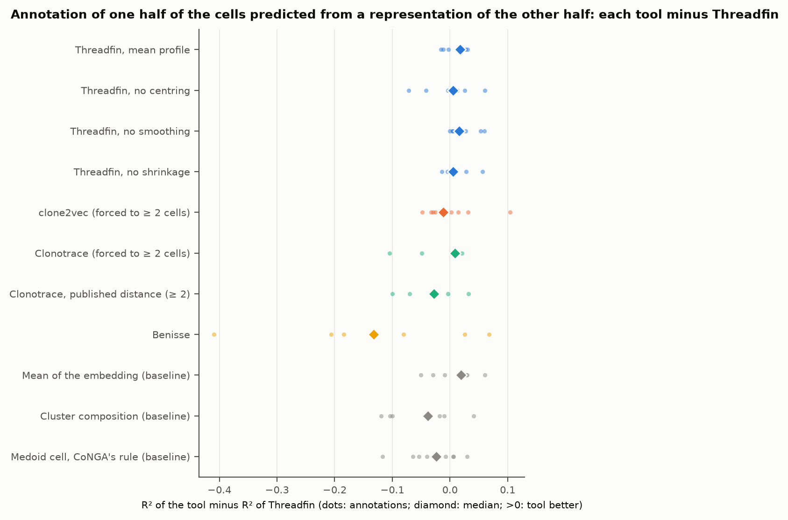

<!-- BEGIN:disjoint -->

| method | annotations | median ΔR² (tool − Threadfin) | tool higher | Threadfin higher |
|---|---|---|---|---|
| Benisse | 24 | -0.063 | 5 | 19 |
| clone2vec (forced to ≥ 2 cells) | 35 | +0.002 | 18 | 17 |
| Clonotrace, published distance (≥ 2) | 24 | -0.032 | 5 | 19 |
| Clonotrace (forced to ≥ 2 cells) | 24 | -0.002 | 12 | 12 |
| Cluster composition (baseline) | 35 | -0.055 | 6 | 29 |
| Medoid cell, CoNGA's rule (baseline) | 35 | -0.027 | 10 | 25 |
| Mean of the embedding (baseline) | 35 | +0.011 | 19 | 16 |
| Threadfin, no centring | 35 | -0.003 | 17 | 18 |
| Threadfin, no shrinkage | 35 | +0.005 | 20 | 15 |
| Threadfin, no smoothing | 35 | +0.020 | 26 | 9 |
| Threadfin, mean profile | 35 | +0.016 | 25 | 10 |

<!-- END:disjoint -->

*Reading.* With the annotation measured on cells that the representation never saw, every score falls
(median R² about 0.05 instead of 0.3), because each half holds half of a clone's cells and two-cell clones
contribute one cell to each half. Threadfin, a plain mean of the embedding, clone2vec (forced to ≥ 2 cells)
and Clonotrace's default distance are close; Clonotrace's published distance, cluster composition, the
one-cell reduction and Benisse are lower. Among Threadfin's own variants, switching off neighbour smoothing
(higher on 26 of 35 annotations) and using the mean profile (25 of 35) help here more clearly than with
shared cells, while switching off centring makes no clear difference.

### 6.5 Reproducibility across disjoint halves of each clone, and LARRY clone linking

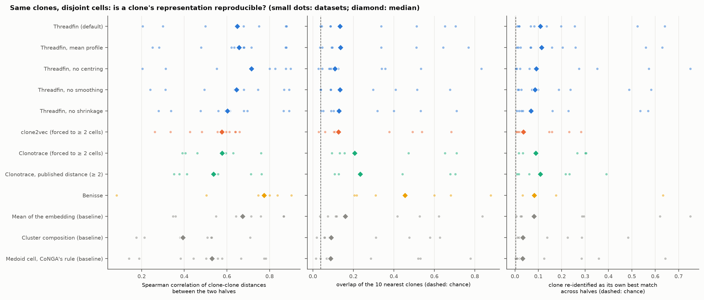

<!-- BEGIN:reproducibility -->

| method | datasets | median distance Spearman | median 10-NN overlap | overlap by chance | median re-identification (top 1) | re-identification by chance |
|---|---|---|---|---|---|---|
| Benisse | 6 | 0.774 | 0.455 | 0.063 | 0.083 | 0.0062 |
| Threadfin, no centring | 10 | 0.719 | 0.112 | 0.044 | 0.084 | 0.0044 |
| Mean of the embedding (baseline) | 10 | 0.653 | 0.161 | 0.051 | 0.084 | 0.0051 |
| Threadfin (default) | 10 | 0.650 | 0.125 | 0.051 | 0.084 | 0.0051 |
| Threadfin, no smoothing | 10 | 0.645 | 0.137 | 0.044 | 0.090 | 0.0044 |
| Threadfin, mean profile | 10 | 0.643 | 0.130 | 0.051 | 0.077 | 0.0051 |
| Threadfin, no shrinkage | 10 | 0.593 | 0.130 | 0.044 | 0.070 | 0.0044 |
| clone2vec (forced to ≥ 2 cells) | 10 | 0.588 | 0.127 | 0.039 | 0.030 | 0.0039 |
| Clonotrace (forced to ≥ 2 cells) | 7 | 0.578 | 0.206 | 0.087 | 0.089 | 0.0086 |
| Clonotrace, published distance (≥ 2) | 7 | 0.537 | 0.234 | 0.087 | 0.108 | 0.0086 |
| Medoid cell, CoNGA's rule (baseline) | 10 | 0.510 | 0.085 | 0.039 | 0.031 | 0.0039 |
| Cluster composition (baseline) | 10 | 0.413 | 0.086 | 0.039 | 0.031 | 0.0039 |

<!-- END:reproducibility -->

*Reading.* Benisse is the most reproducible by construction: its representation is computed from the receptor
sequence, which both halves of a clone share, so its stability says nothing about cell state. Among the
representations of cell state, Threadfin and the plain mean re-identify a clone from its other half most
often (median 8 % of clones are their own best match, against under 1 % by chance), clone2vec about 3 %;
Clonotrace, on the clones it keeps, is close to Threadfin (higher on four of seven datasets, lower on two;
most differences are a few clones). Representations without donor centring keep more of the
clone–clone distance structure (higher Spearman correlation), because the differences between donors are
shared by both halves of every clone.

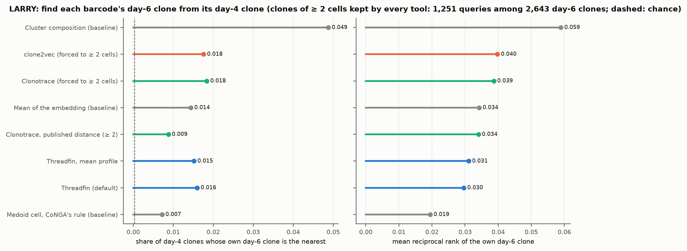

<!-- BEGIN:larry -->

| setting | method | query clones | day-6 candidates | top 1 | top 10 | mean reciprocal rank | median rank | chance top 1 |
|---|---|---|---|---|---|---|---|---|
| forced: clones >= 2 cells | Cluster composition (baseline) | 1,251 | 2,643 | 0.049 | 0.072 | 0.059 | 433 | 0.0004 |
| forced: clones >= 2 cells | clone2vec (forced to ≥ 2 cells) | 1,251 | 2,643 | 0.018 | 0.075 | 0.040 | 326 | 0.0004 |
| forced: clones >= 2 cells | Clonotrace (forced to ≥ 2 cells) | 1,251 | 2,643 | 0.018 | 0.068 | 0.039 | 448 | 0.0004 |
| forced: clones >= 2 cells | Mean of the embedding (baseline) | 1,251 | 2,643 | 0.014 | 0.063 | 0.034 | 597 | 0.0004 |
| forced: clones >= 2 cells | Clonotrace, published distance (≥ 2) | 1,251 | 2,643 | 0.009 | 0.073 | 0.034 | 348 | 0.0004 |
| forced: clones >= 2 cells | Threadfin, mean profile | 1,251 | 2,643 | 0.015 | 0.052 | 0.031 | 628 | 0.0004 |
| forced: clones >= 2 cells | Threadfin (default) | 1,251 | 2,643 | 0.016 | 0.049 | 0.030 | 612 | 0.0004 |
| forced: clones >= 2 cells | Medoid cell, CoNGA's rule (baseline) | 1,251 | 2,643 | 0.007 | 0.041 | 0.019 | 754 | 0.0004 |
| native: clones >= 10 cells | clone2vec (default, ≥ 3 cells) | 164 | 863 | 0.055 | 0.213 | 0.110 | 60 | 0.0012 |
| native: clones >= 10 cells | Clonotrace (default, ≥ 10 cells) | 164 | 863 | 0.049 | 0.177 | 0.098 | 102 | 0.0012 |
| native: clones >= 10 cells | Clonotrace, published distance (≥ 10) | 164 | 863 | 0.043 | 0.177 | 0.091 | 91 | 0.0012 |
| native: clones >= 10 cells | Mean of the embedding (baseline) | 164 | 863 | 0.049 | 0.159 | 0.090 | 172 | 0.0012 |
| native: clones >= 10 cells | Threadfin (default) | 164 | 863 | 0.061 | 0.140 | 0.087 | 168 | 0.0012 |
| native: clones >= 10 cells | Threadfin, mean profile | 164 | 863 | 0.055 | 0.146 | 0.087 | 176 | 0.0012 |
| native: clones >= 10 cells | Cluster composition (baseline) | 164 | 863 | 0.024 | 0.140 | 0.063 | 128 | 0.0012 |
| native: clones >= 10 cells | Medoid cell, CoNGA's rule (baseline) | 164 | 863 | 0.012 | 0.061 | 0.035 | 275 | 0.0012 |

<!-- END:larry -->

*Reading.* Recognising the same barcode two days later is hard for every representation (cells
differentiate between day 4 and day 6), but all are far above chance. Among clones of ≥ 10 cells, clone2vec
places the true day-6 clone highest on average (mean reciprocal rank), Threadfin most often first, and
Clonotrace lies between them; with clones of ≥ 2 cells (scored on the 4,693 clones Clonotrace keeps), the
cluster-composition baseline is best at placing it first and the other methods are close to one another.

### 6.6 Are the clonal tests calibrated?

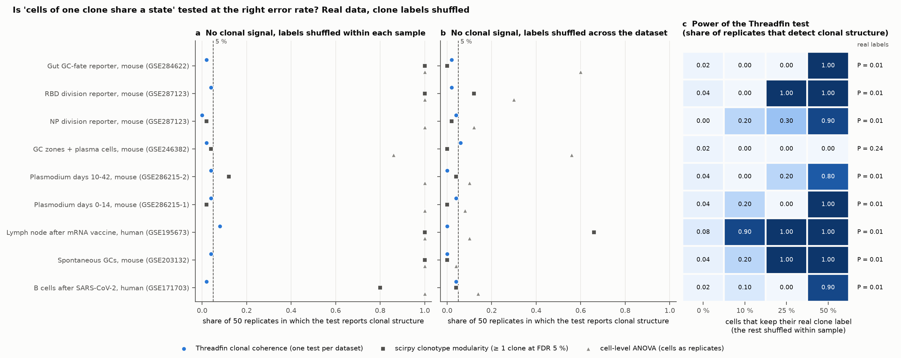

<!-- BEGIN:tests -->

| dataset | Threadfin: false positives, shuffled within sample | scirpy: ≥ 1 clone flagged, shuffled within sample | scirpy: share of clones flagged, shuffled within sample | ANOVA: false positives, shuffled within sample | Threadfin, shuffled across dataset | scirpy, shuffled across dataset | ANOVA, shuffled across dataset | Threadfin power at 10 / 25 / 50 % real labels | Threadfin on the real labels: ICC (null) P | scirpy on the real labels: clones flagged |
|---|---|---|---|---|---|---|---|---|---|---|
| Gut GC reporter | 0.02 | 1.00 | 0.005 | 1.00 | 0.02 | 0.00 | 0.60 | 0.0 / 0.0 / 1.0 | 0.245 (0.130) 0.01 | 35 of 958 |
| RBD reporter | 0.04 | 1.00 | 0.003 | 1.00 | 0.02 | 0.12 | 0.30 | 0.0 / 1.0 / 1.0 | 0.142 (0.016) 0.01 | 123 of 1,887 |
| NP reporter | 0.00 | 0.02 | 0.000 | 1.00 | 0.04 | 0.02 | 0.12 | 0.2 / 0.3 / 0.9 | 0.111 (0.018) 0.01 | 2 of 471 |
| GC + plasma cells | 0.02 | 0.04 | 0.000 | 0.86 | 0.06 | 0.00 | 0.56 | 0.0 / 0.0 / 0.0 | 0.048 (0.032) 0.24 | 0 of 96 |
| Plasmodium d10-42 | 0.04 | 0.12 | 0.000 | 1.00 | 0.00 | 0.04 | 0.10 | 0.0 / 0.2 / 0.8 | 0.451 (0.015) 0.01 | 4 of 1,015 |
| Plasmodium d0-14 | 0.04 | 0.02 | 0.000 | 1.00 | 0.04 | 0.00 | 0.08 | 0.2 / 0.0 / 1.0 | 0.736 (0.061) 0.01 | 30 of 523 |
| Human LN vaccine | 0.08 | 1.00 | 0.001 | 1.00 | 0.00 | 0.66 | 0.10 | 0.9 / 1.0 / 1.0 | 0.216 (0.001) 0.01 | 841 of 11,141 |
| Spontaneous GC | 0.04 | 1.00 | 0.006 | 1.00 | 0.00 | 0.00 | 0.04 | 0.2 / 1.0 / 1.0 | 0.279 (0.027) 0.01 | 120 of 1,051 |
| Human COVID-19 | 0.02 | 0.80 | 0.003 | 1.00 | 0.04 | 0.04 | 0.14 | 0.1 / 0.0 / 0.9 | 0.387 (0.036) 0.01 | 34 of 592 |

<!-- END:tests -->

*Reading.*

* **Shuffled within sample (panel a)** keeps everything about how cells were sampled — each shuffled
  "clone" still comes from one sample, as real clones do — and removes only the clonal signal. Threadfin's
  coherence test, which permutes within samples, reports structure in 0–8 % of replicates (5 % expected).
  scirpy's clonotype modularity compares each clone with random cells from the *whole* graph, so a clone
  that sits in one sample looks modular whenever samples differ: at least one clone was flagged in 100 % of
  replicates in four datasets. Per clone, scirpy's false-discovery share stays below 1 %, so its per-clone
  scores are not wrong as such; they answer "is this clone more connected than random cells?", not "does
  clone identity explain state beyond sampling?". A cell-level ANOVA treats cells as independent
  replicates and rejects almost always.
* **Shuffled across the dataset (panel b)** removes sampling structure too. Threadfin stays at 0–6 %;
  scirpy flags clones in up to 66 % of replicates in the largest dataset (11,141 clones); the ANOVA still
  rejects in up to 60 %.
* **Power (panel c).** With only 10–25 % of cells keeping their real clone label, Threadfin detects the
  remaining clonal structure in the datasets with strong coherence (human lymph node, RBD, spontaneous
  GCs); with 50 % it does so in ≥ 80 % of replicates in 8 of 9 datasets. GSE246382 (884 cells, 96 clones)
  shows no clonal coherence even with the real labels (P = 0.24), as reported in the manuscript.

### 6.7 Simulation with a known answer

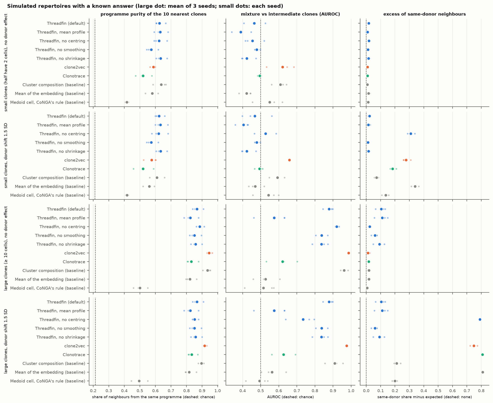

Simulated cells live in a 30-dimensional state space with four states (GC B cell, plasma cell, memory, and
an intermediate state halfway between GC and plasma cell). Each clone follows one of five programmes: all
GC; all plasma cell; memory-biased (70 % memory, 30 % GC); **mixture** (each cell GC or plasma cell with
probability ½); **intermediate** (all cells in the intermediate state). Mixture and intermediate clones have
the same *mean* state, so only a description of a clone's whole distribution can separate them. Six
donors differ in programme composition (Dirichlet(4) weights) and, in the "donor shift" scenarios, every
donor's cells are moved by a random vector of length 1.5 within-state standard deviations. "Small" clones
have 2 + Geometric(0.55) cells (half have two cells); "large" clones 10 + Geometric(0.08). 600 clones and
8,000 unlabelled background cells per dataset, 3 seeds per scenario
([`scripts/simulate_inputs.py`](scripts/simulate_inputs.py)).

<details><summary>All simulation results (mean over 3 seeds)</summary>

<!-- BEGIN:simulation -->

| clones | donor shift (SD) | method | seeds | programme purity (chance) | purity, two-cell clones | mixture vs intermediate AUROC | same-donor excess |
|---|---|---|---|---|---|---|---|
| small (half 2 cells) | 0 | Threadfin (default) | 3 | 0.626 (0.212) | 0.571 | 0.464 | +0.017 |
| small (half 2 cells) | 0 | Threadfin, mean profile | 3 | 0.631 (0.212) | 0.581 | 0.390 | +0.009 |
| small (half 2 cells) | 0 | Clonotrace (forced to ≥ 2 cells) | 3 | 0.521 (0.212) | 0.448 | 0.494 | +0.009 |
| small (half 2 cells) | 0 | Clonotrace, published distance (≥ 2) | 3 | 0.461 (0.212) | 0.402 | 0.546 | +0.006 |
| small (half 2 cells) | 0 | clone2vec (forced to ≥ 2 cells) | 3 | 0.587 (0.212) | 0.537 | 0.621 | +0.010 |
| small (half 2 cells) | 0 | Mean of the embedding (baseline) | 3 | 0.580 (0.212) | 0.534 | 0.422 | +0.016 |
| small (half 2 cells) | 0 | Cluster composition (baseline) | 3 | 0.637 (0.212) | 0.577 | 0.609 | +0.008 |
| small (half 2 cells) | 0 | Medoid cell, CoNGA's rule (baseline) | 3 | 0.416 (0.212) | 0.393 | 0.550 | +0.014 |
| small (half 2 cells) | 0 | Threadfin, no centring | 3 | 0.624 (0.211) | 0.586 | 0.454 | +0.019 |
| small (half 2 cells) | 0 | Threadfin, no smoothing | 3 | 0.573 (0.211) | 0.533 | 0.478 | +0.012 |
| small (half 2 cells) | 0 | Threadfin, no shrinkage | 3 | 0.633 (0.211) | 0.598 | 0.423 | +0.016 |
| small (half 2 cells) | 1.5 | Threadfin (default) | 3 | 0.623 (0.211) | 0.565 | 0.467 | +0.023 |
| small (half 2 cells) | 1.5 | Threadfin, mean profile | 3 | 0.633 (0.211) | 0.586 | 0.405 | +0.015 |
| small (half 2 cells) | 1.5 | Clonotrace (forced to ≥ 2 cells) | 3 | 0.520 (0.211) | 0.453 | 0.493 | +0.184 |
| small (half 2 cells) | 1.5 | Clonotrace, published distance (≥ 2) | 3 | 0.463 (0.211) | 0.406 | 0.545 | +0.080 |
| small (half 2 cells) | 1.5 | clone2vec (forced to ≥ 2 cells) | 3 | 0.575 (0.211) | 0.529 | 0.658 | +0.277 |
| small (half 2 cells) | 1.5 | Mean of the embedding (baseline) | 3 | 0.560 (0.211) | 0.517 | 0.470 | +0.340 |
| small (half 2 cells) | 1.5 | Cluster composition (baseline) | 3 | 0.609 (0.211) | 0.564 | 0.592 | +0.071 |
| small (half 2 cells) | 1.5 | Medoid cell, CoNGA's rule (baseline) | 3 | 0.417 (0.211) | 0.395 | 0.543 | +0.136 |
| small (half 2 cells) | 1.5 | Threadfin, no centring | 3 | 0.621 (0.211) | 0.584 | 0.527 | +0.309 |
| small (half 2 cells) | 1.5 | Threadfin, no smoothing | 3 | 0.573 (0.211) | 0.533 | 0.478 | +0.012 |
| small (half 2 cells) | 1.5 | Threadfin, no shrinkage | 3 | 0.633 (0.211) | 0.598 | 0.423 | +0.016 |
| large (≥ 10 cells) | 0 | Threadfin (default) | 3 | 0.868 (0.213) |  | 0.878 | +0.105 |
| large (≥ 10 cells) | 0 | Threadfin, mean profile | 3 | 0.825 (0.213) |  | 0.575 | +0.112 |
| large (≥ 10 cells) | 0 | Clonotrace (default, ≥ 10 cells) | 3 | 0.831 (0.213) |  | 0.621 | +0.017 |
| large (≥ 10 cells) | 0 | Clonotrace, published distance (≥ 10) | 3 | 0.793 (0.213) |  | 0.809 | +0.020 |
| large (≥ 10 cells) | 0 | clone2vec (default, ≥ 3 cells) | 3 | 0.946 (0.213) |  | 0.987 | +0.013 |
| large (≥ 10 cells) | 0 | Mean of the embedding (baseline) | 3 | 0.822 (0.213) |  | 0.527 | +0.019 |
| large (≥ 10 cells) | 0 | Cluster composition (baseline) | 3 | 0.935 (0.213) |  | 0.962 | +0.018 |
| large (≥ 10 cells) | 0 | Medoid cell, CoNGA's rule (baseline) | 3 | 0.500 (0.213) |  | 0.515 | +0.007 |
| large (≥ 10 cells) | 0 | Threadfin, no centring | 3 | 0.885 (0.213) |  | 0.921 | +0.024 |
| large (≥ 10 cells) | 0 | Threadfin, no smoothing | 3 | 0.851 (0.213) |  | 0.837 | +0.061 |
| large (≥ 10 cells) | 0 | Threadfin, no shrinkage | 3 | 0.859 (0.213) |  | 0.836 | +0.092 |
| large (≥ 10 cells) | 1.5 | Threadfin (default) | 3 | 0.868 (0.213) |  | 0.878 | +0.105 |
| large (≥ 10 cells) | 1.5 | Threadfin, mean profile | 3 | 0.825 (0.213) |  | 0.575 | +0.112 |
| large (≥ 10 cells) | 1.5 | Clonotrace (default, ≥ 10 cells) | 3 | 0.833 (0.213) |  | 0.626 | +0.809 |
| large (≥ 10 cells) | 1.5 | Clonotrace, published distance (≥ 10) | 3 | 0.775 (0.213) |  | 0.779 | +0.433 |
| large (≥ 10 cells) | 1.5 | clone2vec (default, ≥ 3 cells) | 3 | 0.916 (0.213) |  | 0.975 | +0.749 |
| large (≥ 10 cells) | 1.5 | Mean of the embedding (baseline) | 3 | 0.817 (0.213) |  | 0.563 | +0.810 |
| large (≥ 10 cells) | 1.5 | Cluster composition (baseline) | 3 | 0.896 (0.213) |  | 0.910 | +0.212 |
| large (≥ 10 cells) | 1.5 | Medoid cell, CoNGA's rule (baseline) | 3 | 0.495 (0.213) |  | 0.493 | +0.200 |
| large (≥ 10 cells) | 1.5 | Threadfin, no centring | 3 | 0.852 (0.213) |  | 0.734 | +0.791 |
| large (≥ 10 cells) | 1.5 | Threadfin, no smoothing | 3 | 0.851 (0.213) |  | 0.837 | +0.061 |
| large (≥ 10 cells) | 1.5 | Threadfin, no shrinkage | 3 | 0.859 (0.213) |  | 0.836 | +0.092 |

<!-- END:simulation -->

</details>

*Reading.*

* **Grouping clones by programme.** With large clones, clone2vec (purity 0.95) and cluster composition
  (0.94) beat Threadfin (0.87), Clonotrace (0.83) and the mean (0.82); with small clones cluster composition
  (0.64) is best and Threadfin (0.63) second, ahead of clone2vec (0.59) and Clonotrace (0.52). CoNGA's
  one-cell reduction is worst throughout.
* **Mixture vs intermediate.** With ≥ 10 cells per clone, Threadfin's kernel profile separates them
  (AUROC 0.88) where its mean profile (0.58), the plain mean (0.53) and Clonotrace's default distance (0.62)
  cannot — but clone2vec (0.99) and cluster composition (0.96) do it better, and Clonotrace's published
  distance reaches 0.81. With half the clones at two cells no method succeeds (0.39–0.66); two cells cannot
  show whether a clone is a mixture.
* **Donor shift.** Centring on the donor removes an additive donor shift exactly: Threadfin's results are
  identical with and without the shift, while the uncentred representations fill their neighbourhoods with
  same-donor clones (same-donor excess 0.43–0.81 for clone2vec, Clonotrace, the mean and Threadfin without
  centring).
  Two cautions: real donor effects are not purely additive, so this is the most favourable case for
  centring; and when donors differ in programme composition, centring shifts each donor by its own
  composition, which **adds** same-donor structure (excess 0.105 for Threadfin vs 0.007–0.024 for the
  uncentred methods without any donor shift). This is the same artefact found in the gut dataset (one mouse's
  plasma-cell-rich composition, see [`../analyses/gut_all_B_and_centring/`](../analyses/gut_all_B_and_centring/)).

### 6.8 Which parts of Threadfin matter? (ablation)

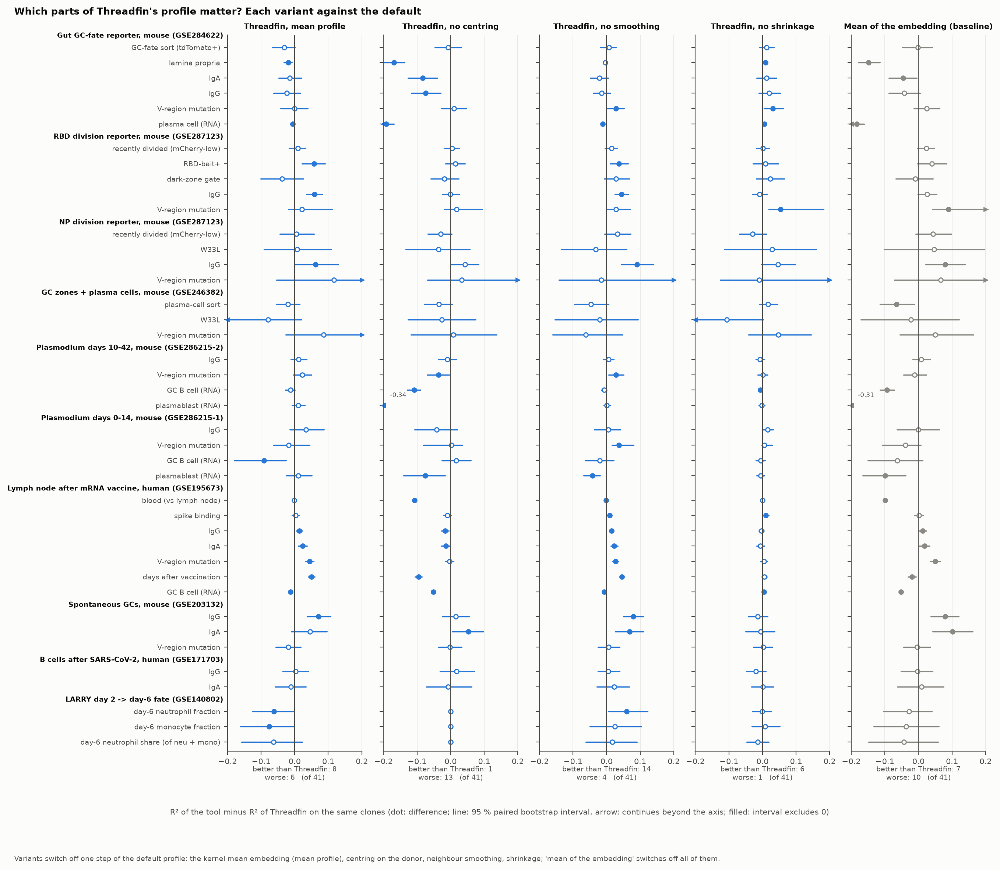

<!-- BEGIN:pairwise_ablation -->

| tool | datasets | annotations | tool better (95 % CI > 0) | Threadfin better (CI < 0) | no clear difference | median ΔR² (tool − Threadfin) | median clones per comparison |
|---|---|---|---|---|---|---|---|
| Threadfin, mean profile | 10 | 41 | 8 | 6 | 27 | +0.003 | 958 |
| Threadfin, no centring | 10 | 41 | 1 | 13 | 27 | -0.010 | 958 |
| Threadfin, no smoothing | 10 | 41 | 14 | 4 | 23 | +0.010 | 958 |
| Threadfin, no shrinkage | 10 | 41 | 6 | 1 | 34 | +0.002 | 958 |
| Mean of the embedding (baseline) | 10 | 41 | 7 | 10 | 24 | -0.003 | 958 |

<!-- END:pairwise_ablation -->

*Reading.* Centring on the donor is the component that helps annotation recovery most: without it,
Threadfin loses on 13 annotations — tissue (lamina propria, blood vs lymph node), plasma-cell and GC
compartments, time since vaccination — and wins on 2. The kernel mean embedding and shrinkage make little
difference to these readouts. Neighbour smoothing (each cell averaged with its 15 nearest cells) helps
slightly for the expression-defined compartments but costs more for properties that differ between
neighbouring clones — isotype, V-region mutation, bait binding, time since vaccination, LARRY neutrophil
fate (without smoothing: 14 wins, 4 losses). Smoothing and shrinkage exist for other reasons — stable
profiles for small clones and a well-defined reliability for each clone — but the benchmark suggests
testing a smaller smoothing neighbourhood as the default; section 6.10 does this and finds a trade-off
with the recovery of planted programmes, so the default is kept.

### 6.9 Computing resources: time, memory, cores, data size and runs that finished

The run-time and memory of every tool relative to Threadfin, split into four sub-questions — time on each
dataset, memory on each dataset, time with 1 to 16 cores, and time as the data grow — in the layout of the
annotation figures (one panel per tool; to the right of the line means more than Threadfin):

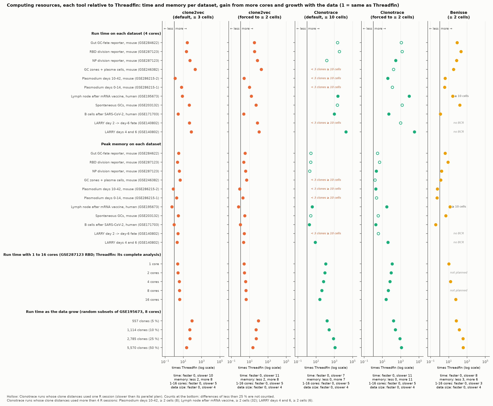

The absolute numbers behind the last two sub-questions:

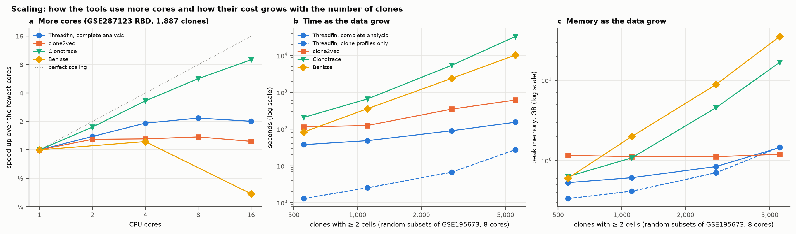

**More cores** (GSE287123 RBD, 1,887 clones; each configuration alone in a job holding 16 cores; Threadfin is
timed for its complete analysis, the other tools for their clone representation; time, peak memory):

<!-- BEGIN:resources_cores -->

| cores | Threadfin, complete analysis | clone2vec | Clonotrace | Benisse |
|---|---|---|---|---|
| 1 | 1.9 min, 0.7 GB | 4.7 min, 1.1 GB | 3.7 h, 2.3 GB | 19.3 min, 4.0 GB |
| 2 | 1.4 min, 0.8 GB | 3.6 min, 1.1 GB | 2.1 h, 2.2 GB | — |
| 4 | 1.0 min, 0.8 GB | 3.6 min, 1.1 GB | 1.1 h, 2.2 GB | 15.8 min, 4.2 GB |
| 8 | 53.9 s, 0.8 GB | 3.4 min, 1.1 GB | 39.0 min, 2.2 GB | — |
| 16 | 58.2 s, 0.8 GB | 3.8 min, 1.1 GB | 24.6 min, 2.5 GB | 56.4 min, 4.2 GB |

<!-- END:resources_cores -->

**More data** (random 5–50 % subsets of the GSE195673 cells, 8 cores; time, peak memory):

<!-- BEGIN:resources_size -->

| subset of GSE195673 | clones ≥ 2 cells | Threadfin, complete analysis | Threadfin, clone profiles | clone2vec | Clonotrace | Benisse |
|---|---|---|---|---|---|---|
| 5 % | 557 | 37.8 s, 0.5 GB | 1.3 s, 0.3 GB | 1.9 min, 1.2 GB | 3.5 min, 0.6 GB | 1.4 min, 0.6 GB |
| 10 % | 1,114 | 48.6 s, 0.6 GB | 2.5 s, 0.4 GB | 2.1 min, 1.1 GB | 11.1 min, 1.1 GB | 6.0 min, 2.0 GB |
| 25 % | 2,785 | 1.5 min, 0.8 GB | 6.7 s, 0.7 GB | 5.8 min, 1.1 GB | 1.5 h, 4.6 GB | 40.0 min, 8.9 GB |
| 50 % | 5,570 | 2.6 min, 1.4 GB | 27.7 s, 1.5 GB | 10.3 min, 1.2 GB | 9.2 h, 16.8 GB | 2.9 h, 35.3 GB |

<!-- END:resources_size -->

*Reading.* Threadfin's complete analysis gains about twofold from parallel layouts and bootstrap replicates
and nothing beyond 8 cores, because each stage of the clone-map search lays out only a few dozen maps;
its clone profiles alone take seconds and grow slightly faster than the number of clones. clone2vec trains
with PyTorch threads and gains little from more cores, but its time grows slowly with the data. Clonotrace's
parallel R sessions scale well (2.7 times from 4 to 16), yet its time grows with about the square of the number
of clones, which is why the full GSE195673 run did not finish in 72 h on 4 sessions. Benisse became slower with
more threads: its Python and R parts both use multithreaded linear algebra, which oversubscribes the cores;
limiting it to 1–4 threads (`OMP_NUM_THREADS`) avoids this. Its memory grows with the square of the number of
clonotypes (35 GB at 5,570 clones).

**Same result with any number of cores?**

<!-- BEGIN:resources_repro -->

| tool | compared | identical | lowest Spearman correlation of clone distances | largest difference of a clone distance |
|---|---|---|---|---|
| clone2vec | 1 core(s) vs 2, 4, 8, 16 | no | 0.999914 | 0.503 |
| Clonotrace | 1 core(s) vs 2, 4, 8, 16 | yes | 1.000000 | 0 |
| Benisse | 1 core(s) vs 4, 16 | no | 1.000000 | 0.00931 |
| Threadfin (clone map and programmes) | 4.4.0 with 1 and with 8 cores vs the released 4.3.1, on 2 datasets (clone-map coordinates and programme labels) | yes |  |  |

<!-- END:resources_repro -->

**The complete Threadfin analysis** on every dataset (released 4.3.1, one process; 4.4.0 gives the same
results and runs the clone-map search and the programme bootstrap on several cores with `n_jobs`, 2.4 and
2.6 times faster on 8 cores for GSE287123 RBD):

<!-- BEGIN:threadfin_full_run -->

| dataset | cells | clones ≥ 2 cells | profiles | coherence test (200 permutations) | clone map (automatic settings) | programmes (30 bootstraps) | one label test | total | peak memory |
|---|---|---|---|---|---|---|---|---|---|
| Gut GC reporter | 16,619 | 958 | 1.9 s | 0.3 s | 47.5 s | 16.6 s | 1.4 s | 1.1 min | 0.6 GB |
| RBD reporter | 36,188 | 1,887 | 3.1 s | 0.7 s | 1.3 min | 35.2 s | 1.9 s | 2.0 min | 0.7 GB |
| NP reporter | 10,109 | 471 | 0.7 s | 0.2 s | 28.7 s | 8.2 s | 0.6 s | 38.3 s | 0.5 GB |
| Plasmodium d10-42 | 72,359 | 1,015 | 30.2 s | 1.1 s | 45.4 s | 19.8 s | 8.8 s | 1.8 min | 1.5 GB |
| Plasmodium d0-14 | 40,623 | 523 | 6.0 s | 0.5 s | 32.8 s | 12.9 s | 3.2 s | 55.4 s | 0.8 GB |
| Human LN vaccine | 193,442 | 11,141 | 42.2 s | 4.3 s | 3.7 min | 4.7 min | 18.3 s | 9.5 min | 2.2 GB |
| Spontaneous GC | 22,898 | 1,051 | 1.2 s | 0.3 s | 47.3 s | 19.2 s | 0.8 s | 1.1 min | 0.6 GB |
| GC + plasma cells | 884 | 96 | 0.2 s | 0.0 s | 15.8 s | 1.6 s | 0.2 s | 17.8 s | 0.5 GB |
| Human COVID-19 | 61,423 | 592 | 25.5 s | 0.7 s | 28.6 s | 12.0 s | 5.8 s | 1.2 min | 1.2 GB |
| LARRY d4/d6 | 44,664 | 6,174 | 3.5 s | 1.3 s | 2.7 min | 3.0 min | ? | 5.8 min | 0.9 GB |

<!-- END:threadfin_full_run -->

**Clone representation per dataset** (4 cores per tool):

<!-- BEGIN:runtime -->

| dataset | Threadfin | clone2vec ≥ 3 | clone2vec ≥ 2 | Clonotrace ≥ 10 | Clonotrace ≥ 2 | Benisse |
|---|---|---|---|---|---|---|
| Gut GC reporter | 1.9 s, 0.4 GB | 50.4 s, 1.1 GB | 1.0 min, 1.1 GB | 1.2 h, 1.0 GB † | 35.9 min, 1.1 GB † | 2.5 min, 1.5 GB |
| RBD reporter | 3.1 s, 0.5 GB | 1.1 min, 1.1 GB | 1.8 min, 1.1 GB | 3.1 h, 1.3 GB † | 1.2 h, 2.4 GB † | 11.0 min, 4.0 GB |
| NP reporter | 0.7 s, 0.3 GB | 35.6 s, 1.1 GB | 47.6 s, 1.1 GB | 1.7 min, 0.6 GB † | 3.3 min, 0.6 GB | 49.1 s, 0.5 GB |
| GC + plasma cells | 0.2 s, 0.2 GB | 33.3 s, 1.1 GB | 32.5 s, 1.1 GB | — | 28.6 s, 0.4 GB † | 5.7 s, 0.3 GB |
| Plasmodium d10-42 | 29.5 s, 1.4 GB | 36.3 s, 1.1 GB | 1.2 min, 1.2 GB | — | 18.8 min, 2.7 GB | 2.0 min, 0.8 GB |
| Plasmodium d0-14 | 5.8 s, 0.6 GB | 36.1 s, 1.1 GB | 53.4 s, 1.1 GB | — | 11.5 min, 1.4 GB † | 20.0 s, 0.3 GB |
| Human LN vaccine | 42.6 s, 2.3 GB | 5.5 min, 1.3 GB | 10.7 min, 1.4 GB | 28.8 h, 8.7 GB | — | 19.0 min, 31.6 GB |
| Spontaneous GC | 1.2 s, 0.4 GB | 53.8 s, 1.1 GB | 1.0 min, 1.1 GB | 43.6 min, 1.0 GB † | 29.7 min, 1.4 GB † | 3.3 min, 1.9 GB |
| Human COVID-19 | 27.3 s, 1.2 GB | 1.2 min, 1.1 GB | 1.0 min, 1.1 GB | 7.4 h, 2.2 GB | 22.7 min, 2.2 GB | 32.2 s, 0.4 GB |
| LARRY d2 | 1.4 s, 0.4 GB | 1.1 min, 1.1 GB | 1.6 min, 1.1 GB | — | 22.6 min, 1.6 GB † | — |
| LARRY d4/d6 | 3.6 s, 0.6 GB | 4.4 min, 1.2 GB | 6.2 min, 1.2 GB | 18.2 h, 4.5 GB | 31.0 h, 22.4 GB | — |

<!-- END:runtime -->

† Clonotrace run whose clone-distance step used one R session (see section 3); its time is longer than
with the vignette's parallel plan.

Clonotrace's stages, per run:

<!-- BEGIN:clonotrace_stages -->

| dataset | setting | clones offered | clones kept | label spreading | clone distances | graph k used |
|---|---|---|---|---|---|---|
| Gut GC reporter | default ≥ 10 | 119 | 119 | 1.5 min | 1.1 h (1 process) | 50 |
| Gut GC reporter | forced ≥ 2 | 958 | 609 | 9.1 min | 26.7 min (1 process) | 30 |
| RBD reporter | default ≥ 10 | 160 | 160 | 3.6 min | 3.0 h (1 process) | 30 |
| RBD reporter | forced ≥ 2 | 1,887 | 1,173 | 40.1 min | 31.6 min (1 process) |  |
| NP reporter | default ≥ 10 | 41 | 41 | 34.3 s | 1.0 min (1 process) |  |
| NP reporter | forced ≥ 2 | 471 | 315 | 2.9 min | 18.6 s (4 workers) | 10 |
| Plasmodium d10-42 | forced ≥ 2 | 1,015 | 531 | 16.4 min | 35.3 s (8 workers) | 100 |
| Plasmodium d0-14 | forced ≥ 2 | 523 | 275 | 10.5 min | 8.7 s (1 process) |  |
| Human LN vaccine | default ≥ 10 | 1,243 | 1,243 | 2.6 h | 26.1 h (4 workers) | 10 |
| Spontaneous GC | default ≥ 10 | 127 | 127 | 1.7 min | 41.6 min (1 process) |  |
| Spontaneous GC | forced ≥ 2 | 1,051 | 770 | 14.7 min | 14.6 min (1 process) |  |
| GC + plasma cells | forced ≥ 2 | 96 | 58 | 27.4 s | 0.8 s (1 process) |  |
| Human COVID-19 | default ≥ 10 | 31 | 31 | 1.1 min | 7.3 h (4 workers) | 10 |
| Human COVID-19 | forced ≥ 2 | 592 | 411 | 16.9 min | 1.0 min (4 workers) | 10 |
| LARRY d2 | forced ≥ 2 | 1,401 | 1,015 | 19.0 min | 3.0 min (1 process) | 10 |
| LARRY d4/d6 | default ≥ 10 | 1,139 | 1,139 | 34.9 min | 17.6 h (4 workers) | 10 |
| LARRY d4/d6 | forced ≥ 2 | 6,174 | 4,693 | 1.9 h | 29.1 h (6 workers) | 10 |

<!-- END:clonotrace_stages -->

Threadfin's representation step is what is timed above; the complete `threadfin.run` (profiles,
coherence test with 200 permutations, automatic clone-map layout search, programmes with bootstrap, three
clone-level tests) took 5.8 minutes for the whole tutorial notebook on GSE287123 (36,188 cells, 1,885
clones), most of it in reading the data, Dandelion and the clone-map layout search.

### 6.10 Sensitivity of Threadfin to its settings

Each setting of the clone profiles was changed alone (number of random Fourier features, kernel bandwidth,
smoothing neighbourhood, number of principal components, random seed), on all datasets, their disjoint halves
and the simulations ([`scripts/run_threadfin.py`](scripts/run_threadfin.py), `SENSITIVITY`):

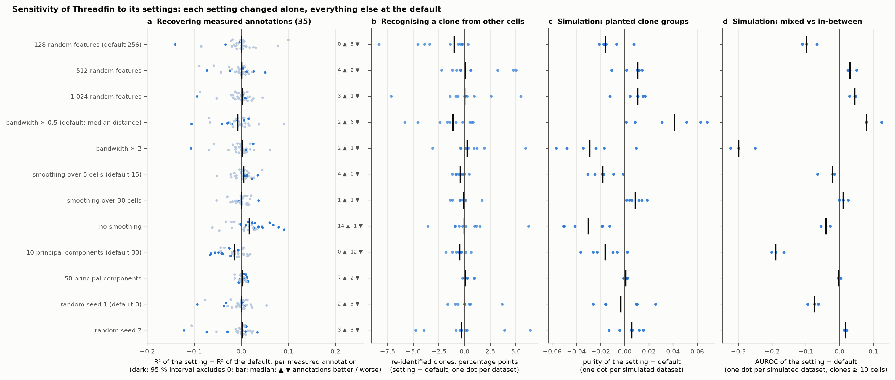

*Reading.* The results do not depend on the number of random features (128–1,024), on the seed, on a
smoothing neighbourhood of 5–30 cells or on 50 instead of 30 principal components: annotation recovery moves
by a median of less than 0.006 in R², and re-identification by less than 1 percentage point. Ten principal
components lose information (12 of 35 annotations worse, none better). Two settings trade one readout for
another. A narrower kernel (bandwidth × 0.5) separates mixed from in-between clones better in simulation
(AUROC + 0.08) but recovers measured annotations slightly worse (2 better, 5 worse); a wider one (× 2) loses
that separation (− 0.30), because the kernel profile then approaches the plain mean. Without smoothing,
measured annotations are recovered better (14 better, 1 worse) but planted programmes worse (purity − 0.03).
The defaults (median-distance bandwidth, 15-cell smoothing) sit between these ends; the manuscript keeps them.

---

## 7. What this benchmark does not show

* **It is not a ranking.** The tools answer different questions (section 2). The readouts here —
  agreement with measured annotations, reproducibility, calibration — are the questions Threadfin was
  designed for; a benchmark built around Clonotrace's question (distances between expanded clones on the
  cell graph) or Benisse's (sequence–expression coupling) would weigh things differently.
* **Annotation recovery measures neighbourhoods, not biology.** A high R² means clones that are close in a
  representation have similar annotations; it does not mean the representation captures the cause.
* **Sorting gates were sorted into separate libraries in some datasets** (GSE287123: the RBD-bait and
  dark-zone gates share tubes), so a representation can recover a gate partly through a library effect.
  All tools see the same embedding, so this affects them alike.
* **The simulation's donor effect is additive**, the case that centring removes exactly (section 6.7).
* **Clonotrace's times** are inflated for the runs marked †; its outputs are not affected.
* **Benisse was run at ≥ 10 cells on GSE195673** (section 3).
* **The resource experiments use one dataset each** (cores: GSE287123 RBD; data size: subsets of GSE195673),
  each configuration alone in a job with dedicated cores; absolute times depend on the hardware.
* **Run-to-run variation of clone calls.** Dandelion's clone assignment depends on Python's hash seed
  (a few clones per 10,000 differ between sessions); all tools received the same clone ids, so the
  comparison is unaffected.

What would make it stronger: an exact-OT Clonotrace run on the smaller datasets; CellRank/CoSpar fate
probabilities on LARRY as an external fate reference; a simulation with non-additive (scaled or
state-specific) donor effects; and timing on a dedicated node with one tool at a time.

---

## 8. Capability matrix

| | Threadfin | Clonotrace | clone2vec | Benisse | CoNGA | scirpy modularity |
|---|---|---|---|---|---|---|
| represents two-cell clones by default | yes | no (≥ 10) | no (≥ 3) | yes (clonotypes) | yes (one cell) | yes (score only) |
| uses the whole distribution of a clone's states | yes (kernel mean) | yes (OT on graph) | indirectly (neighbour co-occurrence) | no (sequence + expression graph) | no (one cell) | no |
| accounts for donor / sample in the representation | yes (centring) | no | no (`split_by` disconnects donors) | no | batch keys optional | no |
| weights clones by sampling depth | yes (shrinkage, reliability) | no | no | no | no | per-clone null by size |
| test of "clone identity explains state" calibrated to sampling | yes (within-sample permutation) | no | no | no | graph overlap test | per clone, against the whole graph |
| clone-level tests of annotations | yes | enrichment per cluster | no | no | no | no |
| uses receptor sequence | no (clone ids only) | no | no | yes | yes (TCRdist) | no |
| runs on lineage barcodes (no receptor) | yes | yes | yes | no | no | yes |
| language | Python | R | Python | Python + R | Python | Python |

---

## 9. Reproducing the benchmark

The scripts read the case-study results in `manuscript/case_studies/results/` and the cached embeddings,
and write everything large (inputs, runs) to a working directory outside the repository
(`THREADFIN_BENCH_WORK`, see [`scripts/bench_paths.py`](scripts/bench_paths.py)). Only the summary tables
and figures are kept here.

**Environments** (one per tool, so no tool's dependencies change another's):

| tool | environment |
|---|---|
| Threadfin, baselines, Benisse's Python encoder, evaluation | Python 3.11, `pip install -e .` of this repository, scanpy 1.11, scirpy 0.22.5, torch (CPU) |
| clone2vec | Python 3.11, `pip install clone2vec==0.1.1` |
| Clonotrace, Benisse's R core | R 4.3.3; Clonotrace 1.2.1 installed from GitHub (`remotes::install_github("yuntianf/Clonotrace@158a7b2")`); Benisse's R dependencies from its README |

**Order of steps**

```bash
cd manuscript/benchmarking/scripts
python prepare_inputs.py                 # the nine B-cell datasets -> inputs/<dataset>/
python prepare_benisse_expression.py     # expression input for Benisse
python prepare_larry.py                  # LARRY day 2 and days 4/6
python simulate_inputs.py                # 12 simulated datasets
python make_tasks.py full > tasks_full.txt          # one shell command per tool x dataset x setting
python make_tasks.py halves > tasks_halves.txt      # the same on disjoint halves (3 random splits)
bash run_tasks.sh tasks_full.txt 8       # run 8 tasks at a time (each records time.txt, run.json)
bash run_tasks.sh tasks_halves.txt 8
python run_tests.py <dataset> 50         # test calibration, per dataset
python make_scaling_inputs.py            # 5-50 % subsets of GSE195673 for the data-size readout
python make_resource_jobs.py --submit    # 1-16 cores and data-size runs, one configuration per job (SLURM)
python evaluate.py all                   # all readouts -> results/*.csv (incl. resources, run status)
python make_figures.py                   # figures/fig1-fig13
python make_overview.py                  # figures/fig0_overview.png, results/overview.csv, results/usability.csv
python summarise.py                      # results/summary_tables.md and the tables of this README
```

`profile_threadfin_run.py <dataset> <n_jobs|none> <out.json>` times every step of the complete Threadfin
analysis; `make_resource_jobs.py` calls it for the core-count and data-size runs.

On the authors' cluster the full set took about a day of wall time, almost all of it Clonotrace on the
largest datasets.

---

## 10. Files

| file | content |
|---|---|
| `results/coverage_runtime.csv` | per dataset × tool setting: status, reason, clones represented (all, two-cell), task wall time and peak memory, the tool's own stage times |
| `results/annotation_pairwise.csv` | per dataset × annotation × tool: R² of the tool and of Threadfin on the same clones, their permutation nulls and P values, the difference with a 95 % paired bootstrap interval, R² on two-cell clones |
| `results/annotation_recovery.csv` | the same readout on the clones represented by *all* tools of a set at once (native, forced, ablation, clone2vec-default sets) |
| `results/annotation_recovery_disjoint.csv` | T3, per split seed and direction |
| `results/split_half_reproducibility.csv` | T4, per dataset × tool × split seed |
| `results/larry_clone_linking.csv` | T5 |
| `results/simulation.csv` | T7, per simulated dataset × tool |
| `results/tests/<dataset>.csv` | T8, one row per replicate and scenario |
| `results/overview.csv` | every tile of the overview figure: verdict, the number shown, the test and its P value |
| `results/overview_rules.json` | the rule behind each column of the overview |
| `results/usability.csv` | the usability checklist with the scores measured in this benchmark filled in |
| `results/resources.csv` | time, memory and stage times with 1-16 cores and on the data-size subsets |
| `results/resources_reproducibility.csv` | whether each tool gives the same result with any number of cores |
| `results/threadfin_full_run.csv` | the complete Threadfin analysis, step by step, on every dataset |
| `results/run_status.csv` | every run (full data and halves) of every tool: finished, failed, stopped, graph size used |
| `scripts/usability_checklist.csv` | the checklist scores with the evidence for each |
| `results/summary_tables.md` | every table of this README, generated |
| `figures/fig1`–`fig11` | the figures above |
| `scripts/` | everything needed to rerun (section 9) |
