# Benchmark: Threadfin, Clonotrace, clone2vec, Benisse, CoNGA's reduction and scirpy

This folder is an end-to-end comparison of Threadfin with the published tools that turn paired single-cell
RNA + lineage (BCR or barcode) data into a description of **clones**, run on the same data with the same
inputs. It was built on 2026-10-20 for the manuscript; every number below comes from the tables in
[`results/`](results/) and every figure from [`figures/`](figures/), and both can be regenerated from the
scripts in [`scripts/`](scripts/) (section 9).

The benchmark asks practical questions a user would ask before choosing a tool, and reports every answer —
including the ones where Threadfin is not the best.

*Revised on 2026-10-30 after an independent review, with the scoring unchanged:* every comparison now draws its
random numbers from its own seeded generator (10,000 bootstrap resamples, shared by the methods scored on the same
clones; calls within Monte-Carlo error of the threshold are reported as unresolved); tied ranks count as mid-ranks;
split-half comparisons match each tool with Threadfin on the same halves and clones; the simulations have 10
independent seeds (3 for Clonotrace) and are tested over seeds; a negative control (Threadfin with another
random seed) is shown next to the tools; Clonotrace's exact-OT runs are scored; Clonotrace's memory is reported
from the scheduler where possible and otherwise marked as a lower bound; the node of every timed run is recorded;
inputs a tool cannot take are handled by one rule; and the figures are redrawn for print.

**Contents**

0. [The benchmark at a glance](#0-the-benchmark-at-a-glance)
1. [Summary in plain words](#1-summary-in-plain-words)
2. [The tools and the question each one answers](#2-the-tools-and-the-question-each-one-answers)
3. [How the comparison was kept fair](#3-how-the-comparison-was-kept-fair)
4. [Datasets](#4-datasets)
5. [Tasks and how each is scored](#5-tasks-and-how-each-is-scored)
6. [Results](#6-results)
7. [What this benchmark does not show](#7-what-this-benchmark-does-not-show)
8. [Capability matrix](#8-capability-matrix)
9. [Reproducing the benchmark](#9-reproducing-the-benchmark)
10. [Files](#10-files)

---

## 0. The benchmark at a glance

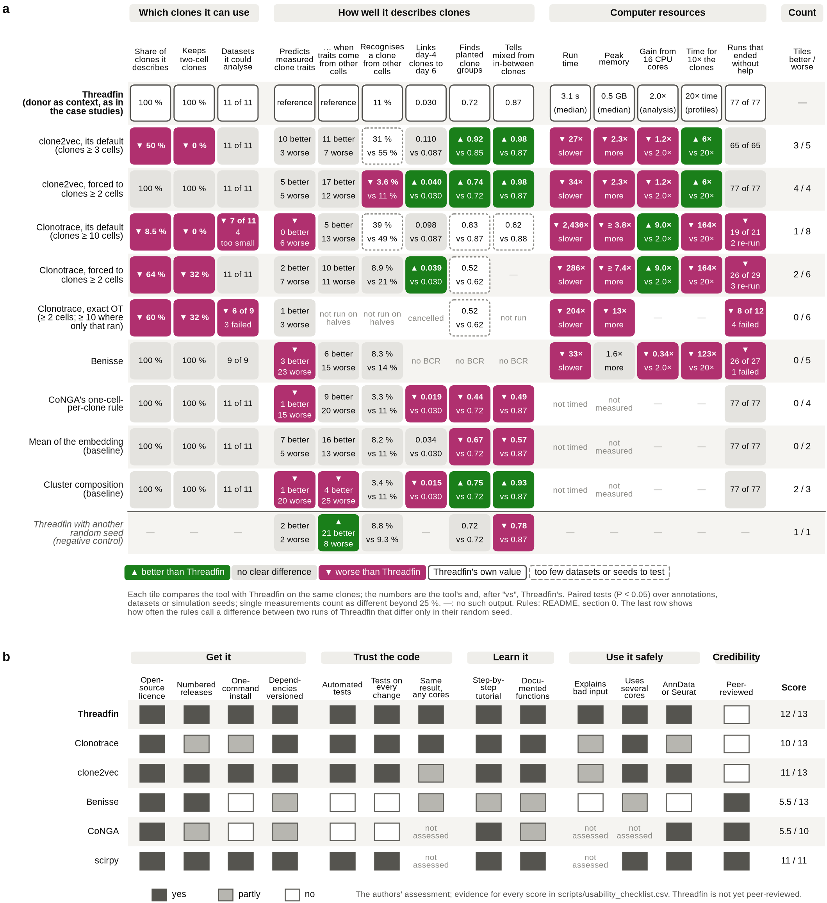

<!-- BEGIN:legend_fig1 -->

**Fig. 1 | The benchmark at a glance.** **a**, Each row is a tool at its own default and forced down to clones of two cells, Clonotrace with the exact optimal-transport distance (runs of 2026-10-25, section 6.11), three simple baselines, and a negative control: Threadfin against itself with another random seed. Each column is one question; the rule behind each verdict is in the table below. Every tile compares the tool with Threadfin on the same clones: green ▲ better, grey no clear difference, magenta ▼ worse; a dashed outline marks a comparison with too few datasets or simulation seeds for a two-sided paired test to reach P < 0.05 (shown descriptively). The numbers are the tool's and, after "vs", Threadfin's. Tests: two-sided sign tests over annotations, Wilcoxon signed-rank tests over datasets or simulation seeds, and a 95 % paired bootstrap interval over day-4 clones (10,000 resamples) for LARRY linking; P < 0.05 with no correction for the 43 tiles that come from a test (sensitivity to α below); n of each tile in results/overview.csv. The last column counts the tiles better and worse than Threadfin; the columns are not independent, so it summarises a row and is not a score. **b**, Usability checklist: the authors' assessment, with the evidence for every score in scripts/usability_checklist.csv.

<!-- END:legend_fig1 -->

**How to read it.** In panel **a**, each row is a tool — at its own default and, where it matters, forced down
to clones of two cells — one of three simple baselines, or the negative control in the last row. Each column is
one question of the benchmark, in plain words, grouped as in section 6 (the calibration of clonal tests, which
only Threadfin, scirpy and a cell-level ANOVA address, is in section 6.6). Every tile compares the tool with
Threadfin on the same clones (on the same halves and clones for the split halves, on the same simulated datasets
for the simulations): **green ▲** better than Threadfin, **grey** no clear difference, **magenta ▼** worse, a
**dashed outline** when too few datasets or simulation seeds exist for a paired test to reach P < 0.05 (the tile
is then descriptive), with the number behind the verdict ("vs" gives Threadfin's value on the same clones);
Threadfin's own row gives its value. Runs that failed, were stopped or needed help are counted, never dropped;
inputs outside a tool's scope and runs the authors cancelled are not counted (the rules below). The last row,
Threadfin against itself with another random seed, shows how often the rules call a difference where there is
none. Panel **b** is a usability checklist in the spirit of the software-quality checklists of earlier
benchmarks (Saelens *et al.* 2019, *Nat. Biotechnol.*; the spatial-alignment benchmark of *Nat. Comput. Sci.*
2026, s43588-026-00977-z, Fig. 4): 1 = yes, 0.5 = partly, 0 = no, scored by the authors, with the evidence for
every score in [`scripts/usability_checklist.csv`](scripts/usability_checklist.csv). The figure is drawn by
[`scripts/make_overview.py`](scripts/make_overview.py) from the tables in [`results/`](results/)
(`results/overview.csv` lists every tile with its test, n and P value).

**What it shows, in plain words.**

* **Which clones a tool can use is the largest difference.** At their defaults, Threadfin and Benisse describe
  every clone with two or more cells; clone2vec (≥ 3 cells) describes a median 50 % and none of the two-cell
  clones, and Clonotrace (≥ 10 cells) a median 8.5 %, and could not be run on 4 of the 11 datasets.
* **On measured clone traits, Threadfin, clone2vec forced to two-cell clones and a plain mean of the embedding
  cannot be told apart.** Clonotrace at its default and Benisse recover fewer annotations; CoNGA's one-cell
  rule and cluster composition recover fewer as well. Single annotations are a noisy unit: Threadfin against
  itself with another random seed gets a "better" or "worse" call on 9 of 70 measured annotations (13 %), so the
  column verdicts rest on the balance of calls across annotations, not on any one of them.
* **Threadfin is not best everywhere.** In simulation (10 independent seeds), clone2vec and the
  cluster-composition baseline group clones by their planted programme and separate mixed from in-between
  clones better than Threadfin (Wilcoxon over seeds, P = 0.002 to 0.006); clone2vec and Clonotrace forced to
  two-cell clones link day-4 LARRY clones to their day-6 descendants slightly better; clone2vec's run time grows
  more slowly with the number of clones; and Clonotrace gains more from extra cores (9.0 times faster on 16 cores
  than on one, against 2.0 times for Threadfin's complete analysis, whose clone-map search gains nothing beyond
  8 cores).
* **Cost and reliability.** clone2vec takes about 30 times and Benisse 33 times Threadfin's time for the
  clone representation; Clonotrace 290–2,400 times (its largest run, 11,141 clones, took 101 h on 32 R sessions
  and 128 GB for the whole job). Five Clonotrace runs needed a larger cell graph to finish, Benisse failed on 1 of
  27 runs, and 4 of the 18 exact-OT Clonotrace runs that ended failed; clone2vec at its default cannot run on 4
  half-datasets that hold fewer clones of ≥ 3 cells than its 10 dimensions (not counted as failures). Benisse
  becomes slower with more cores (2.9 times slower on 16 cores than on one) and needed 35 GB for 5,570 clones.
  The complete Threadfin analysis — profiles, test, clone map, programmes — takes 18 s to 9.5 min in one process
  and under 2.3 GB (section 6.9), and 63 min and 8.3 GB for a million cells on 8 cores.
* **Ease of use.** Threadfin scores 12 of 13 on the checklist: it is not yet peer-reviewed. scirpy (11 of 11
  assessed) and clone2vec (11 of 13) are the most mature of the other tools.

How each column's verdict is reached:

<!-- BEGIN:overview_rules -->

| column | how the verdict is reached |
|---|---|
| Share of clones it describes | median over the datasets of the share of clones with ≥ 2 cells that the tool represents; a run that failed, stopped or could not start because too few clones reach the tool's minimum size counts as 0. Datasets outside a tool's scope (LARRY barcodes for Benisse, which needs receptor sequences) and runs the authors cancelled are left out. Better or worse: more than 5 percentage points from Threadfin. |
| Keeps two-cell clones | the same for clones of exactly two cells. |
| Datasets it could analyse | datasets on which the tool produced a result, of those within its scope (the same rule as above). |
| Predicts measured clone traits | measured annotations that no tool used (sorting gates, isotype, mutation, tissue, time, later fate; RNA-derived calls excluded), each scored on the clones the tool represents: the tool is better (worse) on an annotation when the 95 % paired bootstrap interval (10,000 resamples) of R² − R²(Threadfin) excludes 0; an interval end within the Monte-Carlo error of 0 is unresolved and not counted. Column verdict: two-sided sign test of better vs worse annotations, P < 0.05. |
| … when traits come from other cells | as above, but the representation and the annotation come from disjoint halves of each clone's cells, and the tool's R² is compared with Threadfin's on the same halves and the same clones (3 random splits, both directions, averaged; Clonotrace and Benisse: split 0 only); sign test over annotations. |
| Recognises a clone from other cells | share of clones whose representation from one half of their cells is nearest to their own other half, compared with Threadfin on the same halves and clones (median over datasets of the mean over splits); Wilcoxon signed-rank test over datasets. With fewer than 6 datasets no paired test can reach P < 0.05, so the tile is descriptive. |
| Links day-4 clones to day 6 | LARRY: mean reciprocal rank (ties counted as mid-ranks) of each day-4 clone's own day-6 clone among all day-6 clones; 95 % paired bootstrap interval over clones (10,000 resamples). |
| Finds planted clone groups | simulated data with a known answer: share of each clone's 10 nearest clones that follow its planted programme (mean over clones), compared with Threadfin on the same clones; the unit is the simulation seed (the two donor-shift levels and the two clone-size regimes of a seed share clones or donors, so their differences are averaged within the seed); Wilcoxon signed-rank test over seeds. 10 seeds for every tool except Clonotrace (3 seeds: descriptive, since no paired test of 3 seeds can reach P < 0.05). |
| Tells mixed from in-between clones | AUROC for telling clones made of two kinds of cells from clones of cells halfway between them (clones ≥ 10 cells), tested over seeds as above. |
| Run time | time to compute the clone representation, divided by Threadfin's on the same dataset (median); Clonotrace: only runs whose clone distances used several R sessions, a run stopped at 72 h counted as 72 h. Better or worse: every ratio beyond 25 % in the same direction, otherwise a Wilcoxon test on the log ratios (descriptive with fewer than 6 datasets). |
| Peak memory | peak memory, the same way. For Clonotrace /usr/bin/time sees only the main R session, so the job's peak from the scheduler is used where the run had a job of its own, and the main session otherwise (a lower bound, marked ≥). |
| Gain from 16 CPU cores | time with 1 core divided by time with 16 cores (GSE287123 RBD). The scopes differ: Threadfin's complete analysis, the other tools' clone representation. Better or worse: more than 25 % from Threadfin's gain. |
| Time for 10× the clones | how much longer the clone representation takes for 10 times more clones, from 5-50 % subsets of GSE195673 (8 cores; exponent of a fit to 4 subsets). Better or worse: an exponent more than 0.25 from Threadfin's. |
| Runs that ended without help | runs on the full data and on the disjoint halves that finished with the tool's default settings; failed or stopped runs, and runs that needed a larger cell graph, are counted against the tool. Inputs with fewer clones than a tool can represent at all (clone2vec: 11 clones of ≥ 3 cells; Clonotrace: 3 of its minimum size) and runs the authors cancelled are not counted. |
| Tiles better / worse | number of tiles of the row that are better and worse than Threadfin. The columns are not independent questions, so the count is a summary of the row, not a score or a ranking. |

<!-- END:overview_rules -->

The rules were written on 2026-10-23, after the per-annotation and per-dataset results of 2026-10-20 were known
(the plan of 2026-10-20 named the readouts, not these rules); the paired tests are not corrected for the number
of tiles. Sensitivity to the significance level:

<!-- BEGIN:alpha_sensitivity -->

Of the 43 tiles whose verdict comes from a test, 4 change when the tests use P < 0.01 instead of 0.05:

| row | column | shown | P at 0.05 | verdict at 0.05 | verdict at 0.01 |
|---|---|---|---|---|---|
| clone2vec, its default (clones ≥ 3 cells) | Peak memory | 2.3× more | 0.014 | worse | similar |
| clone2vec, forced to clones ≥ 2 cells | Peak memory | 2.3× more | 0.014 | worse | similar |
| Clonotrace, its default (clones ≥ 10 cells) | Predicts measured clone traits | 0 better 6 worse | 0.031 | worse | similar |
| Threadfin with another random seed (negative control) | … when traits come from other cells | 21 better 8 worse | 0.024 | better | similar |

<!-- END:alpha_sensitivity -->

The usability checklist as a table (evidence for every entry in `scripts/usability_checklist.csv`):

<!-- BEGIN:usability -->

| criterion | Threadfin | Clonotrace | clone2vec | Benisse | CoNGA | scirpy |
|---|---|---|---|---|---|---|
| Open-source licence | yes | yes | yes | yes | yes | yes |
| Numbered releases | yes | partly | yes | yes | partly | yes |
| Installs with one command | yes | partly | yes | no | no | yes |
| Dependencies listed with versions | yes | yes | yes | partly | partly | yes |
| Automated tests | yes | yes | yes | no | no | yes |
| Tests run on every change | yes | yes | yes | no | no | yes |
| Same result with more cores | yes | yes | partly | partly | n.a. | n.a. |
| Step-by-step tutorial | yes | yes | yes | partly | yes | yes |
| Every function documented | yes | yes | yes | partly | partly | yes |
| Explains bad input and how to fix it | yes | partly | partly | no | n.a. | n.a. |
| Can use several CPU cores | yes | yes | yes | partly | n.a. | yes |
| Works with AnnData or Seurat objects | yes | partly | yes | no | yes | yes |
| Peer-reviewed paper | no | no | no | yes | yes | yes |

<!-- END:usability -->

---

## 1. Summary in plain words

* **The tools answer different questions.** Threadfin describes each clone by the distribution of its
  cells' transcriptional states and tests whether clone identity explains cell state. Clonotrace
  measures how far apart expanded clones are on the cell-state graph after spreading each clone's label
  over neighbouring cells. clone2vec learns a clone embedding from which clones' cells are neighbours. Benisse
  embeds receptor *sequences* and refines that embedding with expression. CoNGA (whose reduction rule is
  used here) represents each clone by one cell. scirpy's clonotype modularity scores each clone for being
  more connected in the cell graph than random cells.
* **Coverage is the largest difference.** At their own defaults Threadfin and Benisse represent every clone
  with ≥ 2 cells; clone2vec (≥ 3 cells) leaves out every two-cell clone — 28–86 % of the analysable clones
  depending on the dataset — and Clonotrace (≥ 10 cells) can describe only the 5–18 % of clones that reach
  ten cells and cannot run at all on 4 of the 11 datasets. Forced down to two-cell clones, clone2vec covers
  everything, but Clonotrace still discards 24–48 % of the clones (39–84 % of the two-cell clones) after
  label spreading.
* **Two-cell clones do carry information — and not only for Threadfin.** On two-cell clones alone, the
  measured annotations are predicted with a median R² of 0.22 by Threadfin, 0.22 by clone2vec when it is
  forced to include them, and 0.22 by a plain mean of the cells' embedding coordinates (0.25, 0.26 and 0.26 when
  the expression-derived annotations are included). The information is in the data; what Threadfin adds is
  that it uses these clones by default, weights them by how many cells were sampled, and tests them at the
  right error rate. The statement "only Threadfin can use two-cell clones" is true of the tools' **defaults**,
  not of what the data allow.
* **No representation is uniformly best at recovering measured annotations.** Scored on the same clones,
  clone2vec forced to ≥ 2 cells beat Threadfin on 5 of 41 annotations and lost on 10; at its own
  default (≥ 3 cells) it won 10 and lost 7. A plain mean of the embedding won 7 and lost 10. Clonotrace
  won 2 and lost 13 of 41 when forced to ≥ 2 cells, and won none and lost 8 of 26 at its default (≥ 10
  cells), with its default distance. Benisse lost 22 of 31. It won on RBD-bait binding (a sorting gate),
  V-region mutation in the RBD dataset and the W33L mutation in the NP dataset; of the 19 annotations
  derived from the receptor sequence it was better on 2, worse on 11 and similar on 6. Threadfin against
  itself with another seed gets a call on 9 of 70 measured annotations, so counts of a few annotations either
  way are within this noise.
* **Threadfin's clonal test keeps its error rate when samples differ.** With clone labels shuffled
  within each sample (no clonal signal, but the real differences between samples kept), Threadfin's
  coherence test, which permutes labels within samples, rejected in 0–8 % of replicates at α = 5 % (15 of 450
  over all datasets, 3 %); scirpy flagged at least one clone in 100 % of replicates in 4 of 9 datasets, and a
  cell-level ANOVA rejected in 86–100 %. scirpy and the ANOVA compare a clone with cells of the whole dataset,
  so they answer a different question (section 6.6).
* **Reproducible across disjoint cells of the same clone.** Represented from two disjoint halves of its
  cells, a clone is its own best match among all clones for a median of 11 % of clones with Threadfin, 8 % with
  a plain mean and 4 % with clone2vec (chance under 1 %). On the clones that Clonotrace keeps, Threadfin
  re-identifies 21 % and Clonotrace 8.9 % (Clonotrace higher on 3 of 7 datasets), and on Benisse's clones 14 %
  against Benisse's 8.3 % (neither difference is significant); Benisse keeps the clone–clone distances best, by construction, because both halves
  share the receptor sequence it is built from. Recognising a LARRY barcode two days later is hard for every
  method (top-1 at most 6 % among 863 to 2,643 candidates, all far above chance).
* **On simulated data with a known answer, Threadfin is not the best at grouping clones.** Over 10
  independent simulation seeds, clone2vec and a cell-cluster-composition baseline group clones by their true
  programme more accurately, and separate a "mixed" clone (half GC, half plasma cells) from an "intermediate"
  clone (all cells halfway) better — the distinction Threadfin's kernel profile was designed for (AUROC with
  ≥ 10 cells per clone: 0.98 and 0.93 vs 0.87; the plain mean 0.57 and CoNGA's rule 0.49; Clonotrace, on 3
  seeds, 0.62 with its default distance and 0.78–0.81 with the published one). With small clones no method
  separates the two (AUROC 0.40–0.65). Threadfin's donor centring removes an additive donor shift (its results
  are identical with and without the shift), but the simulated donor effect is purely additive, the easiest
  possible case, and centring itself creates some same-donor structure when donors differ in clone
  composition.
* **Cost.** Building Threadfin's clone profiles took 0.2–43 s and < 2.5 GB per dataset; clone2vec
  0.5–11 min; Benisse 6 s–19 min (up to 32 GB); Clonotrace from a minute to more than four days: 18 h for
  the 1,139 expanded LARRY clones and 31 h for the 6,174 LARRY clones forced to ≥ 2 cells (4–6 R sessions), and
  101 h for the 11,141 lymph-node clones forced to ≥ 2 cells (32 R sessions, 3,214 core-hours, 128 GB for the
  whole job, of which /usr/bin/time saw 67 GB in the main session). Its clone-distance step grows with the
  number of clones and with how widely label spreading spreads each clone — 7 h for only 31 expanded clones in
  GSE171703, where each of them spreads over much of the graph. With 16 instead of 1 core, Threadfin's
  complete analysis ran 2.0 times faster, clone2vec 1.2 times faster, Clonotrace 9.0 times faster and Benisse
  2.9 times slower; for ten times more clones, Threadfin's clone profiles took 20 times longer, clone2vec 6
  times, Clonotrace 164 and Benisse 123 times (section 6.9). Threadfin and Clonotrace gave identical results
  with any number of cores; clone2vec and Benisse differed slightly (clone-distance correlation ≥ 0.9999).

What this means for the manuscript is in section 7 and in [`../README.md`](../README.md).

<!-- BEGIN:status -->

*Status of the full-data runs when these tables were generated (2026-10-30 16:25, Melbourne time).*

Still running: none.

Failed (each with the reason the tool gave): none.

Clonotrace with the exact OT distance (runs of 2026-10-25): 28 started, 14 completed (8 on real data), 4 failed, 10 cancelled by the authors (section 6.11).

<!-- END:status -->

---

## 2. The tools and the question each one answers

| tool | version run | what one clone becomes | default minimum clone size | question it answers |
|---|---|---|---|---|
| **Threadfin** | 4.3.1 (this repository, commit a73092a) | a profile: the mean of random Fourier features of its cells' states (a kernel mean embedding), cells centred on their donor, smoothed over 15 neighbouring cells, shrunk towards the donor average by the number of cells | 2 | Do cells of one clone share a state, beyond how they were sampled? Which annotations explain differences between clones? |
| **Clonotrace** (Fu *et al.* 2025, bioRxiv 10.1101/2025.09.01.673503) | 1.2.1, commit 158a7b2 | a column of cell-to-clone probabilities after bootstrap label spreading on the cell graph; two clones are compared by the mean graph distance from each cell of one clone to its two nearest cells of the other (both directions) — the vignette's fast approximation of an optimal-transport distance (the exact distance in section 6.11) — blended in 1.2.1 with the distance between clone centroids (`revised = TRUE`) | 10 (the vignette's "expanded clones", `count >= 10`) | How different are two expanded clones' distributions over the cell-state graph? |
| **clone2vec** (Isaev *et al.* 2026, kharchenkolab/clone2vec) | 0.1.1 (PyPI) | a 10-dimensional vector learned by a skip-gram model from which clones' cells are nearest neighbours | 3 | Which clones occupy similar regions of the cell embedding? |
| **Benisse** (Zhang *et al.* 2022, *Nat. Mach. Intell.*; wooyongc/Benisse) | 1.1.0, commit f0ff4c1 | a point in a latent space of receptor sequences (heavy-chain CDR3 encoder) refined by a sparse graph supervised by expression | every clonotype | Which receptor sequences go with which expression profiles? |
| **CoNGA** reduction (Schattgen *et al.* 2022, *Nat. Biotechnol.*) | rule of `conga.preprocess.reduce_to_single_cell_per_clone` (0.1.2), re-implemented on the shared embedding | its most central cell (the cell with the smallest summed distance to the clone's other cells) | 1 | (CoNGA then tests graph-vs-graph overlap; only its clone reduction is benchmarked) |
| **scirpy** clonotype modularity (Sturm *et al.* 2020) | 0.22.5 | a per-clone score: how many more edges join the clone's cells in the cell neighbour graph than join random cells | 2 | Which individual clones are more transcriptionally connected than random cells? |
| baseline: **mean of the embedding** | — | the plain mean of its cells' embedding coordinates | 2 here | — |
| baseline: **cluster composition** | — | the fractions of its cells in each Leiden cluster of all cells (square-root transformed) | 2 here | — |

Two further published tools were considered and not run: **CellRank/CoSpar**-style clonal fate inference
(answers fate probabilities of *cells*, not a clone representation) and **Dandelion**'s own analysis
modules (Threadfin already uses Dandelion for clone definition; Dandelion has no clone-state
representation).

---

## 3. How the comparison was kept fair

1. **Identical inputs.** Every tool received the same cell embedding (30 principal components of
   log-normalised expression with immunoglobulin and T-cell-receptor genes removed — the embedding of the
   manuscript; integrated over donors with Harmony for GSE195673 and GSE171703), the same clone ids
   (Dandelion, heavy + light chain, called within donors), the same donors and samples
   ([`scripts/prepare_inputs.py`](scripts/prepare_inputs.py)). Benisse needs receptor sequences and
   expression values, so it also received each cell's heavy-chain V gene, J gene and CDR3 amino-acid sequence
   and the log-normalised expression of 3,000 highly variable genes chosen as for the embedding (receptor
   genes removed; per donor for GSE195673). For GSE171703 the embedding chose its genes per donor and
   Benisse's input did not, so the two gene sets differ there.
2. **Each tool's documented defaults**, taken from its tutorial or README at the version above, and
   recorded per run in `run.json`. Where a default could not be run on these data, the change is listed in
   the table below — none of the changes was chosen by looking at a benchmark result.
3. **Two settings per tool where the minimum clone size matters.** Every tool was run at its own default
   ("native") and forced down to clones of ≥ 2 cells ("forced"), so that a difference between tools cannot
   come only from which clones each is allowed to see.
4. **The same clones in every comparison.** A comparison between Threadfin and another tool uses exactly the
   clones that the other tool represents (pairwise common sets), so a tool that drops clones is scored on
   the clones it kept, and Threadfin on the same ones; on the disjoint halves each tool is compared with
   Threadfin on the same halves and clones, and in the simulations on the same simulated datasets and clones.
   How many clones each tool keeps is reported separately (coverage), never folded into the accuracy scores.
5. **Annotations that no tool used.** The scored annotations (sorting gates, isotype, V-region mutation,
   tissue, time point, later fate) were never given to any tool. Annotations that are themselves derived
   from the expression data (cell-type calls, marked "(RNA)") are easy by construction and are shown
   separately. Two qualifications: Benisse is given each cell's heavy-chain V gene, J gene and CDR3 sequence,
   which are related to the sequence-derived annotations (W33L, V-region mutation), so its results there are
   partly by construction; and 8 of the 35 measured annotations are constant within every sample (the gut
   GC-fate sort and lamina propria, the three RBD gates, the NP division gate, and blood and day in GSE195673),
   so for these a representation is scored on separating the samples of a donor.
6. **Donor-centred scoring.** Annotation values are centred within donor before scoring, so no tool gains
   by separating donors, and permutation nulls shuffle values among clones of the same donor. Threadfin is run
   with the donor as its sampling context, as in the case studies; `threadfin.run()` uses the sample.
7. **Every failure is reported.** Runs that failed or could not be started are listed with the reason. A
   failed run was repeated only to apply the remedy the tool itself prints (a larger cell graph when
   Clonotrace reports a disconnected graph), never to obtain a better score.
8. **Resources and hardware.** Each tool ran with 4 CPU threads (Clonotrace: 4 parallel R sessions, with the
   exceptions listed in the table below) on the University of Melbourne's Spartan cluster, on nodes shared with
   other jobs, so times are indicative to within a factor of about two. The nodes were not all of one kind
   (`results/run_hosts.csv` names the job and node of every timed run): all per-dataset runs ran on 128-core
   Intel Xeon Sapphire Rapids nodes except Clonotrace forced to ≥ 2 cells on GSE195673 (the 101-h run), which
   ran on a 72-core node of the older cascade generation; in the core-count and data-size experiments,
   Threadfin ran on a Sapphire Rapids node and clone2vec, Clonotrace and Benisse on 72-core cascade nodes
   (Benisse's 50 % subset on a Sapphire Rapids node), so the absolute times across tools in Figs. 12 and 13 mix
   CPU generations (each tool's own speed-up and growth are measured on one kind of node).

| tool | change from its tutorial, and why |
|---|---|
| Clonotrace | Label spreading, sparsification and the approximate clone distance as in the vignette, except that the vignette passes `revised = FALSE` to reproduce its published figure, whereas the benchmark keeps the package default (`revised = TRUE`, a blend with the clone-centroid distance) and scores the unrevised distance as "published distance" alongside. (a) When the default cell graph for distances (k = 10) was disconnected, Clonotrace stops and advises a larger k; the run then retried k = 30 and k = 50 (k = 100 for the Plasmodium d10-42 run forced to ≥ 2 cells) and recorded the k used. (b) Clones that keep no cell with probability ≥ 0.1 after label spreading make `clone_disance()` stop; they are removed and counted as lost coverage. (c) The first full-data runs computed the clone distances in one R session instead of the vignette's parallel plan; the distances are identical (verified pair by pair on the NP dataset, 49,455 pairs, and on LARRY days 4/6, 648,091 pairs) but those runs' times are single-process and are marked † in the runtime table. Later runs use 4 parallel sessions (6 for the LARRY run forced to ≥ 2 cells, 8 for the Plasmodium d10-42 run forced to ≥ 2 cells, 32 for the GSE195673 run forced to ≥ 2 cells); where both versions exist, the tables use the parallel one. (d) The first run forced to ≥ 2 cells on GSE195673 (11,141 clones) was stopped after 72 h (15 h of label spreading, then 57 h of clone distances in one process); the rerun with 32 parallel sessions finished in 101 h (4.7 h of label spreading, 95.7 h of clone distances) with k = 30, because the k = 10 graph was disconnected. |
| clone2vec | Documented defaults (`clonal_nn` k = 15, 10 dimensions). Its `split_by` option was not used: it builds a separate graph per category, which for donor-private clones disconnects the clone graph. |
| Benisse | Its README allows a dimension reduction instead of expression, but its initialisation takes 10 principal components of the 10 % most variable rows, which fails on a 30-dimensional embedding; it therefore received log-normalised expression of the 3,000 highly variable genes (as its README recommends). Benisse's unit is the exact clonotype (V + CDR3 + J), finer than a clone; clone-to-clone distances are the mean latent distance over all pairs of the two clones' cells. Run on clones ≥ 2 cells, except ≥ 10 cells on the largest dataset (11,141 clones; its optimisation scales with the square of the number of clonotypes). Not run on LARRY (no receptor). |
| CoNGA rule | Applied to the shared embedding; CoNGA's own pipeline recomputes 50 principal components on its own normalisation. |
| scirpy | `clonotype_modularity(permutation_test="approx")` on a 15-nearest-neighbour graph of the shared embedding; a dataset is counted as "clonal structure found" when at least one clone has FDR < 0.05. This dataset-level reading is ours — scirpy reports per-clone results — and the per-clone false-discovery share is reported too. |

---

## 4. Datasets

Nine B-cell datasets of the manuscript's case studies (paired RNA + BCR, clones = Dandelion clones within
donors) and two from LARRY lentiviral barcoding of mouse haematopoietic progenitors (Weinreb *et al.* 2020),
the dataset of Clonotrace's own tutorial, where a clone is a heritable barcode — ground truth that does not
depend on any receptor-based clone definition.

*A correction made during the benchmark.* Benisse received heavy-chain CDR3 sequences for only 29 % of the
cells in GSE171703's clones. The cause: that dataset's stored clone ids included Dandelion's
light-chain-only groups (cells without a heavy chain grouped by their light chain alone), 1,689 of its 2,281
"clones" with two or more cells. These groups are not clones; they were removed (592 clones with ≥ 2 cells
remain), and **every tool was re-run on the corrected input**. The same defect was fixed in threadfin 4.3.1
and in the case studies (see the [record of defects](../analyses/negative_and_withdrawn_results.md)); the
other eight B-cell datasets contain at most one such group (a two-cell group among the 1,887 RBD clones,
left in place).

<!-- BEGIN:datasets -->

| dataset | study | accession | cells | clones ≥ 2 cells | ≥ 10 cells | donors / samples | annotations scored |
|---|---|---|---|---|---|---|---|
| Gut GC reporter | Siniscalco et al. 2025 Immunity | GSE284622 | 16,619 | 958 | 119 | 3 / 17 | GC-fate sort (tdTomato+); lamina propria; IgA; IgG; V-region mutation; plasma cell (RNA) |
| RBD reporter | Merkenschlager et al. 2025 Nature | GSE287123 | 36,188 | 1,887 | 160 | 10 / 40 | recently divided (mCherry-low); RBD-bait+; dark-zone gate; IgG; V-region mutation |
| NP reporter | Merkenschlager et al. 2025 Nature | GSE287123 | 10,109 | 471 | 41 | 7 / 14 | recently divided (mCherry-low); W33L; IgG; V-region mutation |
| GC + plasma cells | ElTanbouly et al. 2024 J. Exp. Med. | GSE246382 | 884 | 96 | 1 | 11 / 11 | plasma-cell sort; W33L; V-region mutation |
| Plasmodium d10-42 | Skinner et al. 2026 Nat. Immunol. | GSE286215 (exp. 2) | 72,359 | 1,015 | 0 | 42 / 42 | IgG; V-region mutation; GC B cell (RNA); plasmablast (RNA) |
| Plasmodium d0-14 | Skinner et al. 2026 Nat. Immunol. | GSE286215 (exp. 1) | 40,623 | 523 | 0 | 20 / 20 | IgG; V-region mutation; GC B cell (RNA); plasmablast (RNA) |
| Human LN vaccine | Kim et al. 2022 Nature | GSE195673 | 193,442 | 11,141 | 1,243 | 8 / 56 | blood (vs lymph node); spike binding; IgG; IgA; V-region mutation; days after vaccination; GC B cell (RNA) |
| Spontaneous GC | Castrillon et al. 2023 eLife | GSE203132 | 22,898 | 1,051 | 127 | 8 / 8 | IgG; IgA; V-region mutation |
| Human COVID-19 | Dugan et al. 2021 Immunity | GSE171703 | 61,423 | 592 | 31 | 37 / 36 | IgG; IgA |
| LARRY d2 | Weinreb et al. 2020 Science | GSE140802 | 28,249 | 1,401 | 0 | — / — | day-6 neutrophil fraction; day-6 monocyte fraction; day-6 neutrophil share (of neu + mono) |
| LARRY d4/d6 | Weinreb et al. 2020 Science | GSE140802 | 44,664 | 6,174 | 1,139 | — / — | re-identify a barcode's day-6 clone from day 4 |

<!-- END:datasets -->

---

## 5. Tasks and how each is scored

| task | what is measured | why it matters |
|---|---|---|
| **T1 Coverage** | how many of a dataset's clones with ≥ 2 cells (and with exactly 2) a tool represents | a clone that is not represented cannot be studied; most clones in B-cell data are small |
| **T2 Annotation recovery** | each clone's measured annotation (e.g. fraction of its cells in a sort gate) predicted as the mean over its 10 nearest clones in the tool's representation; R² against the truth, permutation null (values shuffled among clones of the same donor, 199 permutations), and a paired bootstrap interval (10,000 resamples of clones, the same resamples for every method scored on the same clones) of the difference to Threadfin; an interval end within the Monte-Carlo error of 0 is reported as unresolved; also R² on two-cell clones only, with its interval | a representation is useful if clones that are close in it are biologically alike in ways that were measured independently |
| **T3 Annotation recovery with disjoint cells** | as T2, but the representation is built from one half of every clone's cells and the annotation measured on the other half (3 random splits × 2 directions; Clonotrace and Benisse: split 0 only; clones with at least two cells in each half); each tool is compared with Threadfin on the same halves and clones | rules out that a tool scores well only because the same cells define both the representation and the annotation |
| **T4 Split-half reproducibility** | the same clones represented from two disjoint halves of their cells: Spearman correlation of all clone–clone distances, overlap of the 10 nearest clones, and how often a clone's own half is its best match among all clones (re-identification; ties counted as mid-ranks) | a representation that changes when other cells of the same clone are sampled describes sampling noise, not the clone |
| **T5 LARRY clone linking** | each day-4 barcode clone's distance to all day-6 clones; is its own barcode's day-6 clone the nearest (top-1), among the 10 nearest (top-10), and mean reciprocal rank; tied distances share the mean of the ranks they span (mid-rank) | the barcode is ground truth: a good representation of a clone's state should recognise the same clone two days later |
| **T6 Later fate from early state (LARRY)** | day-2 clone representation predicts the fractions of that barcode's day-6 cells that became neutrophils or monocytes (scored as T2) | Clonotrace's motivating question, with an outcome measured on other cells days later |
| **T7 Simulation** | repertoires with known programmes, clone sizes and donor shifts (section 6.7; 10 seeds per scenario, 40 simulated datasets, for every tool except Clonotrace, which ran on seeds 1–3): purity of the 10 nearest clones by true programme, separation of "mixture" from "intermediate" clones (AUROC), excess of same-donor neighbours; compared with Threadfin at the level of seeds | the only task with a known right answer |
| **T8 Test calibration and power** | real data with clone labels shuffled (within sample, or across the dataset), 50 replicates each, and with 10–50 % of cells keeping their real label (50 replicates per fraction, Threadfin's test): how often each test reports clonal structure, with Wilson 95 % intervals | a test that reports structure in shuffled data cannot be trusted on real data |
| **T9 Cost** | wall time, peak memory and core-hours of each tool's representation step; for Clonotrace, whose parallel R sessions /usr/bin/time does not see, the scheduler's whole-job peak where the run had a job of its own | what it takes to run |
| **T10 Negative control** | Threadfin against itself with another random-feature seed, scored exactly as the tools are | how often the rules call a difference where there is none |

**How to read R² here.** R² = 1 − (squared error of the prediction) / (variance of the annotation). With
k = 10 neighbours, a representation that carries no information gives R² ≈ −0.1 (the noise of averaging 10
random clones), so 0 is already a little better than chance; the permutation null of every score is in the
tables. R² is computed after centring within donor, so it measures differences *between clones of the same
donor*.

---

## 6. Results

### 6.1 Coverage — which clones can each tool describe?

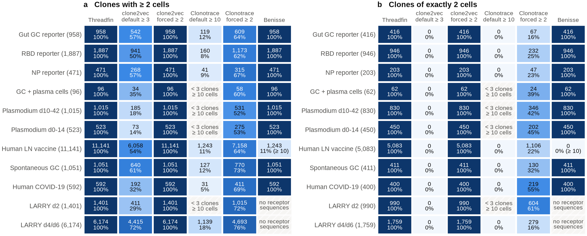

<!-- BEGIN:legend_fig2 -->

**Fig. 2 | Coverage.** Clones with ≥ 2 cells (**a**) and of exactly 2 cells (**b**) that each tool represents, per dataset (row label: the dataset's number of such clones); cell: number represented and share. Hatched: no result, with the reason. Benisse was run at ≥ 10 cells on GSE195673.

<!-- END:legend_fig2 -->

<!-- BEGIN:coverage -->

| dataset | clones ≥ 2 cells | of which 2 cells | Threadfin | clone2vec (default ≥ 3) | clone2vec (forced ≥ 2) | Clonotrace (default ≥ 10) | Clonotrace (forced ≥ 2) | Benisse |
|---|---|---|---|---|---|---|---|---|
| Gut GC reporter | 958 | 416 | 958 (416 two-cell) | 542 (0 two-cell) | 958 (416 two-cell) | 119 (0 two-cell) | 609 (67 two-cell) | 958 (416 two-cell) |
| RBD reporter | 1,887 | 946 | 1,887 (946 two-cell) | 941 (0 two-cell) | 1,887 (946 two-cell) | 160 (0 two-cell) | 1,173 (232 two-cell) | 1,887 (946 two-cell) |
| NP reporter | 471 | 203 | 471 (203 two-cell) | 268 (0 two-cell) | 471 (203 two-cell) | 41 (0 two-cell) | 315 (47 two-cell) | 471 (203 two-cell) |
| GC + plasma cells | 96 | 62 | 96 (62 two-cell) | 34 (0 two-cell) | 96 (62 two-cell) | n/a (< 3 clones ≥ 10 cells) | 58 (24 two-cell) | 96 (62 two-cell) |
| Plasmodium d10-42 | 1,015 | 830 | 1,015 (830 two-cell) | 185 (0 two-cell) | 1,015 (830 two-cell) | n/a (< 3 clones ≥ 10 cells) | 531 (346 two-cell) | 1,015 (830 two-cell) |
| Plasmodium d0-14 | 523 | 450 | 523 (450 two-cell) | 73 (0 two-cell) | 523 (450 two-cell) | n/a (< 3 clones ≥ 10 cells) | 275 (202 two-cell) | 523 (450 two-cell) |
| Human LN vaccine | 11,141 | 5,083 | 11,141 (5,083 two-cell) | 6,058 (0 two-cell) | 11,141 (5,083 two-cell) | 1,243 (0 two-cell) | 7,158 (1,106 two-cell) | 1,243 (0 two-cell) [≥ 10 cells] |
| Spontaneous GC | 1,051 | 411 | 1,051 (411 two-cell) | 640 (0 two-cell) | 1,051 (411 two-cell) | 127 (0 two-cell) | 770 (130 two-cell) | 1,051 (411 two-cell) |
| Human COVID-19 | 592 | 400 | 592 (400 two-cell) | 192 (0 two-cell) | 592 (400 two-cell) | 31 (0 two-cell) | 411 (219 two-cell) | 592 (400 two-cell) |
| LARRY d2 | 1,401 | 990 | 1,401 (990 two-cell) | 411 (0 two-cell) | 1,401 (990 two-cell) | n/a (< 3 clones ≥ 10 cells) | 1,015 (604 two-cell) | n/a (no BCR sequences) |
| LARRY d4/d6 | 6,174 | 1,759 | 6,174 (1,759 two-cell) | 4,415 (0 two-cell) | 6,174 (1,759 two-cell) | 1,139 (0 two-cell) | 4,693 (279 two-cell) | n/a (no BCR sequences) |

<!-- END:coverage -->

*Reading.* Most clones in these datasets are small: 28–86 % of the clones with ≥ 2 cells have exactly two.
clone2vec's default excludes all of them; Clonotrace's default keeps only clones of ≥ 10 cells (≤ 18 %
of clones where it can run) and cannot run on the Plasmodium, GC-zone and LARRY day-2 datasets, which have
fewer than three such clones. Forced to two-cell clones, Clonotrace still loses clones: after bootstrap
label spreading and sparsification, a clone whose cells all fall below probability 0.1 is removed — mostly
two-cell clones in crowded regions of the graph (for example 714 of 946 two-cell clones in the RBD dataset).

### 6.2 Do two-cell clones carry information?

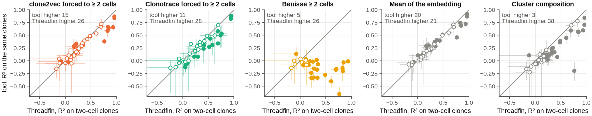

<!-- BEGIN:legend_fig3 -->

**Fig. 3 | Two-cell clones carry information.** R² of each annotation computed on the two-cell clones only: tool (y) against Threadfin (x) on the same clones; one dot per annotation with at least 20 two-cell clones (n = 41 per panel; Benisse 31, Clonotrace 39), including the RNA-derived annotations (medians over the measured annotations alone are in the table below). Predictions are the mean annotation of each clone's 10 nearest clones among all clones of the comparison, after centring within donor. Bars: 95 % bootstrap percentile intervals (10,000 resamples of clones; R² of the two-cell clones of each resample). Filled: the 95 % paired bootstrap interval of the difference excludes 0. Text: annotations with the higher point estimate.

<!-- END:legend_fig3 -->

<!-- BEGIN:two_cell -->

| tool | annotations | median R² on two-cell clones, tool | median R² on the same clones, Threadfin | the same, measured annotations only: tool / Threadfin | tool higher | Threadfin higher | interval excludes 0: tool / Threadfin better | annotations with R² > 0.1 for the tool |
|---|---|---|---|---|---|---|---|---|
| clone2vec (forced to ≥ 2 cells) | 41 | 0.259 | 0.246 | 0.223 / 0.217 (35) | 15 | 26 | 3 / 9 | 30 |
| Clonotrace (forced to ≥ 2 cells) | 39 | 0.236 | 0.304 | 0.220 / 0.273 (33) | 11 | 28 | 0 / 17 | 26 |
| Benisse | 31 | -0.084 | 0.246 | -0.083 / 0.203 (26) | 5 | 26 | 1 / 23 | 1 |
| Mean of the embedding (baseline) | 41 | 0.259 | 0.246 | 0.219 / 0.217 (35) | 20 | 21 | 7 / 10 | 33 |
| Cluster composition (baseline) | 41 | 0.120 | 0.246 | 0.106 / 0.217 (35) | 3 | 38 | 1 / 24 | 23 |
| Medoid cell, CoNGA's rule (baseline) | 41 | 0.207 | 0.246 | 0.182 / 0.217 (35) | 7 | 34 | 1 / 20 | 29 |
| Threadfin, mean profile | 41 | 0.252 | 0.246 | 0.210 / 0.217 (35) | 20 | 21 | 6 / 2 | 29 |
| Threadfin, no shrinkage | 41 | 0.242 | 0.246 | 0.224 / 0.217 (35) | 24 | 17 | 4 / 2 | 32 |

<!-- END:two_cell -->

*Reading.* Yes: on two-cell clones alone, measured annotations are recovered with a median R² of about 0.22
(about 0.25 when the expression-derived annotations are counted), and for most annotations above 0.1. The answer
to "does only Threadfin capture two-cell clones?" is: **by default, yes** — clone2vec and Clonotrace exclude
them unless told otherwise, and Clonotrace still loses 39–84 % of them when forced — **but the information
itself is not unique to Threadfin**: clone2vec forced to ≥ 2 cells and a plain mean of the cells' coordinates
recover about as much from the same two-cell clones. Threadfin's specific contributions for small clones are
(i) including them by default, (ii) shrinking a small clone's profile towards its donor average in proportion
to how few cells were sampled, so that downstream statistics weight it correctly — a matter of weighting, not of
prediction: without shrinkage the two-cell R² is higher on 24 of 41 annotations (the interval excludes 0 on 4
for and 2 against; section 6.8) — and (iii) clonal tests that stay calibrated with many small clones
(section 6.6).

### 6.3 Recovering measured annotations

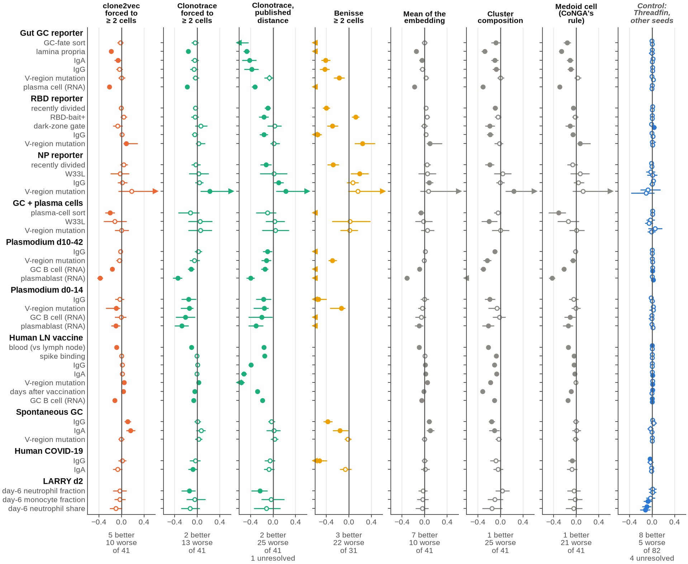

<!-- BEGIN:legend_fig4 -->

**Fig. 4 | Recovering measured clone annotations, every tool forced to clones of ≥ 2 cells.** Dot: R² of the tool minus R² of Threadfin on the clones the tool represents (k-nearest-neighbour regression with k = 10, annotations centred within donor); line: 95 % paired bootstrap percentile interval (10,000 resamples of clones, the same resamples for every method on the same clones; arrow: continues beyond the axis); filled: the interval excludes 0; diamond: an interval end within the Monte-Carlo error of 0 (unresolved). Rows: annotations that no tool used; "(RNA)" marks annotations derived from expression, which are easy by construction. Counts under each panel: annotations better, worse and in all. Last panel, a negative control: Threadfin with random-feature seed 1 (upper line of each row) and seed 2 (lower) against the default seed, on the same clones; every call there is false. Over the measured annotations 9 of 70 control comparisons get a call (13 % (7–23 %), Wilson interval), against 5 % expected from a 95 % interval: the intervals hold each representation fixed and do not include the variation from Threadfin's random features (section 6.10).

<!-- END:legend_fig4 -->

**Every tool forced to clones of ≥ 2 cells** (each comparison on the clones that tool represents):

<!-- BEGIN:pairwise_forced -->

| tool | datasets | annotations | tool better (95 % CI > 0) | Threadfin better (CI < 0) | no clear difference | unresolved | median ΔR² (tool − Threadfin) | median clones per comparison |
|---|---|---|---|---|---|---|---|---|
| clone2vec (forced to ≥ 2 cells) | 10 | 41 | 5 | 10 | 26 | 0 | -0.018 | 958 |
| Clonotrace (forced to ≥ 2 cells) | 10 | 41 | 2 | 13 | 26 | 0 | -0.040 | 531 |
| Clonotrace, published distance (≥ 2) | 10 | 41 | 2 | 25 | 13 | 1 | -0.146 | 531 |
| Benisse | 8 | 31 | 3 | 22 | 6 | 0 | -0.372 | 958 |
| Mean of the embedding (baseline) | 10 | 41 | 7 | 10 | 24 | 0 | -0.003 | 958 |
| Cluster composition (baseline) | 10 | 41 | 1 | 25 | 15 | 0 | -0.101 | 958 |
| Medoid cell, CoNGA's rule (baseline) | 10 | 41 | 1 | 21 | 19 | 0 | -0.050 | 958 |

<!-- END:pairwise_forced -->

The same, leaving out the annotations derived from expression ("(RNA)"), which are easy by construction:

<!-- BEGIN:pairwise_forced_no_rna -->

| tool | datasets | annotations | tool better (95 % CI > 0) | Threadfin better (CI < 0) | no clear difference | unresolved | median ΔR² (tool − Threadfin) | median clones per comparison |
|---|---|---|---|---|---|---|---|---|
| clone2vec (forced to ≥ 2 cells) | 10 | 35 | 5 | 5 | 25 | 0 | -0.006 | 958 |
| Clonotrace (forced to ≥ 2 cells) | 10 | 35 | 2 | 7 | 26 | 0 | -0.032 | 609 |
| Clonotrace, published distance (≥ 2) | 10 | 35 | 2 | 19 | 13 | 1 | -0.119 | 609 |
| Benisse | 8 | 26 | 3 | 17 | 6 | 0 | -0.284 | 958 |
| Mean of the embedding (baseline) | 10 | 35 | 7 | 5 | 23 | 0 | +0.001 | 958 |
| Cluster composition (baseline) | 10 | 35 | 1 | 20 | 14 | 0 | -0.095 | 958 |
| Medoid cell, CoNGA's rule (baseline) | 10 | 35 | 1 | 15 | 19 | 0 | -0.043 | 958 |

<!-- END:pairwise_forced_no_rna -->

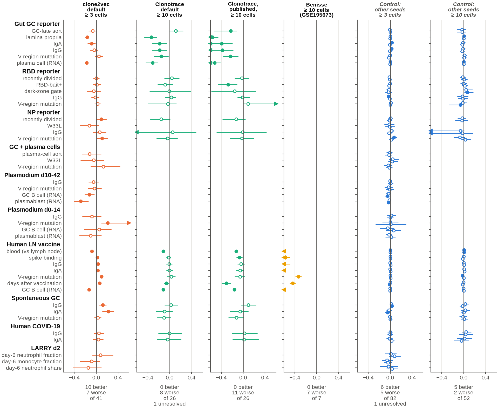

<!-- BEGIN:legend_fig5 -->

**Fig. 5 | Recovering measured clone annotations, every tool at its own default.** clone2vec keeps clones of ≥ 3 cells, Clonotrace ≥ 10; Benisse was run at ≥ 10 cells on GSE195673 only. Dot: R² of the tool minus R² of Threadfin on the clones the tool represents (k-nearest-neighbour regression with k = 10, annotations centred within donor); line: 95 % paired bootstrap percentile interval (10,000 resamples of clones, the same resamples for every method on the same clones; arrow: continues beyond the axis); filled: the interval excludes 0; diamond: an interval end within the Monte-Carlo error of 0 (unresolved). Rows: annotations that no tool used; "(RNA)" marks annotations derived from expression, which are easy by construction. Counts under each panel: annotations better, worse and in all. Last two panels: the seed control restricted to the clones of ≥ 3 and ≥ 10 cells.

<!-- END:legend_fig5 -->

**Every tool at its own default**, scored on the clones it represents:

<!-- BEGIN:pairwise_native -->

| tool | datasets | annotations | tool better (95 % CI > 0) | Threadfin better (CI < 0) | no clear difference | unresolved | median ΔR² (tool − Threadfin) | median clones per comparison |
|---|---|---|---|---|---|---|---|---|
| clone2vec (default, ≥ 3 cells) | 10 | 41 | 10 | 7 | 24 | 0 | +0.002 | 268 |
| Clonotrace (default, ≥ 10 cells) | 6 | 26 | 0 | 8 | 17 | 1 | -0.039 | 127 |
| Clonotrace, published distance (≥ 10) | 6 | 26 | 0 | 11 | 15 | 0 | -0.096 | 127 |
| Benisse (≥ 10 cells) | 1 | 7 | 0 | 7 | 0 | 0 | -0.606 | 1243 |

<!-- END:pairwise_native -->

**Negative control: Threadfin against itself.** The same readout with Threadfin's random-feature seed changed
(seed 1 or 2 against the default 0, everything else equal), on the same clones; every call here is a false call:

<!-- BEGIN:seed_control -->

| comparisons | annotations | comparisons (2 seeds) | called better | called worse | unresolved | false-call rate (Wilson 95 % CI) | binomial P against 5 % | median |ΔR²| | largest |ΔR²| |
|---|---|---|---|---|---|---|---|---|---|
| all clones ≥ 2 cells (Fig. 4) | measured | 70 | 5 | 4 | 4 | 13 % (7–23 %) | 0.008 | 0.008 | 0.122 |
| all clones ≥ 2 cells (Fig. 4) | all (incl. RNA) | 82 | 8 | 5 | 4 | 16 % (10–25 %) | 2.1e-04 | 0.007 | 0.122 |
| clones ≥ 3 cells (Fig. 5) | measured | 70 | 5 | 3 | 1 | 11 % (6–21 %) | 0.023 | 0.010 | 0.077 |
| clones ≥ 3 cells (Fig. 5) | all (incl. RNA) | 82 | 6 | 5 | 1 | 13 % (8–22 %) | 0.0026 | 0.010 | 0.077 |
| clones ≥ 10 cells (Fig. 5) | measured | 48 | 4 | 2 | 0 | 12 % (6–25 %) | 0.032 | 0.017 | 0.068 |
| clones ≥ 10 cells (Fig. 5) | all (incl. RNA) | 52 | 5 | 2 | 0 | 13 % (7–25 %) | 0.014 | 0.016 | 0.068 |

<!-- END:seed_control -->

*Reading.* Every call in this table is a false call. Over the measured annotations, 9 of the 70 seed
comparisons on all clones get one (13 %; 4 more are unresolved), against 5 % expected from a 95 % interval:
the paired bootstrap holds each representation fixed and leaves out the variation that Threadfin's random
features add (the largest change is 0.12 in R², LARRY day-2 neutrophil share). A difference on one or a few
annotations of this size is therefore not evidence that two tools differ; the verdicts of Fig. 1 come from sign
tests over all annotations, which the control passes (2 better and 2 worse with seed 1).

<details><summary>Every annotation, every tool (R² of the tool vs R² of Threadfin on the same clones; ▲ tool better, ▼ Threadfin better, 95 % paired bootstrap interval excluding 0; ? an interval end within the Monte-Carlo error of 0)</summary>

<!-- BEGIN:pairwise_detail -->

| dataset | target | clone2vec (forced to ≥ 2 cells) | Clonotrace (forced to ≥ 2 cells) | Benisse | Mean of the embedding (baseline) |
|---|---|---|---|---|---|
| Gut GC reporter | IgA | 0.27 vs 0.34 ▼ | 0.28 vs 0.32 | -0.07 vs 0.34 ▼ | 0.29 vs 0.34 ▼ |
| Gut GC reporter | IgG | 0.25 vs 0.28 | 0.22 vs 0.27 | -0.14 vs 0.28 ▼ | 0.24 vs 0.28 |
| Gut GC reporter | GC-fate sort (tdTomato+) | 0.66 vs 0.68 | 0.62 vs 0.65 | -0.10 vs 0.68 ▼ | 0.68 vs 0.68 |
| Gut GC reporter | V-region mutation | 0.07 vs 0.06 | 0.06 vs 0.09 | -0.11 vs 0.06 ▼ | 0.09 vs 0.06 |
| Gut GC reporter | lamina propria | 0.71 vs 0.89 ▼ | 0.75 vs 0.91 ▼ | 0.01 vs 0.89 ▼ | 0.74 vs 0.89 ▼ |
| Gut GC reporter | plasma cell (RNA) | 0.74 vs 0.95 ▼ | 0.76 vs 0.94 ▼ | 0.03 vs 0.95 ▼ | 0.77 vs 0.95 ▼ |
| RBD reporter | RBD-bait+ | 0.10 vs 0.05 | 0.01 vs 0.05 | 0.17 vs 0.05 ▲ | 0.09 vs 0.05 |
| RBD reporter | IgG | 0.34 vs 0.32 | 0.30 vs 0.35 | -0.23 vs 0.32 ▼ | 0.35 vs 0.32 |
| RBD reporter | dark-zone gate | 0.21 vs 0.27 | 0.31 vs 0.25 | -0.02 vs 0.27 ▼ | 0.26 vs 0.27 |
| RBD reporter | V-region mutation | -0.04 vs -0.13 ▲ | -0.02 vs -0.04 | 0.12 vs -0.13 ▲ | -0.04 vs -0.13 ▲ |
| RBD reporter | recently divided (mCherry-low) | 0.30 vs 0.31 | 0.28 vs 0.31 | -0.09 vs 0.31 ▼ | 0.33 vs 0.31 |
| NP reporter | recently divided (mCherry-low) | 0.30 vs 0.26 | 0.21 vs 0.24 | -0.02 vs 0.26 ▼ | 0.30 vs 0.26 |
| NP reporter | V-region mutation | 0.01 vs -0.18 | -0.01 vs -0.23 ▲ | -0.02 vs -0.18 | -0.11 vs -0.18 |
| NP reporter | W33L | -0.18 vs -0.16 | -0.16 vs -0.19 | 0.03 vs -0.16 ▲ | -0.11 vs -0.16 |
| NP reporter | IgG | -0.04 vs -0.05 | -0.06 vs -0.10 | 0.01 vs -0.05 | 0.03 vs -0.05 ▲ |
| GC + plasma cells | plasma-cell sort | 0.59 vs 0.79 ▼ | 0.50 vs 0.62 | -0.15 vs 0.79 ▼ | 0.73 vs 0.79 ▼ |
| GC + plasma cells | V-region mutation | -0.15 vs -0.15 | -0.14 vs -0.19 | -0.13 vs -0.15 | -0.10 vs -0.15 |
| GC + plasma cells | W33L | -0.05 vs 0.07 | -0.08 vs -0.13 | 0.09 vs 0.07 | 0.04 vs 0.07 |
| Plasmodium d10-42 | GC B cell (RNA) | 0.67 vs 0.84 ▼ | 0.57 vs 0.68 ▼ | -0.14 vs 0.84 ▼ | 0.74 vs 0.84 ▼ |
| Plasmodium d10-42 | IgG | 0.50 vs 0.52 | 0.42 vs 0.40 | -0.19 vs 0.52 ▼ | 0.53 vs 0.52 |
| Plasmodium d10-42 | plasmablast (RNA) | 0.39 vs 0.77 ▼ | 0.35 vs 0.69 ▼ | -0.54 vs 0.77 ▼ | 0.46 vs 0.77 ▼ |
| Plasmodium d10-42 | V-region mutation | 0.31 vs 0.35 | 0.26 vs 0.31 | 0.06 vs 0.35 ▼ | 0.34 vs 0.35 |
| Plasmodium d0-14 | V-region mutation | -0.03 vs 0.06 ▼ | -0.07 vs 0.07 ▼ | -0.08 vs 0.06 ▼ | 0.02 vs 0.06 |
| Plasmodium d0-14 | GC B cell (RNA) | 0.69 vs 0.70 | 0.32 vs 0.53 ▼ | -0.15 vs 0.70 ▼ | 0.64 vs 0.70 |
| Plasmodium d0-14 | plasmablast (RNA) | 0.53 vs 0.63 ▼ | 0.33 vs 0.60 ▼ | -0.35 vs 0.63 ▼ | 0.53 vs 0.63 ▼ |
| Plasmodium d0-14 | IgG | 0.20 vs 0.23 | 0.10 vs 0.25 ▼ | -0.31 vs 0.23 ▼ | 0.23 vs 0.23 |
| Human LN vaccine | blood (vs lymph node) | 0.88 vs 0.97 ▼ | 0.86 vs 0.97 ▼ | — | 0.87 vs 0.97 ▼ |
| Human LN vaccine | V-region mutation | 0.39 vs 0.35 ▲ | 0.37 vs 0.35 ▲ | — | 0.39 vs 0.35 ▲ |
| Human LN vaccine | IgG | 0.40 vs 0.39 | 0.34 vs 0.33 | — | 0.40 vs 0.39 ▲ |
| Human LN vaccine | GC B cell (RNA) | 0.84 vs 0.96 ▼ | 0.90 vs 0.96 ▼ | — | 0.91 vs 0.96 ▼ |
| Human LN vaccine | IgA | 0.17 vs 0.15 | 0.16 vs 0.16 | — | 0.17 vs 0.15 ▲ |
| Human LN vaccine | spike binding | 0.32 vs 0.32 | 0.32 vs 0.32 | — | 0.32 vs 0.32 |
| Human LN vaccine | days after vaccination | 0.50 vs 0.47 ▲ | 0.44 vs 0.48 ▼ | — | 0.45 vs 0.47 ▼ |
| Spontaneous GC | V-region mutation | 0.06 vs 0.06 | 0.06 vs 0.03 | 0.04 vs 0.06 | 0.05 vs 0.06 |
| Spontaneous GC | IgA | 0.36 vs 0.19 ▲ | 0.23 vs 0.16 | 0.04 vs 0.19 ▼ | 0.30 vs 0.19 ▲ |
| Spontaneous GC | IgG | 0.38 vs 0.27 ▲ | 0.31 vs 0.30 | -0.11 vs 0.27 ▼ | 0.35 vs 0.27 ▲ |
| Human COVID-19 | IgA | 0.03 vs 0.09 | -0.02 vs 0.06 ▼ | 0.03 vs 0.09 | 0.10 vs 0.09 |
| Human COVID-19 | IgG | 0.23 vs 0.22 | 0.14 vs 0.18 | -0.30 vs 0.22 ▼ | 0.22 vs 0.22 |
| LARRY d2 | day-6 neutrophil fraction | 0.16 vs 0.19 | 0.16 vs 0.30 ▼ | — | 0.16 vs 0.19 |
| LARRY d2 | day-6 monocyte fraction | 0.11 vs 0.14 | 0.05 vs 0.10 | — | 0.10 vs 0.14 |
| LARRY d2 | day-6 neutrophil share (of neu + mono) | 0.11 vs 0.21 | 0.09 vs 0.21 | — | 0.17 vs 0.21 |

<!-- END:pairwise_detail -->

</details>

*Reading.*

* **Threadfin vs clone2vec.** Similar overall. Threadfin is ahead mainly on annotations that separate
  compartments within a donor (lamina propria vs lymphoid tissue in the gut, blood vs lymph node, plasma
  cells and GC B cells) — the annotations where centring on the donor helps (section 6.8); clone2vec is
  ahead on isotype in spontaneous GCs, V-region mutation and time since vaccination. On clones of ≥ 3
  cells (clone2vec's default) clone2vec wins slightly more often than it loses; including the two-cell
  clones tips the balance towards Threadfin.
* **Threadfin vs Clonotrace.** On the clones Clonotrace keeps, its default (revised) distance and Threadfin
  are mostly indistinguishable; of the 15 annotations where they differ (forced to ≥ 2 cells), Threadfin
  is better on 13 (lamina propria and plasma cells in the gut, GC B cells and plasmablasts in the Plasmodium
  days 10–42 data, four in the Plasmodium days 0–14 data, IgA after SARS-CoV-2 infection, LARRY neutrophil
  fate, and blood vs lymph node, GC B cells and time since vaccination in the lymph-node data) and
  Clonotrace on two (V-region mutation in the NP and lymph-node data); at Clonotrace's default (≥ 10 cells) Threadfin is better on 8 of 26 and never worse (one more interval is unresolved).
  Clonotrace's published (unrevised) distance does worse than its revised default.
* **Threadfin vs Benisse.** Benisse's representation is anchored on receptor sequence, so it carries
  little of the cell-state annotations. It is better than Threadfin on three annotations: RBD-bait binding (a
  sorting gate, which depends on the receptor's binding), V-region mutation in the RBD dataset and the W33L
  mutation in the NP dataset; on the other annotations derived from the receptor sequence it is worse (11 of the
  19 at ≥ 2 cells) or similar (6). Benisse answers a different question — which receptor sequences go with which
  expression profiles — and its sequence input is related to these annotations (section 3).
* **Threadfin vs simple baselines.** A plain mean of the embedding is as good as Threadfin on these
  readouts (7 wins, 10 losses of 41); cluster composition and CoNGA's single-cell reduction are clearly
  worse. Most of Threadfin's advantage over the mean comes from centring on the donor (section 6.8).

### 6.4 Annotation recovery when representation and annotation use different cells

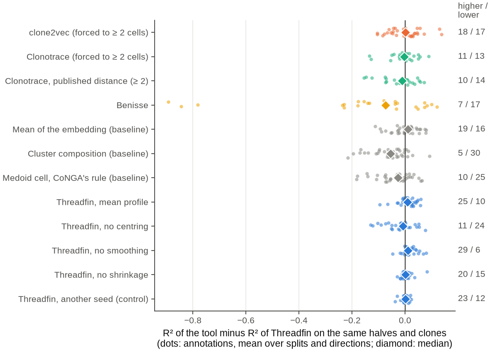

<!-- BEGIN:legend_fig6 -->

**Fig. 6 | Annotation of one half of each clone's cells predicted from a representation of the other half.** R² of the tool minus R² of Threadfin on the same halves and clones (the same split, direction and set of clones), averaged over 3 random splits × 2 directions (Clonotrace and Benisse: split 0 only). Dots: annotations (24–35 per method, including the RNA-derived ones); diamond: median; right: annotations higher / lower than Threadfin. Clones need ≥ 2 cells in each half. The tools come from the comparison of every tool (forced to ≥ 2 cells), Threadfin's variants from the ablation comparison and the control (seed 1) from the sensitivity comparison, each against Threadfin in the same comparison.

<!-- END:legend_fig6 -->

<!-- BEGIN:disjoint -->

| method | set | annotations | median ΔR² (tool − Threadfin, same halves and clones) | tool higher | Threadfin higher | measured annotations only: higher / lower (sign test P) |
|---|---|---|---|---|---|---|
| clone2vec (forced to ≥ 2 cells) | forced | 35 | +0.002 | 18 | 17 | 17 / 12 (0.46) |
| Clonotrace (forced to ≥ 2 cells) | forced | 24 | -0.004 | 11 | 13 | 10 / 11 (1) |
| Clonotrace, published distance (≥ 2) | forced | 24 | -0.011 | 10 | 14 | 9 / 12 (0.66) |
| Benisse | forced | 24 | -0.074 | 7 | 17 | 6 / 15 (0.078) |
| Mean of the embedding (baseline) | forced | 35 | +0.011 | 19 | 16 | 16 / 13 (0.71) |
| Cluster composition (baseline) | forced | 35 | -0.055 | 5 | 30 | 4 / 25 (1.0e-04) |
| Medoid cell, CoNGA's rule (baseline) | forced | 35 | -0.027 | 10 | 25 | 9 / 20 (0.061) |
| Threadfin, mean profile | ablation | 35 | +0.009 | 25 | 10 | 20 / 9 (0.061) |
| Threadfin, no centring | ablation | 35 | -0.009 | 11 | 24 | 9 / 20 (0.061) |
| Threadfin, no smoothing | ablation | 35 | +0.011 | 29 | 6 | 24 / 5 (5.5e-04) |
| Threadfin, no shrinkage | ablation | 35 | +0.001 | 20 | 15 | 16 / 13 (0.71) |
| Threadfin, another seed (control) | sensitivity | 35 | +0.002 | 23 | 12 | 21 / 8 (0.024) |

<!-- END:disjoint -->

*Reading.* With the annotation measured on cells that the representation never saw, every score falls
(median R² of Threadfin about 0.04 instead of 0.27), because each half holds only half of a clone's cells (the test
needs at least two cells of a clone in each half, so two-cell clones are not part of it). Each tool is compared
with Threadfin on the same halves and clones; Clonotrace and Benisse were run on split 0 only, so their rows use
Threadfin's split-0 values. Threadfin, a plain mean of the embedding, clone2vec (forced to ≥ 2 cells) and
Clonotrace's default distance are close; Clonotrace's published distance, the one-cell reduction, Benisse and
most clearly cluster composition (lower on 30 of 35 annotations) are lower. Among Threadfin's own variants,
switching off neighbour smoothing (higher on 29 of 35 annotations) and using the mean profile (25 of 35) help
here more clearly than with shared cells, and switching off centring lowers recovery (lower on 24 of 35). The
seed control is higher on 23 of 35 annotations with a median difference of +0.002 in R²: a sign test over
point estimates can find a direction in differences far too small to matter, so a lean of this kind is not a
difference between methods.

### 6.5 Reproducibility across disjoint halves of each clone, and LARRY clone linking


<!-- BEGIN:legend_fig7 -->

**Fig. 7 | The same clones represented from two disjoint halves of their cells.** **a**, Spearman correlation of all clone–clone distances between the halves; **b**, overlap of the 10 nearest clones (dashed: chance); **c**, share of clones whose representation from one half is nearest to their own other half (re-identification; ties counted as mid-ranks; dashed: chance). Dots: datasets (6–10 per method; mean over 3 splits, Clonotrace and Benisse split 0 only); diamond: median over datasets; black tick: Threadfin's median on the same halves and clones. Clones need ≥ 2 cells in each half; at most 4,000 clones and 300,000 clone pairs per dataset (the same subsample for every method).

<!-- END:legend_fig7 -->

<!-- BEGIN:reproducibility -->

| method | set | datasets | median distance Spearman | Threadfin, same clones | median 10-NN overlap | Threadfin, same clones  | overlap by chance | median re-identification (top 1) | Threadfin, same clones   | higher / lower than Threadfin | re-identification by chance |
|---|---|---|---|---|---|---|---|---|---|---|---|
| Threadfin (default) | forced | 10 | 0.649 | 0.649 | 0.134 | 0.134 | 0.051 | 0.109 | 0.109 |  | 0.0050 |
| clone2vec (forced to ≥ 2 cells) | forced | 10 | 0.577 | 0.649 | 0.126 | 0.134 | 0.051 | 0.036 | 0.109 | 0 / 10 | 0.0050 |
| Clonotrace (forced to ≥ 2 cells) | forced | 7 | 0.578 | 0.658 | 0.206 | 0.180 | 0.087 | 0.089 | 0.208 | 3 / 4 | 0.0086 |
| Clonotrace, published distance (≥ 2) | forced | 7 | 0.537 | 0.658 | 0.234 | 0.180 | 0.087 | 0.108 | 0.208 | 0 / 7 | 0.0086 |
| Benisse | forced | 6 | 0.774 | 0.598 | 0.455 | 0.144 | 0.063 | 0.083 | 0.143 | 4 / 2 | 0.0062 |
| Mean of the embedding (baseline) | forced | 10 | 0.673 | 0.649 | 0.160 | 0.134 | 0.051 | 0.082 | 0.109 | 6 / 4 | 0.0050 |
| Cluster composition (baseline) | forced | 10 | 0.393 | 0.649 | 0.090 | 0.134 | 0.051 | 0.034 | 0.109 | 4 / 6 | 0.0050 |
| Medoid cell, CoNGA's rule (baseline) | forced | 10 | 0.530 | 0.649 | 0.087 | 0.134 | 0.051 | 0.033 | 0.109 | 2 / 8 | 0.0050 |
| Threadfin, mean profile | ablation | 10 | 0.649 | 0.641 | 0.128 | 0.124 | 0.044 | 0.102 | 0.093 | 6 / 3 | 0.0044 |
| Threadfin, no centring | ablation | 10 | 0.717 | 0.641 | 0.110 | 0.124 | 0.044 | 0.091 | 0.093 | 5 / 3 | 0.0044 |
| Threadfin, no smoothing | ablation | 10 | 0.646 | 0.641 | 0.134 | 0.124 | 0.044 | 0.086 | 0.093 | 5 / 5 | 0.0044 |
| Threadfin, no shrinkage | ablation | 10 | 0.603 | 0.641 | 0.128 | 0.124 | 0.044 | 0.069 | 0.093 | 4 / 6 | 0.0044 |
| Threadfin, another seed (control) | sensitivity | 10 | 0.637 | 0.641 | 0.125 | 0.124 | 0.044 | 0.088 | 0.093 | 5 / 3 | 0.0044 |

<!-- END:reproducibility -->

*Reading.* Benisse is the most reproducible by construction: its representation is computed from the receptor
sequence, which both halves of a clone share, so its stability says nothing about cell state. Among the
representations of cell state, Threadfin has the highest median re-identification (11 % of clones are their own
best match from the other half, against under 1 % by chance); the plain mean reaches 8 % (no clear difference,
Wilcoxon P = 0.43) and clone2vec 4 % (lower on all 10 datasets, P = 0.002). On the same halves and clones, the
medians are 8.9 % for Clonotrace against 21 % for Threadfin (Clonotrace higher on 3 of 7 datasets, lower on 4;
P = 0.47) and 8.3 % for Benisse against 14 % (P = 0.84): lower medians, but no clear difference. Threadfin
without donor centring keeps more of the
clone–clone distance structure than Threadfin on the same clones (Spearman correlation 0.717 vs 0.641), because
the differences between donors are shared by both halves of every clone.

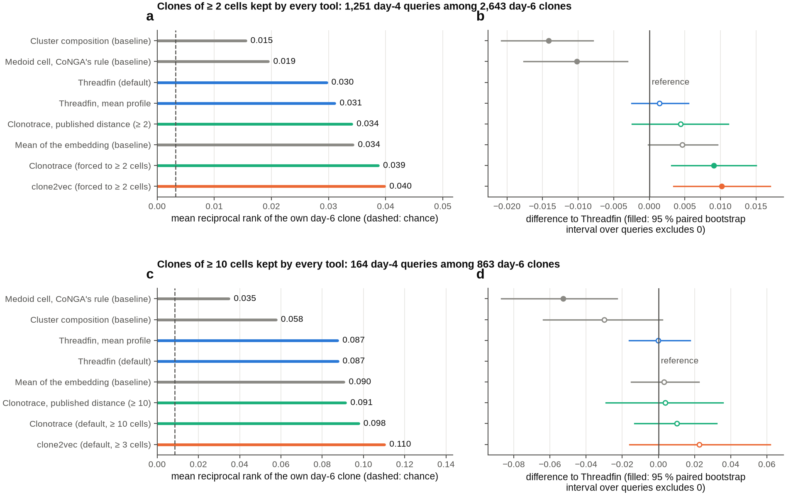

<!-- BEGIN:legend_fig8 -->

**Fig. 8 | Linking day-4 LARRY clones to the same barcode's day-6 clone.** Each day-4 clone's own day-6 clone is ranked among all day-6 clones by the distance between representations (ties counted as mid-ranks). **a**, **b**: clones of ≥ 2 cells kept by every tool (1,251 day-4 queries, 2,643 day-6 candidates); **c**, **d**: clones of ≥ 10 cells (164 queries, 863 candidates). **a**, **c**: mean reciprocal rank (dashed: chance); **b**, **d**: difference to Threadfin with its 95 % paired bootstrap interval over day-4 queries (10,000 resamples); filled: the interval excludes 0.

<!-- END:legend_fig8 -->

<!-- BEGIN:larry -->

| setting | method | query clones | day-6 candidates | top 1 | top 10 | mean reciprocal rank | difference to Threadfin (95 % CI) | queries with tied candidates | median rank | chance top 1 |
|---|---|---|---|---|---|---|---|---|---|---|
| forced: clones >= 2 cells | clone2vec (forced to ≥ 2 cells) | 1,251 | 2,643 | 0.018 | 0.075 | 0.040 | +0.010 [+0.003, +0.017] | 0% | 326 | 0.0004 |
| forced: clones >= 2 cells | Clonotrace (forced to ≥ 2 cells) | 1,251 | 2,643 | 0.018 | 0.068 | 0.039 | +0.009 [+0.003, +0.015] | 0% | 448 | 0.0004 |
| forced: clones >= 2 cells | Mean of the embedding (baseline) | 1,251 | 2,643 | 0.014 | 0.063 | 0.034 | +0.005 [-0.000, +0.010] | 0% | 597 | 0.0004 |
| forced: clones >= 2 cells | Clonotrace, published distance (≥ 2) | 1,251 | 2,643 | 0.009 | 0.073 | 0.034 | +0.004 [-0.002, +0.011] | 0% | 348 | 0.0004 |
| forced: clones >= 2 cells | Threadfin, mean profile | 1,251 | 2,643 | 0.015 | 0.052 | 0.031 | +0.001 [-0.002, +0.006] | 0% | 628 | 0.0004 |
| forced: clones >= 2 cells | Threadfin (default) | 1,251 | 2,643 | 0.016 | 0.049 | 0.030 |  | 0% | 612 | 0.0004 |
| forced: clones >= 2 cells | Medoid cell, CoNGA's rule (baseline) | 1,251 | 2,643 | 0.007 | 0.041 | 0.019 | -0.010 [-0.018, -0.003] | 0% | 754 | 0.0004 |
| forced: clones >= 2 cells | Cluster composition (baseline) | 1,251 | 2,643 | 0.004 | 0.026 | 0.015 | -0.014 [-0.021, -0.008] | 66% | 444 | 0.0004 |
| native: clones >= 10 cells | clone2vec (default, ≥ 3 cells) | 164 | 863 | 0.055 | 0.213 | 0.110 | +0.023 [-0.016, +0.062] | 0% | 60 | 0.0012 |
| native: clones >= 10 cells | Clonotrace (default, ≥ 10 cells) | 164 | 863 | 0.049 | 0.177 | 0.098 | +0.010 [-0.013, +0.032] | 0% | 102 | 0.0012 |
| native: clones >= 10 cells | Clonotrace, published distance (≥ 10) | 164 | 863 | 0.043 | 0.177 | 0.091 | +0.004 [-0.029, +0.036] | 0% | 91 | 0.0012 |
| native: clones >= 10 cells | Mean of the embedding (baseline) | 164 | 863 | 0.049 | 0.159 | 0.090 | +0.003 [-0.015, +0.022] | 0% | 172 | 0.0012 |
| native: clones >= 10 cells | Threadfin (default) | 164 | 863 | 0.061 | 0.140 | 0.087 |  | 0% | 168 | 0.0012 |
| native: clones >= 10 cells | Threadfin, mean profile | 164 | 863 | 0.055 | 0.146 | 0.087 | -0.000 [-0.016, +0.018] | 0% | 176 | 0.0012 |
| native: clones >= 10 cells | Cluster composition (baseline) | 164 | 863 | 0.018 | 0.140 | 0.058 | -0.030 [-0.064, +0.002] | 18% | 128 | 0.0012 |
| native: clones >= 10 cells | Medoid cell, CoNGA's rule (baseline) | 164 | 863 | 0.012 | 0.061 | 0.035 | -0.053 [-0.087, -0.023] | 0% | 275 | 0.0012 |

<!-- END:larry -->

*Reading.* Recognising the same barcode two days later is hard for every representation (cells
differentiate between day 4 and day 6), but all are far above chance. Tied distances share their ranks
(mid-rank): cluster composition gives many clones identical composition vectors (66 % of the queries among clones
of ≥ 2 cells tie with another day-6 clone), and an earlier version of this table counted those ties in favour of
the true clone, which made composition look best; scored with mid-ranks it is the weakest representation there
(mean reciprocal rank 0.015 vs 0.030 for Threadfin). Among clones of ≥ 2 cells (the 4,693 clones Clonotrace
keeps), clone2vec and Clonotrace link slightly better than Threadfin (0.040 and 0.039 vs 0.030; both paired
intervals exclude 0). Among clones of ≥ 10 cells, clone2vec places the true day-6 clone highest on average (0.110
vs 0.087) and Threadfin places it first slightly more often (10 vs 9 of 164 queries); no paired interval there
excludes 0 except CoNGA's rule (worse).

### 6.6 Are the clonal tests calibrated?

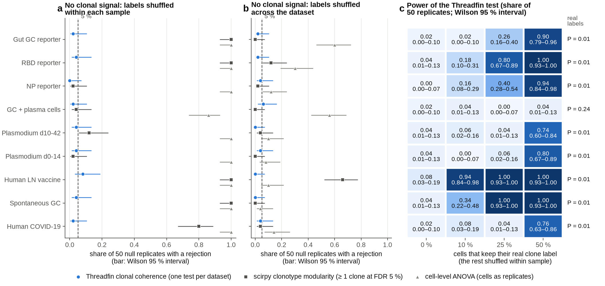

<!-- BEGIN:legend_fig9 -->

**Fig. 9 | Are tests of "cells of one clone share a state" calibrated?** Real data, clone labels shuffled. **a**, **b**: share of 50 null replicates per dataset in which each test reports clonal structure, with Wilson 95 % intervals (dashed: 5 %). Threadfin: clonal coherence test, 99 within-sample permutations, P < 0.05; scirpy: clonotype modularity, at least one clone at FDR < 5 %; ANOVA: cells as replicates, Bonferroni over the first 10 embedding dimensions. **c**, power of Threadfin's test when 10, 25 or 50 % of cells keep their real clone label and the rest are shuffled within sample (50 replicates per fraction; 0 %: the 50 within-sample null replicates), with Wilson 95 % intervals under each value; right: P of the test on the real labels.

<!-- END:legend_fig9 -->

<!-- BEGIN:tests -->

| dataset | Threadfin: false positives, shuffled within sample | scirpy: ≥ 1 clone flagged, shuffled within sample | scirpy: share of clones flagged, shuffled within sample | ANOVA: false positives, shuffled within sample | Threadfin, shuffled across dataset | scirpy, shuffled across dataset | ANOVA, shuffled across dataset | Threadfin power at 10 / 25 / 50 % real labels (50 replicates each) | Threadfin on the real labels: ICC (null) P | scirpy on the real labels: clones flagged |
|---|---|---|---|---|---|---|---|---|---|---|
| Gut GC reporter | 2 % (0–10 %) | 1.00 | 0.005 | 1.00 | 2 % (0–10 %) | 0.00 | 0.60 | 0.02 / 0.26 / 0.90 | 0.245 (0.130) 0.01 | 35 of 958 |
| RBD reporter | 4 % (1–13 %) | 1.00 | 0.003 | 1.00 | 2 % (0–10 %) | 0.12 | 0.30 | 0.18 / 0.80 / 1.00 | 0.142 (0.016) 0.01 | 123 of 1,887 |
| NP reporter | 0 % (0–7 %) | 0.02 | 0.000 | 1.00 | 4 % (1–13 %) | 0.02 | 0.12 | 0.16 / 0.40 / 0.94 | 0.111 (0.018) 0.01 | 2 of 471 |
| GC + plasma cells | 2 % (0–10 %) | 0.04 | 0.000 | 0.86 | 6 % (2–16 %) | 0.00 | 0.56 | 0.04 / 0.00 / 0.04 | 0.048 (0.032) 0.24 | 0 of 96 |
| Plasmodium d10-42 | 4 % (1–13 %) | 0.12 | 0.000 | 1.00 | 0 % (0–7 %) | 0.04 | 0.10 | 0.06 / 0.04 / 0.74 | 0.451 (0.015) 0.01 | 4 of 1,015 |
| Plasmodium d0-14 | 4 % (1–13 %) | 0.02 | 0.000 | 1.00 | 4 % (1–13 %) | 0.00 | 0.08 | 0.00 / 0.06 / 0.80 | 0.736 (0.061) 0.01 | 30 of 523 |
| Human LN vaccine | 8 % (3–19 %) | 1.00 | 0.001 | 1.00 | 0 % (0–7 %) | 0.66 | 0.10 | 0.94 / 1.00 / 1.00 | 0.216 (0.001) 0.01 | 841 of 11,141 |
| Spontaneous GC | 4 % (1–13 %) | 1.00 | 0.006 | 1.00 | 0 % (0–7 %) | 0.00 | 0.04 | 0.34 / 1.00 / 1.00 | 0.279 (0.027) 0.01 | 120 of 1,051 |
| Human COVID-19 | 2 % (0–10 %) | 0.80 | 0.003 | 1.00 | 4 % (1–13 %) | 0.04 | 0.14 | 0.08 / 0.04 / 0.76 | 0.387 (0.036) 0.01 | 34 of 592 |

Threadfin's coherence test over all nine datasets: shuffled within sample: 15 of 450, 3 % (2–5 %); shuffled across the dataset: 11 of 450, 2 % (1–4 %).

<!-- END:tests -->

*Reading.*

* **Shuffled within sample (panel a)** keeps everything about how cells were sampled — each shuffled
  "clone" still comes from one sample, as real clones do — and removes only the clonal signal. Threadfin's
  coherence test, which permutes within samples, reports structure in 0–8 % of replicates per dataset (15 of
  450 over all nine, 3 %, Wilson 95 % interval 2–5 %; 5 % expected).
  scirpy's clonotype modularity compares each clone with random cells from the *whole* graph, so a clone
  that sits in one sample looks modular whenever samples differ: at least one clone was flagged in 100 % of
  replicates in four datasets. Per clone, scirpy's false-discovery share stays below 1 %, so its per-clone
  scores are not wrong as such; they answer "is this clone more connected than random cells?", not "does
  clone identity explain state beyond sampling?". A cell-level ANOVA treats cells as independent
  replicates and rejects almost always.
* **Shuffled across the dataset (panel b)** removes sampling structure too. Threadfin stays at 0–6 % (11 of 450);
  scirpy flags clones in up to 66 % of replicates in the largest dataset (11,141 clones); the ANOVA still
  rejects in up to 60 %.
* **Power (panel c; 50 replicates per fraction).** With only 10–25 % of cells keeping their real clone label,
  Threadfin detects the remaining clonal structure in the datasets with strong coherence (human lymph node 94 %
  of replicates at 10 %; RBD 80 % and spontaneous GCs 100 % at 25 %); with 50 % it does so in 74–100 % of
  replicates in 8 of 9 datasets (≥ 90 % in five). GSE246382 (884 cells, 96 clones) shows no clonal coherence
  even with the real labels (P = 0.24), as reported in the manuscript. (The first version of this panel used 10
  replicates per fraction, too few for a stable estimate.)

### 6.7 Simulation with a known answer

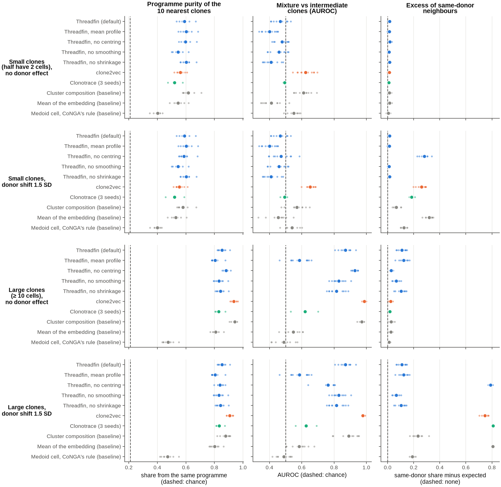

<!-- BEGIN:legend_fig10 -->

**Fig. 10 | Simulated repertoires with a known answer.** 600 clones and 8,000 unlabelled cells per dataset, six donors; rows of panels: clone sizes and donor shift. Small dots: simulated datasets (one per seed); large dot: mean over seeds. Every tool except Clonotrace: 10 seeds; Clonotrace: 3 seeds (its runs take hours per large simulation). Columns: share of each clone's 10 nearest clones that follow the same planted programme (dashed: chance); AUROC for telling mixture from intermediate clones by the share of mixture clones among the 10 nearest (clones ≥ 10 cells; dashed: chance); share of same-donor neighbours minus its expectation (dashed: none). The seed-level tests against Threadfin are in the table below.

<!-- END:legend_fig10 -->

Simulated cells live in a 30-dimensional state space with four states (GC B cell, plasma cell, memory, and
an intermediate state halfway between GC and plasma cell). Each clone follows one of five programmes: all
GC; all plasma cell; memory-biased (70 % memory, 30 % GC); **mixture** (each cell GC or plasma cell with
probability ½); **intermediate** (all cells in the intermediate state). Mixture and intermediate clones have
the same *mean* state, so only a description of a clone's whole distribution can separate them. Six
donors differ in programme composition (Dirichlet(4) weights) and, in the "donor shift" scenarios, every
donor's cells are moved by a random vector of length 1.5 within-state standard deviations. "Small" clones
have 2 + Geometric(0.55) cells (half have two cells); "large" clones 10 + Geometric(0.08). 600 clones and
8,000 unlabelled background cells per dataset ([`scripts/simulate_inputs.py`](scripts/simulate_inputs.py)).
The two donor-shift levels of one seed share the same clones and cells (the shift is added afterwards), and the
two clone-size regimes of a seed share the donors' shifts and programme weights, so the independent unit is the
seed: each tool is compared with Threadfin within each seed and the comparison is tested over seeds. Seeds 1–3
were run with every tool; seeds 4–10 were added for every tool except Clonotrace, whose runs on large simulated
clones take hours each (its comparisons, on 3 seeds, are descriptive).

<details><summary>All simulation results (mean over seeds: 10 for every tool except Clonotrace, 3 for Clonotrace)</summary>

<!-- BEGIN:simulation -->

| clones | donor shift (SD) | method | seeds | programme purity (chance) | purity, two-cell clones | mixture vs intermediate AUROC | same-donor excess |
|---|---|---|---|---|---|---|---|
| small (half 2 cells) | 0 | Threadfin (default) | 10 | 0.591 (0.209) | 0.558 | 0.467 | +0.014 |
| small (half 2 cells) | 0 | Threadfin, mean profile | 10 | 0.603 (0.209) | 0.574 | 0.400 | +0.013 |
| small (half 2 cells) | 0 | Threadfin, no centring | 10 | 0.597 (0.209) | 0.566 | 0.478 | +0.017 |
| small (half 2 cells) | 0 | Threadfin, no smoothing | 10 | 0.546 (0.209) | 0.514 | 0.459 | +0.010 |
| small (half 2 cells) | 0 | Threadfin, no shrinkage | 10 | 0.603 (0.209) | 0.577 | 0.410 | +0.015 |
| small (half 2 cells) | 0 | clone2vec (forced to ≥ 2 cells) | 10 | 0.562 (0.209) | 0.530 | 0.623 | +0.013 |
| small (half 2 cells) | 0 | Clonotrace (forced to ≥ 2 cells) | 3 | 0.521 (0.212) | 0.448 | 0.494 | +0.009 |
| small (half 2 cells) | 0 | Mean of the embedding (baseline) | 10 | 0.546 (0.209) | 0.520 | 0.411 | +0.014 |
| small (half 2 cells) | 0 | Cluster composition (baseline) | 10 | 0.616 (0.209) | 0.584 | 0.611 | +0.013 |
| small (half 2 cells) | 0 | Medoid cell, CoNGA's rule (baseline) | 10 | 0.401 (0.209) | 0.396 | 0.550 | +0.006 |
| small (half 2 cells) | 1.5 | Threadfin (default) | 10 | 0.591 (0.209) | 0.558 | 0.467 | +0.014 |
| small (half 2 cells) | 1.5 | Threadfin, mean profile | 10 | 0.603 (0.209) | 0.574 | 0.400 | +0.013 |
| small (half 2 cells) | 1.5 | Threadfin, no centring | 10 | 0.587 (0.209) | 0.557 | 0.472 | +0.281 |
| small (half 2 cells) | 1.5 | Threadfin, no smoothing | 10 | 0.546 (0.209) | 0.514 | 0.459 | +0.010 |
| small (half 2 cells) | 1.5 | Threadfin, no shrinkage | 10 | 0.603 (0.209) | 0.577 | 0.410 | +0.015 |
| small (half 2 cells) | 1.5 | clone2vec (forced to ≥ 2 cells) | 10 | 0.554 (0.209) | 0.525 | 0.653 | +0.259 |
| small (half 2 cells) | 1.5 | Clonotrace (forced to ≥ 2 cells) | 3 | 0.520 (0.211) | 0.453 | 0.493 | +0.184 |
| small (half 2 cells) | 1.5 | Mean of the embedding (baseline) | 10 | 0.528 (0.209) | 0.507 | 0.455 | +0.320 |
| small (half 2 cells) | 1.5 | Cluster composition (baseline) | 10 | 0.580 (0.209) | 0.555 | 0.569 | +0.066 |
| small (half 2 cells) | 1.5 | Medoid cell, CoNGA's rule (baseline) | 10 | 0.400 (0.209) | 0.395 | 0.540 | +0.124 |
| large (≥ 10 cells) | 0 | Threadfin (default) | 10 | 0.853 (0.210) |  | 0.871 | +0.109 |
| large (≥ 10 cells) | 0 | Threadfin, mean profile | 10 | 0.805 (0.210) |  | 0.585 | +0.123 |
| large (≥ 10 cells) | 0 | Threadfin, no centring | 10 | 0.883 (0.210) |  | 0.928 | +0.027 |
| large (≥ 10 cells) | 0 | Threadfin, no smoothing | 10 | 0.832 (0.210) |  | 0.830 | +0.066 |
| large (≥ 10 cells) | 0 | Threadfin, no shrinkage | 10 | 0.842 (0.210) |  | 0.815 | +0.103 |
| large (≥ 10 cells) | 0 | clone2vec (default, ≥ 3 cells) | 10 | 0.936 (0.210) |  | 0.987 | +0.022 |
| large (≥ 10 cells) | 0 | Clonotrace (default, ≥ 10 cells) | 3 | 0.831 (0.213) |  | 0.621 | +0.017 |
| large (≥ 10 cells) | 0 | Mean of the embedding (baseline) | 10 | 0.808 (0.210) |  | 0.548 | +0.024 |
| large (≥ 10 cells) | 0 | Cluster composition (baseline) | 10 | 0.942 (0.210) |  | 0.972 | +0.028 |
| large (≥ 10 cells) | 0 | Medoid cell, CoNGA's rule (baseline) | 10 | 0.476 (0.210) |  | 0.489 | +0.011 |
| large (≥ 10 cells) | 1.5 | Threadfin (default) | 10 | 0.853 (0.210) |  | 0.871 | +0.109 |
| large (≥ 10 cells) | 1.5 | Threadfin, mean profile | 10 | 0.805 (0.210) |  | 0.585 | +0.123 |
| large (≥ 10 cells) | 1.5 | Threadfin, no centring | 10 | 0.839 (0.210) |  | 0.763 | +0.790 |
| large (≥ 10 cells) | 1.5 | Threadfin, no smoothing | 10 | 0.832 (0.210) |  | 0.830 | +0.066 |
| large (≥ 10 cells) | 1.5 | Threadfin, no shrinkage | 10 | 0.842 (0.210) |  | 0.815 | +0.103 |
| large (≥ 10 cells) | 1.5 | clone2vec (default, ≥ 3 cells) | 10 | 0.907 (0.210) |  | 0.979 | +0.746 |
| large (≥ 10 cells) | 1.5 | Clonotrace (default, ≥ 10 cells) | 3 | 0.833 (0.213) |  | 0.626 | +0.809 |
| large (≥ 10 cells) | 1.5 | Mean of the embedding (baseline) | 10 | 0.801 (0.210) |  | 0.584 | +0.808 |
| large (≥ 10 cells) | 1.5 | Cluster composition (baseline) | 10 | 0.878 (0.210) |  | 0.890 | +0.233 |
| large (≥ 10 cells) | 1.5 | Medoid cell, CoNGA's rule (baseline) | 10 | 0.471 (0.210) |  | 0.489 | +0.189 |

<!-- END:simulation -->

</details>

Each tool against Threadfin on the same simulated datasets and clones, tested at the level of seeds (the rule of
Fig. 1; with 3 seeds no paired test can reach P < 0.05):

<!-- BEGIN:simulation_tests -->

| tool | readout | tool vs Threadfin (mean over seeds) | seeds | Wilcoxon P over seeds | verdict |
|---|---|---|---|---|---|
| clone2vec (default, ≥ 3 cells) | programme purity | 0.92 vs 0.85 | 10 | 0.002 | better |
| clone2vec (default, ≥ 3 cells) | mixture vs intermediate AUROC | 0.98 vs 0.87 | 10 | 0.002 | better |
| clone2vec (forced to ≥ 2 cells) | programme purity | 0.74 vs 0.72 | 10 | 0.0059 | better |
| clone2vec (forced to ≥ 2 cells) | mixture vs intermediate AUROC | 0.98 vs 0.87 | 10 | 0.002 | better |
| Clonotrace (default, ≥ 10 cells) | programme purity | 0.83 vs 0.87 | 3 |  | too few seeds to test |
| Clonotrace (default, ≥ 10 cells) | mixture vs intermediate AUROC | 0.62 vs 0.88 | 3 |  | too few seeds to test |
| Clonotrace (forced to ≥ 2 cells) | programme purity | 0.52 vs 0.62 | 3 |  | too few seeds to test |
| Clonotrace, exact OT (≥ 2) | programme purity | 0.52 vs 0.62 | 3 |  | too few seeds to test |
| Mean of the embedding (baseline) | programme purity | 0.67 vs 0.72 | 10 | 0.002 | worse |
| Mean of the embedding (baseline) | mixture vs intermediate AUROC | 0.57 vs 0.87 | 10 | 0.002 | worse |
| Cluster composition (baseline) | programme purity | 0.75 vs 0.72 | 10 | 0.002 | better |
| Cluster composition (baseline) | mixture vs intermediate AUROC | 0.93 vs 0.87 | 10 | 0.002 | better |
| Medoid cell, CoNGA's rule (baseline) | programme purity | 0.44 vs 0.72 | 10 | 0.002 | worse |
| Medoid cell, CoNGA's rule (baseline) | mixture vs intermediate AUROC | 0.49 vs 0.87 | 10 | 0.002 | worse |
| Threadfin, another seed (control) | programme purity | 0.72 vs 0.72 | 10 | 0.13 | similar |
| Threadfin, another seed (control) | mixture vs intermediate AUROC | 0.78 vs 0.87 | 10 | 0.002 | worse |

<!-- END:simulation_tests -->

*Reading.*

* **Grouping clones by programme.** With large clones, clone2vec (purity 0.94) and cluster composition
  (0.94) beat Threadfin (0.85), Clonotrace (0.83, 3 seeds) and the mean (0.81); with small clones cluster
  composition (0.62) is best and Threadfin's variants follow (0.59–0.60), ahead of clone2vec (0.56) and Clonotrace
  (0.52). CoNGA's one-cell reduction is worst throughout. Over seeds, clone2vec and composition are better than
  Threadfin (P = 0.002–0.006), the plain mean and CoNGA's rule worse.
* **Mixture vs intermediate.** With ≥ 10 cells per clone, Threadfin's kernel profile separates them
  (AUROC 0.87) where its mean profile (0.59), the plain mean (0.57) and Clonotrace's default distance (0.62)
  cannot — but clone2vec (0.98) and cluster composition (0.93) do it better, and Clonotrace's published
  distance reaches 0.78–0.81. With half the clones at two cells no method succeeds (0.40–0.65); two cells cannot
  show whether a clone is a mixture. Threadfin's own value depends on its random features: with seed 1 it is
  0.78, with seed 2 0.88, and 512 or 1,024 features raise it by 0.04 (section 6.10).
* **Donor shift.** Centring on the donor removes an additive donor shift: Threadfin's results are identical with
  and without the shift, while the uncentred representations fill their neighbourhoods with same-donor clones
  (same-donor excess 0.75–0.81 with large clones for clone2vec, Clonotrace, the mean and Threadfin without
  centring).
  Two cautions: real donor effects are not purely additive, so this is the most favourable case for
  centring; and when donors differ in programme composition, centring shifts each donor by its own
  composition, which **adds** same-donor structure (excess 0.109 for Threadfin vs 0.011–0.028 for the
  uncentred methods without any donor shift). This is the same artefact found in the gut dataset (one mouse's
  plasma-cell-rich composition, see [`../analyses/gut_all_B_and_centring/`](../analyses/gut_all_B_and_centring/)).

### 6.8 Which parts of Threadfin matter? (ablation)

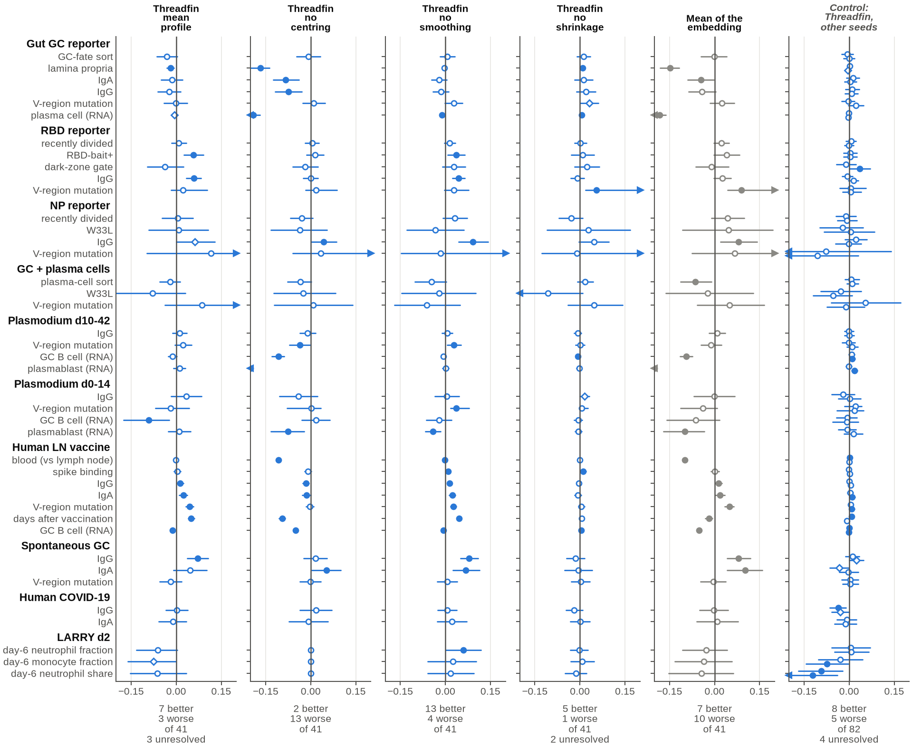

<!-- BEGIN:legend_fig11 -->

**Fig. 11 | Which parts of Threadfin matter?** Each variant switches off one step of the default profile: the kernel mean embedding (mean profile), centring on the donor, neighbour smoothing, shrinkage; "mean of the embedding" switches off all of them. Dot: R² of the tool minus R² of Threadfin on the clones the tool represents (k-nearest-neighbour regression with k = 10, annotations centred within donor); line: 95 % paired bootstrap percentile interval (10,000 resamples of clones, the same resamples for every method on the same clones; arrow: continues beyond the axis); filled: the interval excludes 0; diamond: an interval end within the Monte-Carlo error of 0 (unresolved). Rows: annotations that no tool used; "(RNA)" marks annotations derived from expression, which are easy by construction. Counts under each panel: annotations better, worse and in all. Last panel: the seed control of Fig. 4.

<!-- END:legend_fig11 -->

<!-- BEGIN:pairwise_ablation -->

| tool | datasets | annotations | tool better (95 % CI > 0) | Threadfin better (CI < 0) | no clear difference | unresolved | median ΔR² (tool − Threadfin) | median clones per comparison |
|---|---|---|---|---|---|---|---|---|
| Threadfin, mean profile | 10 | 41 | 7 | 3 | 28 | 3 | +0.003 | 958 |
| Threadfin, no centring | 10 | 41 | 2 | 13 | 26 | 0 | -0.010 | 958 |
| Threadfin, no smoothing | 10 | 41 | 13 | 4 | 24 | 0 | +0.010 | 958 |
| Threadfin, no shrinkage | 10 | 41 | 5 | 1 | 33 | 2 | +0.002 | 958 |
| Mean of the embedding (baseline) | 10 | 41 | 7 | 10 | 24 | 0 | -0.003 | 958 |

<!-- END:pairwise_ablation -->

*Reading.* Centring on the donor is the component that helps annotation recovery most: without it,
Threadfin loses on 13 annotations — tissue (lamina propria, blood vs lymph node), plasma-cell and GC
compartments, isotype in the gut and lymph node, time since vaccination — and wins on 2. The kernel mean
embedding and shrinkage make little difference to these readouts. Neighbour smoothing (each cell averaged with
its 15 nearest cells) helps slightly for the expression-defined compartments but costs more for properties that
differ between neighbouring clones — isotype, V-region mutation, bait binding, time since vaccination, LARRY
neutrophil fate (without smoothing: 13 wins, 4 losses). The last panel of Fig. 11 is the seed control of Fig. 4,
for the scale of chance calls. Smoothing and shrinkage exist for other reasons — stable
profiles for small clones and a well-defined reliability for each clone — but the benchmark suggests
testing a smaller smoothing neighbourhood as the default; section 6.10 does this and finds a trade-off
with the recovery of planted programmes, so the default is kept.

### 6.9 Computing resources: time, memory, cores, data size and runs that finished

The run-time and memory of every tool relative to Threadfin, split into four sub-questions — time on each
dataset, memory on each dataset, time with 1 to 16 cores, and time as the data grow — in the layout of the
annotation figures (one panel per tool; to the right of the line means more than Threadfin):

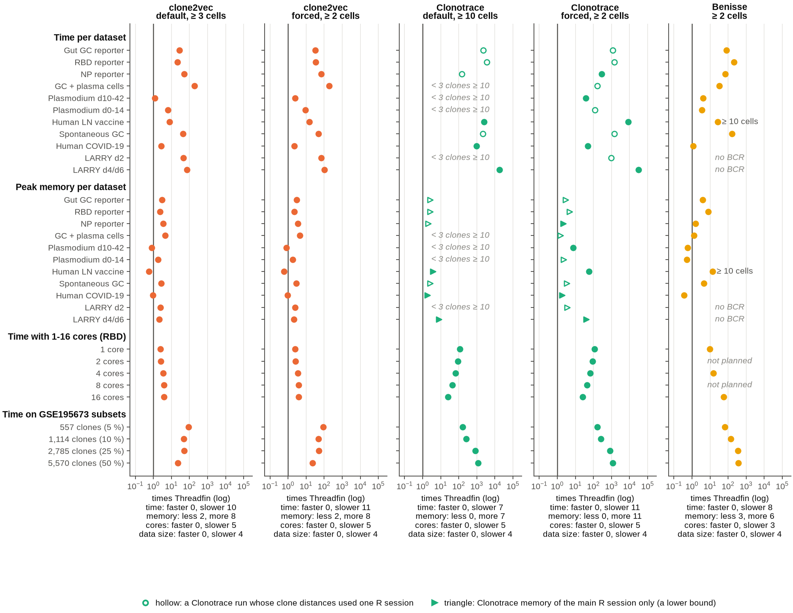

<!-- BEGIN:legend_fig12 -->

**Fig. 12 | Computing resources of each tool relative to Threadfin** (log scale; 1 = the same). Top blocks: time and peak memory of the clone representation on each dataset (4 cores; Clonotrace forced to ≥ 2 cells used 6, 8 and 32 R sessions for the clone distances on LARRY days 4/6, Plasmodium d10-42 and GSE195673). Lower blocks: time with 1–16 cores (GSE287123 RBD; Threadfin: its complete analysis, the other tools: their clone representation) and on 5–50 % subsets of GSE195673 (8 cores). Hollow: Clonotrace runs whose clone distances used one R session (slower than its parallel plan). In the two lower blocks the default and forced panels of a tool show the same runs (each program was run once there, on clones of ≥ 2 cells). Triangles: Clonotrace memory of the main R session only, a lower bound (its parallel sessions are not measured by /usr/bin/time; the job's peak from the scheduler is used where the run had a job of its own). Counts under each panel: differences of more than 25 %. Hardware (results/run_hosts.csv): the per-dataset runs ran on 128-core Sapphire Rapids nodes, except Clonotrace forced to ≥ 2 cells on GSE195673 (a 72-core node of the older cascade generation); in the core-count and data-size blocks Threadfin ran on a Sapphire Rapids node and clone2vec, Clonotrace and Benisse on 72-core cascade nodes (Benisse's 50 % subset on a Sapphire Rapids node), so cross-tool times there mix CPU generations. Nodes were shared with other jobs; times are indicative to within about a factor of two.

<!-- END:legend_fig12 -->

The absolute numbers behind the last two sub-questions:

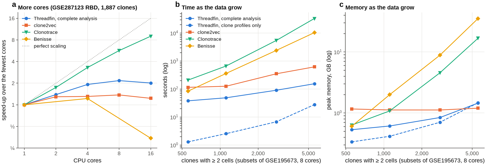

<!-- BEGIN:legend_fig13 -->

**Fig. 13 | Scaling.** **a**, speed-up with cores on GSE287123 RBD (1,887 clones; each configuration alone in a job holding 16 cores, one after another). **b**, **c**, time and peak memory on 5, 10, 25 and 50 % subsets of GSE195673 (8 cores). Threadfin's runs were on a Sapphire Rapids node, the other tools' on 72-core cascade nodes (Benisse's 50 % subset on a Sapphire Rapids node); Clonotrace's memory is its main R session (a lower bound; job peaks for its two largest subsets in the table). Growth exponents are fits to 4 subsets.

<!-- END:legend_fig13 -->

**More cores** (GSE287123 RBD, 1,887 clones; each configuration alone in a job holding 16 cores; Threadfin is
timed for its complete analysis, the other tools for their clone representation; time, peak memory):

<!-- BEGIN:resources_cores -->

| cores | Threadfin, complete analysis | clone2vec | Clonotrace | Benisse |
|---|---|---|---|---|
| 1 | 1.9 min, 0.7 GB | 4.7 min, 1.1 GB | 3.7 h, ≥ 2.3 GB | 19.3 min, 4.0 GB |
| 2 | 1.4 min, 0.8 GB | 3.6 min, 1.1 GB | 2.1 h, ≥ 2.2 GB | — |
| 4 | 1.0 min, 0.8 GB | 3.6 min, 1.1 GB | 1.1 h, ≥ 2.2 GB | 15.8 min, 4.2 GB |
| 8 | 53.9 s, 0.8 GB | 3.4 min, 1.1 GB | 39.0 min, ≥ 2.2 GB | — |
| 16 | 58.2 s, 0.8 GB | 3.8 min, 1.1 GB | 24.6 min, ≥ 2.5 GB | 56.4 min, 4.2 GB |

<!-- END:resources_cores -->

**More data** (random 5–50 % subsets of the GSE195673 cells, 8 cores; time, peak memory):

<!-- BEGIN:resources_size -->

| subset of GSE195673 | clones ≥ 2 cells | Threadfin, complete analysis | Threadfin, clone profiles | clone2vec | Clonotrace | Benisse |
|---|---|---|---|---|---|---|
| 5 % | 557 | 37.8 s, 0.5 GB | 1.3 s, 0.3 GB | 1.9 min, 1.2 GB | 3.5 min, ≥ 0.6 GB | 1.4 min, 0.6 GB |
| 10 % | 1,114 | 48.6 s, 0.6 GB | 2.5 s, 0.4 GB | 2.1 min, 1.1 GB | 11.1 min, ≥ 1.1 GB | 6.0 min, 2.0 GB |
| 25 % | 2,785 | 1.5 min, 0.8 GB | 6.7 s, 0.7 GB | 5.8 min, 1.1 GB | 1.5 h, 9.9 GB (job) | 40.0 min, 8.9 GB |
| 50 % | 5,570 | 2.6 min, 1.4 GB | 27.7 s, 1.5 GB | 10.3 min, 1.2 GB | 9.2 h, 20.7 GB (job) | 2.9 h, 35.3 GB |

<!-- END:resources_size -->

*Reading.* Threadfin's complete analysis gains about twofold from parallel layouts and bootstrap replicates
and nothing beyond 8 cores, because each stage of the clone-map search lays out only a few dozen maps;
its clone profiles alone take seconds and grow slightly faster than the number of clones. The core-count
experiment therefore times different scopes — Threadfin's complete analysis, the other tools' clone
representation — and Threadfin's representation alone (seconds) was not timed with 1–16 cores. clone2vec trains
with PyTorch threads and gains little from more cores, but its time grows slowly with the data. Clonotrace's
parallel R sessions scale well (9.0 times faster on 16 cores than on one, 2.7 times from 4 to 16), yet its time
grows with about the square of the number of clones, which is why the full GSE195673 run took 101 h even on 32
sessions. Benisse became slower with more threads: its Python and R parts both use multithreaded linear algebra,
which oversubscribes the cores; limiting it to 1–4 threads (`OMP_NUM_THREADS`) avoids this. Its memory grows with
the square of the number of clonotypes (35 GB at 5,570 clones). Clonotrace's memory as /usr/bin/time measures it
covers the main R session only (marked ≥, a lower bound): its parallel sessions are not waited-for children of
the timed process. Where a Clonotrace run had a SLURM job of its own, the job's peak from the scheduler is shown
instead ("job"): 128 GB for GSE195673 forced to ≥ 2 cells (67 GB in the main session), 10.8 GB for Plasmodium
d10-42 (2.7 GB), and 9.9 and 20.7 GB for the 25 % and 50 % subsets (4.6 and 16.8 GB). The growth exponents are fits
to four subsets and use the processes' wall times; the nodes differed between tools (section 3), so absolute
times across tools are indicative.

**A million cells.** Threadfin's complete analysis of a synthetic atlas of 1,000,000 cells (182,665 clones,
71,376 with ≥ 2 cells) took 63 min and 8.3 GB on 8 cores
([`../analyses/technical_validation/scalability/`](../analyses/technical_validation/scalability/README.md)); the
other tools were not run at that size.

**Same result with any number of cores?**

<!-- BEGIN:resources_repro -->

| tool | compared | identical | lowest Spearman correlation of clone distances | largest difference of a clone distance |
|---|---|---|---|---|
| clone2vec | 1 core(s) vs 2, 4, 8, 16 | no | 0.999914 | 0.503 |
| Clonotrace | 1 core(s) vs 2, 4, 8, 16 | yes | 1.000000 | 0 |
| Benisse | 1 core(s) vs 4, 16 | no | 1.000000 | 0.00931 |
| Threadfin (clone map and programmes) | 4.4.0 with 1 and with 8 cores vs the released 4.3.1, on 2 datasets (clone-map coordinates and programme labels) | yes |  |  |

<!-- END:resources_repro -->

**The complete Threadfin analysis** on every dataset (released 4.3.1, one process; 4.4.0 gives the same
results and runs the clone-map search and the programme bootstrap on several cores with `n_jobs`, 2.4 and
2.6 times faster on 8 cores for GSE287123 RBD):

<!-- BEGIN:threadfin_full_run -->

| dataset | cells | clones ≥ 2 cells | profiles | coherence test (200 permutations) | clone map (automatic settings) | programmes (30 bootstraps) | one label test | total | peak memory |
|---|---|---|---|---|---|---|---|---|---|
| Gut GC reporter | 16,619 | 958 | 1.9 s | 0.3 s | 47.5 s | 16.6 s | 1.4 s | 1.1 min | 0.6 GB |
| RBD reporter | 36,188 | 1,887 | 3.1 s | 0.7 s | 1.3 min | 35.2 s | 1.9 s | 2.0 min | 0.7 GB |
| NP reporter | 10,109 | 471 | 0.7 s | 0.2 s | 28.7 s | 8.2 s | 0.6 s | 38.3 s | 0.5 GB |
| Plasmodium d10-42 | 72,359 | 1,015 | 30.2 s | 1.1 s | 45.4 s | 19.8 s | 8.8 s | 1.8 min | 1.5 GB |
| Plasmodium d0-14 | 40,623 | 523 | 6.0 s | 0.5 s | 32.8 s | 12.9 s | 3.2 s | 55.4 s | 0.8 GB |
| Human LN vaccine | 193,442 | 11,141 | 42.2 s | 4.3 s | 3.7 min | 4.7 min | 18.3 s | 9.5 min | 2.2 GB |
| Spontaneous GC | 22,898 | 1,051 | 1.2 s | 0.3 s | 47.3 s | 19.2 s | 0.8 s | 1.1 min | 0.6 GB |
| GC + plasma cells | 884 | 96 | 0.2 s | 0.0 s | 15.8 s | 1.6 s | 0.2 s | 17.8 s | 0.5 GB |
| Human COVID-19 | 61,423 | 592 | 25.5 s | 0.7 s | 28.6 s | 12.0 s | 5.8 s | 1.2 min | 1.2 GB |
| LARRY d4/d6 | 44,664 | 6,174 | 3.5 s | 1.3 s | 2.7 min | 3.0 min | ? | 5.8 min | 0.9 GB |

<!-- END:threadfin_full_run -->

**Clone representation per dataset** (4 cores per tool; Clonotrace forced to ≥ 2 cells used 6, 8 and 32 R
sessions for the clone distances on LARRY days 4/6, Plasmodium days 10–42 and GSE195673; time, peak memory, and
for Clonotrace the core-hours, i.e. the R sessions of each stage times its wall time; Clonotrace memory marked ≥
is its main R session only, "(job)" the scheduler's peak of a job that ran that run alone):

<!-- BEGIN:runtime -->

| dataset | Threadfin | clone2vec ≥ 3 | clone2vec ≥ 2 | Clonotrace ≥ 10 | Clonotrace ≥ 2 | Benisse |
|---|---|---|---|---|---|---|
| Gut GC reporter | 1.9 s, 0.4 GB | 50.4 s, 1.1 GB | 1.0 min, 1.1 GB | 1.2 h, ≥ 1.0 GB, 1.2 core-h † | 35.9 min, ≥ 1.1 GB, 1.1 core-h † | 2.5 min, 1.5 GB |
| RBD reporter | 3.1 s, 0.5 GB | 1.1 min, 1.1 GB | 1.8 min, 1.1 GB | 3.1 h, ≥ 1.3 GB, 3.3 core-h † | 1.2 h, ≥ 2.4 GB, 3.2 core-h † | 11.0 min, 4.0 GB |
| NP reporter | 0.7 s, 0.3 GB | 35.6 s, 1.1 GB | 47.6 s, 1.1 GB | 1.7 min, ≥ 0.6 GB, 0.1 core-h † | 3.3 min, ≥ 0.6 GB, 0.2 core-h | 49.1 s, 0.5 GB |
| GC + plasma cells | 0.2 s, 0.2 GB | 33.3 s, 1.1 GB | 32.5 s, 1.1 GB | — | 28.6 s, ≥ 0.4 GB, 0.0 core-h † | 5.7 s, 0.3 GB |
| Plasmodium d10-42 | 29.5 s, 1.4 GB | 36.3 s, 1.1 GB | 1.2 min, 1.2 GB | — | 18.8 min, 10.8 GB (job), 2.3 core-h | 2.0 min, 0.8 GB |
| Plasmodium d0-14 | 5.8 s, 0.6 GB | 36.1 s, 1.1 GB | 53.4 s, 1.1 GB | — | 11.5 min, ≥ 1.4 GB, 0.7 core-h † | 20.0 s, 0.3 GB |
| Human LN vaccine | 42.6 s, 2.3 GB | 5.5 min, 1.3 GB | 10.7 min, 1.4 GB | 28.8 h, ≥ 8.7 GB, 114.8 core-h | 100.7 h, 128.2 GB (job), 3,213.9 core-h | 19.0 min, 31.6 GB |
| Spontaneous GC | 1.2 s, 0.4 GB | 53.8 s, 1.1 GB | 1.0 min, 1.1 GB | 43.6 min, ≥ 1.0 GB, 0.8 core-h † | 29.7 min, ≥ 1.4 GB, 1.2 core-h † | 3.3 min, 1.9 GB |
| Human COVID-19 | 27.3 s, 1.2 GB | 1.2 min, 1.1 GB | 1.0 min, 1.1 GB | 7.4 h, ≥ 2.2 GB, 29.5 core-h | 22.7 min, ≥ 2.2 GB, 1.3 core-h | 32.2 s, 0.4 GB |
| LARRY d2 | 1.4 s, 0.4 GB | 1.1 min, 1.1 GB | 1.6 min, 1.1 GB | — | 22.6 min, ≥ 1.6 GB, 1.3 core-h † | — |
| LARRY d4/d6 | 3.6 s, 0.6 GB | 4.4 min, 1.2 GB | 6.2 min, 1.2 GB | 18.2 h, ≥ 4.5 GB, 72.6 core-h | 31.0 h, ≥ 22.4 GB, 185.6 core-h | — |

<!-- END:runtime -->

† Clonotrace run whose clone-distance step used one R session (see section 3); its time is longer than
with the vignette's parallel plan.

Clonotrace's stages, per run:

<!-- BEGIN:clonotrace_stages -->

| dataset | setting | clones offered | clones kept | label spreading | clone distances | core-hours | graph k used |
|---|---|---|---|---|---|---|---|
| Gut GC reporter | default ≥ 10 | 119 | 119 | 1.5 min | 1.1 h (1 process) | 1.2 | 50 |
| Gut GC reporter | forced ≥ 2 | 958 | 609 | 9.1 min | 26.7 min (1 process) | 1.1 | 30 |
| RBD reporter | default ≥ 10 | 160 | 160 | 3.6 min | 3.0 h (1 process) | 3.3 | 30 |
| RBD reporter | forced ≥ 2 | 1,887 | 1,173 | 40.1 min | 31.6 min (1 process) | 3.2 |  |
| NP reporter | default ≥ 10 | 41 | 41 | 34.3 s | 1.0 min (1 process) | 0.1 |  |
| NP reporter | forced ≥ 2 | 471 | 315 | 2.9 min | 18.6 s (4 workers) | 0.2 | 10 |
| Plasmodium d10-42 | forced ≥ 2 | 1,015 | 531 | 16.4 min | 35.3 s (8 workers) | 2.3 | 100 |
| Plasmodium d0-14 | forced ≥ 2 | 523 | 275 | 10.5 min | 8.7 s (1 process) | 0.7 |  |
| Human LN vaccine | default ≥ 10 | 1,243 | 1,243 | 2.6 h | 26.1 h (4 workers) | 114.8 | 10 |
| Human LN vaccine | forced ≥ 2 | 11,141 | 7,158 | 4.7 h | 95.7 h (32 workers) | 3,213.9 | 30 |
| Spontaneous GC | default ≥ 10 | 127 | 127 | 1.7 min | 41.6 min (1 process) | 0.8 |  |
| Spontaneous GC | forced ≥ 2 | 1,051 | 770 | 14.7 min | 14.6 min (1 process) | 1.2 |  |
| GC + plasma cells | forced ≥ 2 | 96 | 58 | 27.4 s | 0.8 s (1 process) | 0.0 |  |
| Human COVID-19 | default ≥ 10 | 31 | 31 | 1.1 min | 7.3 h (4 workers) | 29.5 | 10 |
| Human COVID-19 | forced ≥ 2 | 592 | 411 | 16.9 min | 1.0 min (4 workers) | 1.3 | 10 |
| LARRY d2 | forced ≥ 2 | 1,401 | 1,015 | 19.0 min | 3.0 min (1 process) | 1.3 | 10 |
| LARRY d4/d6 | default ≥ 10 | 1,139 | 1,139 | 34.9 min | 17.6 h (4 workers) | 72.6 | 10 |
| LARRY d4/d6 | forced ≥ 2 | 6,174 | 4,693 | 1.9 h | 29.1 h (6 workers) | 185.6 | 10 |

<!-- END:clonotrace_stages -->

Where the runs ran (SLURM jobs on Spartan; `results/run_hosts.csv` lists every run):

<!-- BEGIN:hosts -->

| runs | number | nodes | node names |
|---|---|---|---|
| per-dataset runs, Threadfin and the baselines | 209 | Sapphire Rapids, 128 cores: 209 | bm054, bm067, bm180 |
| per-dataset runs, clone2vec | 22 | Sapphire Rapids, 128 cores: 22 | bm054, bm067 |
| per-dataset runs, Clonotrace (approximate distance) | 18 | 72-core cascade generation: 1; Sapphire Rapids, 128 cores: 17 | bm038, bm054, bm067, bm180 |
| per-dataset runs, Clonotrace (exact OT) | 16 | Sapphire Rapids, 128 cores: 16 | bm064, bm065, bm066, bm070, bm072, bm073, bm139, bm140, bm142, bm148, bm180 |
| per-dataset runs, Benisse | 9 | Sapphire Rapids, 128 cores: 9 | bm053, bm067 |
| core-count and data-size runs, Threadfin | 13 | Sapphire Rapids, 128 cores: 13 | bm180 |
| core-count and data-size runs, clone2vec | 9 | 72-core cascade generation: 9 | bm015, bm018 |
| core-count and data-size runs, Clonotrace | 9 | 72-core cascade generation: 9 | bm015, bm017, bm028, bm049 |
| core-count and data-size runs, Benisse | 7 | 72-core cascade generation: 6; Sapphire Rapids, 128 cores: 1 | bm018, bm030, bm046, bm053 |

<!-- END:hosts -->

Threadfin's representation step is what is timed above; the complete `threadfin.run` (profiles,
coherence test with 200 permutations, automatic clone-map layout search, programmes with bootstrap, three
clone-level tests) took 5.8 minutes for the whole tutorial notebook on GSE287123 (36,188 cells; 1,885 clones
from the notebook's own Dandelion run, against 1,887 in the benchmark input, section 7), most of it in reading
the data, Dandelion and the clone-map layout search.

### 6.10 Sensitivity of Threadfin to its settings

Each setting of the clone profiles was changed alone (number of random Fourier features, kernel bandwidth,
smoothing neighbourhood, number of principal components, random seed), on all datasets, their disjoint halves
and the simulations ([`scripts/run_threadfin.py`](scripts/run_threadfin.py), `SENSITIVITY`):

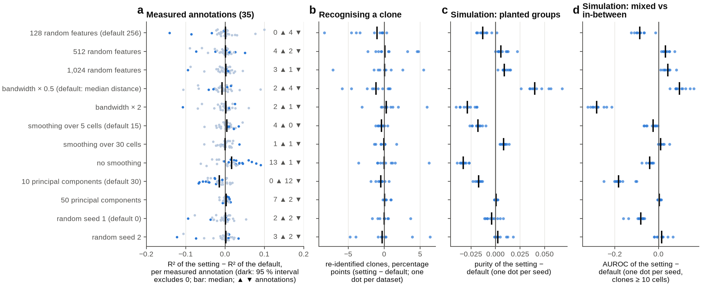

<!-- BEGIN:legend_fig14 -->

**Fig. 14 | Sensitivity of Threadfin to its settings** (one setting changed at a time). **a**, R² of the setting minus the default per measured annotation (n = 35 per setting); dark: the 95 % paired bootstrap interval (10,000 resamples) excludes 0; bar: median; right: annotations better ▲ and worse ▼. The two seed rows are the negative control of Figs. 4, 5 and 11. **b**, re-identification across halves (percentage points; one dot per dataset, mean over 3 splits). **c**, **d**, simulation: one dot per seed (mean over the seed's simulated datasets), programme purity and the mixture vs intermediate AUROC (clones ≥ 10 cells).

<!-- END:legend_fig14 -->

*Reading.* Annotation recovery and re-identification move little when the number of random features
(128–1,024), the random seed, the smoothing neighbourhood (5–30 cells) or the number of principal components
(50 instead of 30) changes: the median change in R² is at most 0.005 (median absolute change 0.004–0.010) and
re-identification moves by at most 1 percentage point. Each of these settings still gets calls on a few
annotations — with seed 1, 2 better and 2 worse; with seed 2, 3 and 2 — which is the chance level that the seed
control measures (section 6.3), not a dependence on the setting. One readout does depend on the random features:
the separation of mixed from in-between clones in simulation. Its AUROC is 0.87 with the default seed 0, 0.78
with seed 1 (lower on all 10 simulation seeds) and 0.88 with seed 2; 128 features lose 0.08 and 512 or 1,024 gain
0.04. None of the comparisons of Fig. 1 would change with seed 1 (clone2vec and composition reach 0.98 and 0.93,
the plain mean and CoNGA's rule 0.57 and 0.49). Ten principal components lose information (12 of 35 annotations
worse, none better; AUROC − 0.18). Two settings trade one readout for another. A narrower kernel (bandwidth ×
0.5) separates mixed from in-between clones better in simulation (AUROC + 0.10) but recovers measured
annotations slightly worse (2 better, 4 worse); a wider one (× 2) loses that separation (− 0.28), because the
kernel profile then approaches the plain mean. Without smoothing, measured annotations are recovered better (13
better, 1 worse) but planted programmes worse (purity − 0.03). The defaults (median-distance bandwidth, 15-cell
smoothing) sit between these ends; the manuscript keeps them.

### 6.11 Clonotrace with the exact optimal-transport distance

Clonotrace's vignette offers two clone distances: exact optimal transport between the clones' cell
distributions on the cell graph, and the faster nearest-neighbour approximation that the rest of this benchmark
uses. On 2026-10-25 Clonotrace was also run with the exact distance (`exact = TRUE`, the vignette's disk backend,
`force_exact = TRUE` because several inputs exceed its default size limits, otherwise the same call and
`revised = TRUE`; 8 R sessions; one SLURM job per run; `make_tasks.py exact_ot`). The option is restored in
[`scripts/run_clonotrace.R`](scripts/run_clonotrace.R) as its 8th argument; it reproduces two of the stored runs
exactly (GSE246382 at ≥ 2 cells and the NP dataset at ≥ 10 cells: identical distances and clones). The runs are
scored like the others; the overview's exact-OT row uses each dataset's ≥ 2-cell run, or its ≥ 10-cell run where
only that finished.

<!-- BEGIN:exact -->

| dataset | setting | status | clones kept | clone distances | approximate distance | job peak memory | reason |
|---|---|---|---|---|---|---|---|
| Gut GC reporter | ≥ 2 cells | failed |  |  | 26.7 min | 5.0 GB | the tool: "All stored endpoint cells must lie in one connected graph component." |
| RBD reporter | ≥ 2 cells | cancelled |  |  | 31.6 min |  | cancelled by the authors |
| NP reporter | ≥ 2 cells | completed | 315 | 0.5 min | 0.3 min | 4.2 GB |  |
| Plasmodium d10-42 | ≥ 2 cells | failed |  |  | 0.6 min | 10.8 GB | the tool: "All stored endpoint cells must lie in one connected graph component." |
| Plasmodium d0-14 | ≥ 2 cells | completed | 275 | 0.2 min | 0.1 min | 7.3 GB |  |
| Spontaneous GC | ≥ 2 cells | completed | 770 | 3.3 min | 14.6 min | 6.0 GB |  |
| GC + plasma cells | ≥ 2 cells | completed | 58 | 0.0 min | 0.0 min | 3.2 GB |  |
| Human COVID-19 | ≥ 2 cells | completed | 413 | 0.8 min | 1.0 min | 9.9 GB |  |
| LARRY d2 | ≥ 2 cells | completed | 1,015 | 3.4 min | 3.0 min | 6.7 GB |  |
| simulation, small clones, shift 0, seed 1 | ≥ 2 cells | completed | 554 | 0.8 min | 0.7 min | 4.1 GB |  |
| simulation, small clones, shift 0, seed 2 | ≥ 2 cells | completed | 524 | 0.8 min | 0.5 min | 4.1 GB |  |
| simulation, small clones, shift 0, seed 3 | ≥ 2 cells | completed | 523 | 0.8 min | 0.5 min | 4.1 GB |  |
| simulation, small clones, shift 1.5, seed 1 | ≥ 2 cells | completed | 528 | 0.8 min | 0.6 min | 4.1 GB |  |
| simulation, small clones, shift 1.5, seed 2 | ≥ 2 cells | completed | 518 | 0.8 min | 0.6 min | 4.1 GB |  |
| simulation, small clones, shift 1.5, seed 3 | ≥ 2 cells | completed | 522 | 0.8 min | 0.4 min | 4.1 GB |  |
| Gut GC reporter | ≥ 10 cells | failed |  |  | 68.2 min | 4.6 GB | the tool: "All stored endpoint cells must lie in one connected graph component." |
| RBD reporter | ≥ 10 cells | failed |  |  | 181.0 min | 6.7 GB | the tool: "All stored endpoint cells must lie in one connected graph component." |
| NP reporter | ≥ 10 cells | completed | 41 | 0.5 min | 1.0 min | 3.6 GB |  |
| Human LN vaccine | ≥ 10 cells | cancelled |  |  | 1566.8 min |  | cancelled by the authors |
| Spontaneous GC | ≥ 10 cells | completed | 127 | 11.9 min | 41.6 min | 5.3 GB |  |
| Human COVID-19 | ≥ 10 cells | cancelled |  |  | 440.3 min |  | cancelled by the authors |
| LARRY d4/d6 | ≥ 10 cells | cancelled |  |  | 1053.3 min |  | cancelled by the authors |
| simulation, large clones, shift 0, seed 1 | ≥ 10 cells | cancelled |  |  | 355.0 min |  | cancelled by the authors |
| simulation, large clones, shift 0, seed 2 | ≥ 10 cells | cancelled |  |  | 286.3 min |  | cancelled by the authors |
| simulation, large clones, shift 0, seed 3 | ≥ 10 cells | cancelled |  |  | 300.6 min |  | cancelled by the authors |
| simulation, large clones, shift 1.5, seed 1 | ≥ 10 cells | cancelled |  |  | 379.9 min |  | cancelled by the authors |
| simulation, large clones, shift 1.5, seed 2 | ≥ 10 cells | cancelled |  |  | 310.4 min |  | cancelled by the authors |
| simulation, large clones, shift 1.5, seed 3 | ≥ 10 cells | cancelled |  |  | 316.9 min |  | cancelled by the authors |

<!-- END:exact -->

Scored on the clones each run represents (the published distance is the unrevised one, `dis_clonotrace`):

<!-- BEGIN:pairwise_exact -->

| tool | datasets | annotations | tool better (95 % CI > 0) | Threadfin better (CI < 0) | no clear difference | unresolved | median ΔR² (tool − Threadfin) | median clones per comparison |
|---|---|---|---|---|---|---|---|---|
| Clonotrace, exact OT (≥ 2) | 6 | 19 | 1 | 5 | 13 | 0 | -0.022 | 275 |
| Clonotrace, exact OT, published (≥ 2) | 6 | 19 | 1 | 5 | 13 | 0 | -0.060 | 275 |
| Clonotrace, exact OT (≥ 10) | 2 | 6 | 0 | 0 | 5 | 1 | -0.097 | 84 |
| Clonotrace, exact OT, published (≥ 10) | 2 | 6 | 0 | 1 | 5 | 0 | -0.056 | 84 |

<!-- END:pairwise_exact -->

*Reading.* Of the 28 exact-OT runs started on 2026-10-25, 14 finished (8 on real data, 6 on small simulated
clones), 4 failed and 10 were cancelled by the authors after 20 minutes to an hour, when the exact-OT runs were
set aside; the cancelled runs are counted neither for nor against Clonotrace. The four failures are the four
inputs on which the approximate distance needed a larger cell graph (section 3): the exact distance stops with
"All stored endpoint cells must lie in one connected graph component", and the run script retries a larger graph
only on Clonotrace's "disconnected graph" message of the approximate distance, so no larger graph was tried for
them. Where it finished, the exact distance recovered measured annotations as the approximate one did: against
Threadfin on the same clones, 1 better and 5 worse of 19 annotations at ≥ 2 cells (the approximate distance on the
same datasets and annotations: 1 better, 6 worse), and its clone distances took minutes on 8 R sessions. In the
simulations it grouped clones as the approximate distance did (purity 0.52 against 0.62 for Threadfin, 3 seeds).

---

## 7. What this benchmark does not show

* **It is not a ranking.** The tools answer different questions (section 2). The readouts here —
  agreement with measured annotations, reproducibility, calibration — are the questions Threadfin was
  designed for; a benchmark built around Clonotrace's question (distances between expanded clones on the
  cell graph) or Benisse's (sequence–expression coupling) would weigh things differently.
* **Annotation recovery measures neighbourhoods, not biology.** A high R² means clones that are close in a
  representation have similar annotations; it does not mean the representation captures the cause. Eight of the
  35 measured annotations are constant within every sample (section 3), so for them it measures how well a
  representation separates the samples of a donor.
* **Single-annotation calls are anti-conservative.** The paired bootstrap holds each representation fixed, so it
  leaves out the variation of the stochastic representations themselves; Threadfin against itself with another
  seed gets a call on 9 of 70 measured annotations (13 %; section 6.3). The column verdicts of Fig. 1 use sign
  tests over annotations, which the control passes in the "measured traits" column; in the column with disjoint
  cells the sign test over point estimates found a lean in the control too (seed 1: 21 of 29 annotations higher,
  P = 0.024; seed 2: 16 of 29, P = 0.71), so a verdict there that is not far stronger is weak evidence.
* **No correction for multiple tests.** The tiles of Fig. 1 are tested at P < 0.05 each; at P < 0.01, 4 of the 43
  tested tiles change (section 0). The rules were written after the per-annotation results were known.
* **Sorting gates were sorted into separate libraries in some datasets** (GSE287123: the RBD-bait and
  dark-zone gates share tubes), so a representation can recover a gate partly through a library effect.
  All tools see the same embedding, so this affects them alike.
* **The simulation is simple**: Gaussian cell states, an additive donor effect (the case that centring removes
  exactly, section 6.7), and 10 seeds per scenario (3 for Clonotrace, whose simulation comparisons are therefore
  descriptive).
* **One run per stochastic tool and input.** clone2vec, Clonotrace's label spreading and Benisse were run once per
  input, with their default seeds, and Clonotrace and Benisse on split 0 only of the disjoint halves; the
  intervals condition on that run. Threadfin's own seed dependence is in section 6.10.
* **Defaults for the other tools.** Threadfin was run at 11 alternative settings (section 6.10); the other tools
  at their defaults and forced to two-cell clones only. For example, Clonotrace's 0.1 probability threshold in
  `clone_disance()` removes the clones behind its 24–48 % loss of coverage; other thresholds were not tried.
* **Clonotrace's times** are inflated for the runs marked †; its outputs are not affected. Its memory as
  /usr/bin/time records it is the main R session only (section 6.9).
* **Benisse was run at ≥ 10 cells on GSE195673** (section 3); from its growth with the number of clonotypes, a run
  at ≥ 2 cells would take about 12 h and 140 GB, which is feasible but was not done.
* **The resource experiments use one dataset each** (cores: GSE287123 RBD; data size: subsets of GSE195673),
  each configuration alone in a job with dedicated cores, on nodes of two CPU generations (section 3); the
  core-count readout compares Threadfin's complete analysis with the other tools' clone representation.
* **The usability checklist is the authors' assessment.** Threadfin's score for explaining bad input rests on its
  own test of 19 awkward inputs; the other tools' scores on the failures seen in this benchmark, not on the same
  test. "Same result with more cores" was measured across core counts, not across repeated runs.
* **Only BCR and lineage-barcode data.** Threadfin also reads T-cell receptor data (since 4.5.0); no T-cell
  benchmark (CoNGA's full test, scirpy, mvTCR or Tessa) was run.
* **Run-to-run variation of clone calls.** Dandelion's clone assignment depends on Python's hash seed
  (a few clones per 10,000 differ between sessions, e.g. 1,885 or 1,887 RBD clones); all tools received the same
  clone ids, so the comparison is unaffected.
* **The disjoint-cell readout** separates cells, but the embedding (principal components and Harmony) was fitted
  on all cells.

What would make it stronger: Clonotrace on more simulation seeds and on further splits of the disjoint halves,
Benisse on further splits and at ≥ 2 cells on GSE195673; several seeds per stochastic tool; a small grid of
settings per competitor; the four failed exact-OT inputs with a larger cell graph; CellRank/CoSpar fate
probabilities on LARRY as an external fate reference; a simulation with non-additive (scaled or state-specific)
donor effects; a T-cell benchmark; and timing on dedicated nodes of one kind with one tool at a time.

---

## 8. Capability matrix

| | Threadfin | Clonotrace | clone2vec | Benisse | CoNGA | scirpy modularity |
|---|---|---|---|---|---|---|
| represents two-cell clones by default | yes | no (≥ 10) | no (≥ 3) | yes (clonotypes) | yes (one cell) | yes (score only) |
| uses the whole distribution of a clone's states | yes (kernel mean) | yes (OT on graph) | indirectly (neighbour co-occurrence) | no (sequence + expression graph) | no (one cell) | no |
| accounts for donor / sample in the representation | yes (centring) | optional (`clone_disance(sample=)`; not used here, as in the vignette) | no (`split_by` disconnects donors) | no | batch keys optional | no |
| weights clones by sampling depth | yes (shrinkage, reliability) | no | no | no | no | per-clone null by size |
| test of "clone identity explains state" calibrated to sampling | yes (within-sample permutation) | no | no | no | graph overlap test | per clone, against the whole graph |
| clone-level tests of annotations | yes | enrichment per cluster | no | no | no | no |
| uses receptor sequence | no (clone ids only) | no | no | yes | yes (TCRdist) | no |
| runs on lineage barcodes (no receptor) | yes | yes | yes | no | no | yes |
| language | Python | R | Python | Python + R | Python | Python |

---

## 9. Reproducing the benchmark

The scripts in [`scripts/`](scripts/) take the public data to every table and figure here. Large files (inputs,
runs) live in a working directory outside the repository; only the tables, figures and environment files are kept
in this folder. Every location and program is an environment variable (no path is fixed in a script):

| variable | what it holds | default |
|---|---|---|
| `THREADFIN_DATA` | the downloaded public data | `manuscript/case_studies/data` |
| `THREADFIN_EMBEDDING_CACHE` | one `<dataset>_embedding.h5ad` per B-cell dataset (30 principal components, `obsm['X_threadfin']`) | `../internal_validation/algorithm_revision/embedding_cache` next to the repository |
| `THREADFIN_LARRY_CACHE` | `early_embedding.h5ad` and `all_embedding.h5ad` of LARRY | `../internal_validation/paper_673503/larry` |
| `THREADFIN_BENCH_WORK` | `inputs/` and `runs/` of the benchmark | `../benchmarking_2026-10-20/work` |
| `THREADFIN_BENCH_RESULTS` | where the tables (and, next to them, the figures) are written | this folder's `results/` |
| `THREADFIN_PYTHON`, `CLONE2VEC_PYTHON` | the Python of each environment | the current interpreter; `python` |
| `CLONOTRACE_RSCRIPT`, `CLONOTRACE_R_LIBS`, `CLONOTRACE_R` | Rscript, the library holding Clonotrace 1.2.1, a frozen copy of `run_clonotrace.R` | `Rscript`; none; `<work>/frozen/run_clonotrace_par.R` |
| `BENISSE_SRC`, `BENISSE_PYTHON`, `BENISSE_RSCRIPT` | a clone of wooyongc/Benisse at f0ff4c1 and the programs that run its encoder and R core | `<work>/../src/Benisse`; the current interpreter; `Rscript` |
| `THREADFIN_PACKAGE` | optional: a folder holding the `threadfin` package of the version to run, put first on `PYTHONPATH` | none |

The authors' values are in `src/benchmark_env.sh` of the working folder.

**Environments** ([`envs/`](envs/); one per tool, so no tool's dependencies change another's):

| file | environment |
|---|---|
| [`envs/threadfin_v4.pip.txt`](envs/threadfin_v4.pip.txt) | Python 3.11.7: Threadfin (the runs used 4.3.1, commit a73092a: `pip install git+https://github.com/Reynold4k/Threadfin@a73092a`), the baselines, scirpy 0.22.5, Benisse's encoder (torch, CPU) and the evaluation |
| [`envs/clone2vec.pip.txt`](envs/clone2vec.pip.txt) | Python 3.11.7: `clone2vec==0.1.1` |
| [`envs/clonotrace_r.conda.txt`](envs/clonotrace_r.conda.txt), [`envs/R_packages.csv`](envs/R_packages.csv) | R 4.3.3 (conda) with Benisse's R dependencies; Clonotrace 1.2.1 installed into its own library from GitHub (`remotes::install_github("yuntianf/Clonotrace@158a7b2")`) |

The files were written on 2026-10-28 from the environments the runs used (the Python environment has since
received newer versions of some packages; the versions that matter are the ones named above).

**From public data to the tables**

```bash
# 1. data and case-study inputs (manuscript/case_studies; about 12 GB)
bash ../case_studies/download.sh "$THREADFIN_DATA"
python ../case_studies/run_case_study.py <dataset>      # each of the nine B-cell datasets -> case_studies/results/<dataset>/cells.csv.gz
python ../case_studies/cache_embedding.py <dataset>     # -> <dataset>_embedding.h5ad (its output folder is set in the script: use THREADFIN_EMBEDDING_CACHE's)
python ../analyses/lineage_barcode_systems/larry/fetch_clonotrace_hematopoiesis.py   # GSE140802 (LARRY)
python ../analyses/lineage_barcode_systems/larry/reanalyse_clonotrace_larry.py      # writes the two LARRY embeddings (THREADFIN_LARRY_CACHE)
# 2. benchmark inputs (scripts/)
cd scripts
python prepare_inputs.py                  # the nine B-cell datasets -> inputs/<dataset>/ (embedding, cells, 3 random splits, CDR3)
python prepare_benisse_expression.py      # expression input for Benisse
python prepare_larry.py                   # LARRY day 2 and days 4/6
python simulate_inputs.py                 # 40 simulated datasets (seeds 1-10; an existing input is kept)
python make_scaling_inputs.py             # 5-50 % subsets of GSE195673 for the data-size readout
# 3. runs: one shell command per tool x dataset x setting, each under /usr/bin/time -v (time.txt, run.json)
export THREADFIN_PACKAGE=<folder with threadfin 4.3.1>   # git archive a73092a threadfin | tar -x -C <folder>
python make_tasks.py full > tasks_full.txt;           bash run_tasks.sh tasks_full.txt 8
python make_tasks.py halves > tasks_halves.txt;       bash run_tasks.sh tasks_halves.txt 8
python make_tasks.py sensitivity > tasks_sens.txt;    bash run_tasks.sh tasks_sens.txt 8
python make_tasks.py sim_seeds > tasks_seeds.txt;     bash run_tasks.sh tasks_seeds.txt 4     # seeds 4-10 (no Clonotrace)
python make_tasks.py rerun_failed > tasks_rerun.txt;  bash run_tasks.sh tasks_rerun.txt 4     # Clonotrace: graph_k ladder 10, 30, 50
python make_tasks.py exact_ot > tasks_exact.txt                                                # Clonotrace exact OT, one job each (section 6.11)
# Clonotrace runs repeated by hand (frozen copy of run_clonotrace.R; arguments: dataset variant min_size sessions inputs out [ladder] [exact]):
#   Plasmodium d10-42 forced to >= 2 cells:  Rscript run_clonotrace.R malaria_late full 2 8 $THREADFIN_BENCH_WORK/inputs <run> 10,30,50,100,200
#   GSE195673 forced to >= 2 cells:          Rscript run_clonotrace.R ln_vaccine full 2 32 $THREADFIN_BENCH_WORK/inputs <run>
#   the first single-process distance runs were repeated with 4-6 parallel sessions (the tables use the parallel runs)
python run_tests.py <dataset> 50          # test calibration, per B-cell dataset
python run_tests.py <dataset> --power 50  # power of Threadfin's test, 50 replicates per fraction
python make_resource_jobs.py --submit     # 1-16 cores and data-size runs, one configuration per SLURM job
python record_run_hosts.py                # cluster only: job, node and scheduler peaks of every timed run -> results/run_hosts.csv
# 4. readouts, figures, overview and tables
python evaluate.py all                    # or one readout per process: coverage resources annotation pairwise disjoint reproducibility larry simulation
python make_figures.py                    # figures/fig2-fig14
python make_overview.py                   # figures/fig1_overview, results/overview.csv, overview_alpha_sensitivity.csv, usability.csv
python summarise.py                       # results/summary_tables.md and the tables and legends of this README
```

The published tables were made with `bash src/refresh_benchmark.sh all` in the working folder, which runs step 4
with one readout per process. Since 2026-10-28 every comparison draws its random numbers from its own generator
(seeded from what it compares), so `python evaluate.py all`, any order of the readouts, and runs that are added
or fail later give the same numbers for every other comparison.

**Compute budget** (every stored run with a time record; core-hours = cores held × wall time, Clonotrace per stage
with its number of R sessions):

<!-- BEGIN:budget -->

| tool | runs with a time record | completed | wall-hours, completed runs | core-hours, completed runs | wall-hours, all runs (incl. failed, stopped, replaced) | core-hours, all runs | longest run |
|---|---|---|---|---|---|---|---|
| Benisse | 34 | 33 | 6.1 | 34.6 | 6.1 | 34.7 | 2.9 h |
| Clonotrace | 77 | 73 | 305.2 | 3,889.4 | 521.7 | 4,584.4 | 100.8 h |
| Clonotrace, exact OT | 18 | 14 | 1.5 | 11.0 | 2.0 | 14.5 | 19.0 min |
| Threadfin and baselines | 280 | 280 | 2.9 | 9.1 | 2.9 | 9.1 | 5.6 min |
| clone2vec | 320 | 308 | 12.3 | 49.7 | 12.4 | 50.1 | 20.1 min |

<!-- END:budget -->

On the authors' cluster step 4 takes about an hour; the Clonotrace runs took from minutes to 101 h each
(GSE195673 forced to ≥ 2 cells, 32 R sessions; an earlier single-process attempt was stopped at 72 h).

---

## 10. Files

| file | content |
|---|---|
| `results/coverage_runtime.csv` | per dataset × tool setting: status, reason, clones represented (all, two-cell), task wall time and peak memory (for Clonotrace the main R session only), core-hours, the tool's own stage times |
| `results/annotation_pairwise.csv` | per dataset × annotation × tool: R² of the tool and of Threadfin on the same clones, their permutation nulls and P values, the difference with a 95 % paired bootstrap interval (10,000 resamples) and its call (better, worse, similar, unresolved), R² on two-cell clones with intervals; also the seed controls (`threadfin_kernel_seed1`, `_seed2`, and on clones ≥ 3 and ≥ 10 cells) and the exact-OT Clonotrace runs |
| `results/annotation_recovery.csv` | the same readout on the clones represented by *all* tools of a set at once (native, forced, ablation, clone2vec-default sets) |
| `results/annotation_recovery_disjoint.csv` | T3, per split seed and direction |
| `results/split_half_reproducibility.csv` | T4, per dataset × tool × split seed |
| `results/larry_clone_linking.csv` | T5 (mid-ranks), with the paired bootstrap interval of the difference to Threadfin |
| `results/simulation.csv` | T7, per simulated dataset × tool and set (the `seeds:` sets cover seeds 1-10, the others seeds 1-3) |
| `results/tests/<dataset>.csv` | T8, one row per replicate and scenario; `results/tests/power/<dataset>.csv`: the 50-replicate power runs |
| `results/overview.csv` | every tile of Fig. 1: verdict, the number shown, the test, its n and P value |
| `results/overview_rules.json` | the rule behind each column of Fig. 1 |
| `results/overview_alpha_sensitivity.csv` | the tiles whose verdict changes at P < 0.01 |
| `results/usability.csv` | the usability checklist with the scores measured in this benchmark filled in |
| `results/resources.csv` | time, memory and stage times with 1-16 cores and on the data-size subsets |
| `results/resources_reproducibility.csv` | whether each tool gives the same result with any number of cores |
| `results/threadfin_full_run.csv` | the complete Threadfin analysis, step by step, on every dataset |
| `results/run_status.csv` | every run (full data and halves) of every tool: finished, failed, stopped, cancelled, graph size used, clones it could represent |
| `results/run_hosts.csv` | the SLURM job, node and node kind of every timed run, and the job's peak memory and CPU time where the job held that run alone |
| `results/compute_budget.csv` | wall time and core-hours of every stored run |
| `scripts/usability_checklist.csv` | the checklist scores with the evidence for each |
| `results/summary_tables.md` | every table of this README, generated |
| `figures/fig1`–`fig14` | the figures above (PNG at 300 dpi and PDF), numbered in the order of this README |
| `envs/` | the environments of the tools |
| `scripts/` | everything needed to rerun (section 9) |
